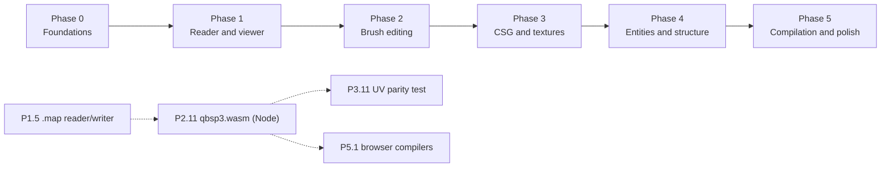

# Joole – Implementation plan

This plan breaks the work of building Joole, from an empty repository to v1.0, into phases and work packages.

Status: active, 24.11.2026. The normative sources are [docs/00-spec.md](docs/00-spec.md) (what to build), [docs/10-stack.md](docs/10-stack.md) (which technologies to use) and [AGENTS.md](AGENTS.md) (how to work). This plan only sets the order and the slicing of the work. If the plan and the spec disagree, the spec wins, and the plan is corrected in the same change.

## How to use this plan

- **Phases** follow the spec's five implementation phases (_Implementation phases and decisions_). Phase 0 is an extra foundation phase that must be finished before phase 1 starts. A phase is closed only when its **gate**, which is the spec's _Done when_ criterion, has been verified and checked off here.
- **Work packages** (WP) have IDs of the form `P<phase>.<n>`. A WP is normally one to three pull requests. Each WP lists:
  - _Goal_
  - _Scope_: modules and files
  - _Tests_
  - _Depends on_
  - _Done when_
- **Order:** within a phase, a WP may start as soon as its dependencies are done. WPs marked ⇄ can run in parallel with the rest of their phase.
- **Status:** tick the checkbox next to the WP title when it is merged and its _Done when_ holds. Gates are ticked separately.
- **Definition of Done for every WP:**
  1. Tests are written first for `core/` and `app/` code, including a regression test for every bug fix.
  2. `pnpm check` passes locally and in CI.
  3. Layer rules hold, with no `eslint-disable` used to get around them.
  4. The spec, stack, AGENTS.md and this plan are updated where affected.
  5. Any borrowed code carries a provenance header and an entry in `THIRD_PARTY_NOTICES.md`.
  6. Nothing in the build, the tests or CI depends on `ext/`.
- **UI work** follows [docs/design-system/](docs/design-system/README.md): its tokens (`tokens.css`), the `q2-` classes in `components/bundle.css`, the component READMEs, and the language and voice rules (the UI text is in English). UI WPs below name the design-system component they implement.
- **Source references** use the path from the repo root inside `ext/<repo>/` plus the function name (for example `ext/Quake-2-Tools/bsp/qbsp3/textures.c`, `TextureAxisFromPlane`).

## Overview

| Phase                    | Goal                                                                       | Gate (from spec)                                                                                              | Main risks                                                    |
| ------------------------ | -------------------------------------------------------------------------- | ------------------------------------------------------------------------------------------------------------- | ------------------------------------------------------------- |
| 0 Foundations            | Repository, toolchain, CI, layer enforcement                               | `pnpm check` and `pnpm e2e` are green locally and in CI, and the layer canary tests fail on forbidden imports | TS 7 combined with typescript-eslint, Solid 2 being brand new |
| 1 Reader and viewer      | Parse Q2 data, show a map in four views                                    | id's released Q2 map sources open with textures, and the round-trip test passes                               | `.map` fidelity, render performance                           |
| 2 Brush editing          | Commands, undo, selection, transforms, saving, qbsp3 in Node               | A simple room can be built from scratch and saved, and qbsp3 accepts it with no warnings                      | Porting qbsp3 to WASM, undo memory                            |
| 3 CSG and textures       | CSG operations, vertex editing, texture tools and lock, surface flags      | The property-based CSG tests pass, and textures look the same in the editor and in the game                   | CSG robustness, exact UV parity                               |
| 4 Entities and structure | Entity definitions, panels, tree, groups, scope, prefabs, md2              | A working single-player level (player start, door, button, monster) can be made from start to finish          | Inferring key types from QUAKED text                          |
| 5 Compilation and polish | Compilers in the browser, leaks, PWA, performance, Firefox/Safari, release | The performance targets are met, and a map compiles to a playable BSP without leaving the browser             | Threads, performance targets, browser differences             |

The dotted edges are cross-phase dependencies that let the qbsp3 port start early, in parallel with the rest of phase 1 and 2.

---

## Phase 0 – Foundations

Goal: a repository in which every later WP can follow the normal workflow (write the test first, run `pnpm check`, get a green CI run) and in which the architecture rules are enforced by tools from the first commit.

### [x] P0.1 Repository and governance

- **Goal:** create the remote repository and the legal and housekeeping files.
- **Scope:**
  - The GitHub repository [github.com/wex/joole](https://github.com/wex/joole) on the `wex` GitHub account, public. Creating it is the owner's action; until then CI is run locally.
  - Repository settings: squash merge only (PR title as the commit message), and branch protection for `main` (PR required, CI checks required, linear history, no force-pushes, no required review).
  - `LICENSE` (GPL-2.0 text with an "or later" notice) and a short `README.md` that points to `docs/`.
  - `THIRD_PARTY_NOTICES.md` (empty skeleton), `.editorconfig` and `.nvmrc` (`26`).
  - The existing `.gitignore` (`/ext/`) extended with `node_modules/`, `dist/`, `coverage/`, `playwright-report/` and `test-results/`.
- **Depends on:** –
- **Done when:** the remote exists, `main` is protected as above, the existing local history is pushed, and `git status` never shows `ext/`.

### [x] P0.2 Package scaffold

- **Goal:** set up `package.json` and the dependencies listed in the stack.
- **Scope:**
  - `package.json` with `type: module`, `engines.node >=26`, `packageManager: pnpm@12.x` and `license: GPL-2.0-or-later`.
  - `pnpm-workspace.yaml` containing settings only: `minimumReleaseAge: 10080` and no `packages`.
  - Runtime dependencies: `solid-js@2`, `@solidjs/web@2`, `nanoid@6` and `lucide-static@1`.
  - Dev dependencies: `vite@8`, `@solidjs/vite-plugin@3`, `typescript@6.0` (for typescript-eslint and the editor), `typescript7` as an alias for `npm:typescript@7`, `vitest@5`, `@vitest/coverage-v8@5`, `fast-check@4`, `@playwright/test@1`, `eslint@10`, `typescript-eslint@8`, `eslint-plugin-import-x@4`, `eslint-import-resolver-typescript@4`, `eslint-plugin-solid`, `eslint-config-prettier`, `prettier@3`, `@types/node`, and `vite-plugin-pwa@2`, which is installed now but configured in P5.4.
  - `index.html`, a placeholder `src/main.ts`, and the empty layer directories with `index.ts` barrels.
  - Install everything with `pnpm add`. Every version must be at least 7 days old.
- **Depends on:** P0.1
- **Done when:** `pnpm install --frozen-lockfile` works on a clean checkout, and `pnpm dev` serves an empty page.

### [x] P0.3 TypeScript project references

- **Goal:** make each layer's environment rules a compile error.
- **Scope:**
  - `tsconfig.base.json` with the stack's strict options.
  - `tsconfig.core.json` for `src/core` and `src/game`, with `lib: ["ES2023"]` and `types: []`.
  - `tsconfig.app.json` for `src/app`, `render`, `platform`, `ui` and `main.ts`, with DOM types.
  - `tsconfig.workers.json` with `WebWorker` types.
  - `tsconfig.test.json` with Vitest and Node types.
  - A root `tsconfig.json` with references, and the path aliases `@core/*` … `@ui/*`.
  - `src/env.d.ts` for the `?raw`, `?url` and `*.module.css` imports.
  - TS 6.0 is the `typescript` package and TS 7.0 the `typescript7` alias, as decided in the stack. `pnpm typecheck` calls `typescript7/bin/tsc` by path, with declarations emitted into the ignored `.tsbuild/` cache because TS 7.0 does not allow `--noEmit` in referenced composite projects.
- **Tests:** a canary script compiles a temporary core file that uses `document`, and it must fail. A lint canary runs one type-aware typescript-eslint rule, to prove that typescript-eslint loads TS 6 and not TS 7.
- **Depends on:** P0.2
- **Done when:** `pnpm typecheck` (TS 7 `tsc -b`) passes, the DOM canary fails as expected, and the type-aware lint canary runs.

### [x] P0.4 Lint, format and layer enforcement

- **Goal:** turn the spec's dependency rules into automated checks.
- **Scope:**
  - `eslint.config.js` (flat config) containing:
    - typescript-eslint
    - the `import-x/no-restricted-paths` zones from the stack, using the TypeScript resolver
    - `no-restricted-imports` that allows `solid-js` and `@solidjs/*` only in `ui/`
    - `@typescript-eslint/consistent-type-imports`
    - eslint-plugin-solid's `v2` config for `src/ui`
    - `eslint-config-prettier`
    - `ignores: ['ext/**', 'dist/**']`
  - `.prettierrc` and `.prettierignore` (`ext/`).
- **Tests:** `tests/lint/layers.test.ts` uses the ESLint Node API to lint small in-memory snippets placed under virtual paths in each layer. It asserts that every forbidden direction from the spec table produces an error and that every allowed direction does not.
- **Depends on:** P0.3
- **Done when:** `pnpm lint` passes on the repository, and every row of the layer table is covered by the canary test.

### [x] P0.5 Vite configuration

- **Goal:** set up a dev server and build that are ready for workers, WASM and threads.
- **Scope:** `vite.config.ts` with:
  - `@solidjs/vite-plugin` and aliases
  - `server.headers` and `preview.headers` with COOP `same-origin` and COEP `require-corp`, and the production Content-Security-Policy in `preview.headers` only
  - `optimizeDeps.entries: ['index.html']`
  - `server.watch.ignored: ['**/ext/**']`
  - `worker.format: 'es'`
- **Tests:** an E2E smoke test asserts that `crossOriginIsolated === true` in both `pnpm dev` and `pnpm preview`, and that the preview build logs no CSP violations.
- **Depends on:** P0.2
- **Done when:** the smoke test passes, and `pnpm build` produces `dist/`.

### [x] P0.6 Test infrastructure ⇄

- **Goal:** get Vitest and Playwright running with the agreed limits.
- **Scope:**
  - `vitest.config.ts`:
    - `include` covers `src/**/*.test.ts` and `tests/**/*.test.ts` only.
    - The Node environment is used for `core`, `game` and `app`.
    - Coverage uses v8 with a 90 % line threshold for `src/core/**`.
    - benchmarks are set up for `*.bench.ts` with Vitest 5's `benchmark` configuration.
  - `playwright.config.ts`:
    - `testDir: tests/e2e` and a Chromium project with `--use-angle=swiftshader`.
    - A `webServer` that runs `pnpm build && pnpm preview`.
    - Firefox and WebKit projects defined but disabled until P5.5.
  - `tests/helpers/localdata.ts`, which skips tests when `JOOLE_Q2_DIR` (game installation) or `JOOLE_MAPS_DIR` (id's map sources) is not set.
- **Depends on:** P0.2
- **Done when:** `pnpm test`, `pnpm test:coverage`, `pnpm bench` and `pnpm e2e` each run at least one trivial test.

### [x] P0.7 CI (GitHub Actions)

- **Goal:** enforce the workflow on every pull request.
- **Scope:** `.github/workflows/ci.yml`:
  - Triggers on PRs and `main`.
  - Uses Node 26 through `actions/setup-node` and pnpm through `pnpm/action-setup`, with all actions pinned to a commit SHA.
  - Caches the pnpm store.
  - Runs `pnpm install --frozen-lockfile`, then `pnpm check`, then `pnpm exec playwright install --with-deps chromium`, then `pnpm e2e`.
  - Uploads the Playwright report when a run fails.
  - Checks that the PR title follows Conventional Commits, because squash merge turns it into the commit message (a small script, no third-party action).
  - The WASM reproducibility job is added in P2.11.
- **Depends on:** P0.1, P0.4 to P0.6
- **Done when:** a PR shows a green CI run, and a deliberately broken PR (a layer violation) shows a red one.

### [x] P0.8 Preview hosting (Cloudflare Workers) ⇄

- **Goal:** get early preview deployments with the production headers.
- **Scope:** `public/_headers` (COOP, COEP and the Content-Security-Policy for `/*`), `wrangler.jsonc` (static assets from `dist/`, no Worker script), and Cloudflare's Git integration (Workers Builds) connected to the repository: `main` deploys to `joole.<account>.workers.dev`, and each PR branch gets a preview URL. Connecting the account is the owner's action.
- **Depends on:** P0.1, P0.5
- **Done when:** the preview deployment reports `crossOriginIsolated === true`. This WP may slip to P5.7 without blocking anything.

### [x] P0.9 Documentation sync

- **Goal:** make the documents describe reality rather than the target state.
- **Scope:** AGENTS.md (_Project status_, the command table, actual file names), the stack (the TS 6 mechanism), and this plan's status.
- **Depends on:** P0.1 to P0.7
- **Done when:** every command listed in AGENTS.md exists in `package.json`, or is marked with the phase that adds it.

**[x] Gate 0:** `pnpm check` and `pnpm e2e` are green locally and in CI, the layer and DOM canaries fail as expected, and `crossOriginIsolated` is true in dev and preview.

---

## Phase 1 – Reader and viewer

Goal: read Q2 game data and `.map` files without loss, and show the map in four views with textures.

### [x] P1.1 Shared types (`core/types`)

- **Goal:** put every data-model type in one place, as type declarations only.
- **Scope:**
  - From the spec: `Id`, `Vec3`, `Plane`, `FaceTexture` (including `attribsInFile`), `Face`, `BrushNode`, `EntityNode`, `GroupNode` (including `props`), `MapNode`, `MapDocument`, `Patch` and the `Command` interface.
  - `ByteSource`, a random-access read interface (`size`, `read(offset, length): Promise<Uint8Array>`) that the parsers use instead of `Blob`.
  - `Inflate`, the type of the injected deflate function.
  - A `Result<T, E>` type for operations that can fail.
- **Tests:** none needed beyond type checks. ESLint ensures that `core/types` contains no runtime code (`import type` only).
- **Depends on:** Gate 0
- **Done when:** the types match the spec's _Data model_ section exactly.

### [x] P1.2 Geometry basics (`core/geom`)

- **Goal:** turn plane sets into polygons, the derived geometry that every later feature builds on.
- **Scope:**
  - `vec3` and `mat4` helpers in float64, and `PLANE_EPS` and `POINT_EPS` in one module.
  - Plane construction from three points. It must match `PlaneFromPoints` in `ext/Quake-2-Tools/bsp/qbsp3/map.c`: normal = (p0 − p1) × (p2 − p1), normalised, and d = p0 · n.
  - Windings: a base winding for a plane, and clipping by a plane (after `common/polylib.c`).
  - Building brush polygons: each face's base winding is clipped by all other planes, and empty faces are redundant.
  - Brush validity: volume > 0, at least 4 faces, no redundant faces.
  - AABBs, and edge and vertex extraction for the wireframe.
- **Tests:**
  - unit tests on a cube, a wedge and degenerate inputs (duplicate, mirrored and missing planes)
  - fast-check properties: a random convex hull's polygons are planar and convex, and every vertex lies on at least 3 planes
- **Depends on:** P1.1
- **Done when:** coverage is at least 90 % and a 5 000-brush polygon build benchmark is recorded.

### [x] P1.3 Game module basics (`game/q2`) ⇄

- **Goal:** collect the Q2 constants in one place.
- **Scope:**
  - The `SURF_*` and `CONTENTS_*` constants, checked against `ext/Quake-2-Tools/common/qfiles.h`.
  - The default texture `e2u1/mine10_1`, the base directory `baseq2`, and the location of the palette `pics/colormap.pcx`.
  - Compile profile names. Their parameters are filled in during P5.2.
  - The search-order algorithm as a pure function. Given the file names in the mod and base directories, it returns the ordered search path using q2pro's `pakcmp` rules (`ext/q2pro/src/common/files.c`). The result must also match vanilla `FS_AddGameDirectory` for `pak0` to `pak9`.
- **Tests:** a table of search-order cases (vanilla, mixed `pakN` and named paks, `.pkz`, case-insensitive names).
- **Depends on:** P1.1
- **Done when:** the search-order tests pass and match both reference implementations.

### [x] P1.4 Binary formats (`core/formats`) ⇄

- **Goal:** read `.pak`, `.pkz`, `.wal` and the palette without loading whole archives into memory.
- **Scope:**
  - The `pak` directory parser (`PACK` header, 64-byte entries) over a `ByteSource`.
  - The `pkz` (ZIP) reader: the end-of-central-directory record, the central directory, local headers, the stored and deflate methods. Inflating is done through the injected `Inflate`, and ZIP64 and encrypted archives are rejected with a clear error.
  - The `wal` header, mip 0 and its default flags, contents and value.
  - The `pcx` palette, taken from the last 768 bytes after checking the `0x0C` marker.
  - `tests/fixtures/build-fixtures.ts`, a script that creates tiny synthetic pak, pkz, wal and pcx files, which are committed.
- **Tests:**
  - unit tests on the synthetic fixtures
  - Node tests that inflate with `zlib`, behind the same `Inflate` interface
  - optional tests against the real `pak0.pak` (skipped without `JOOLE_Q2_DIR`)
- **Depends on:** P1.1
- **Done when:** every vanilla texture in `pak0.pak` decodes, verified locally with `JOOLE_Q2_DIR`.

### [x] P1.5 `.map` reader and writer (`core/formats`)

- **Goal:** read and write `.map` files without loss, following every rule in the spec.
- **Scope:**
  - A tokenizer that matches qbsp3's `common/scriplib.c`: `//`, `;`, `#` and `/* */` comments, and quoted strings.
  - A parser that produces entities, brushes and faces, keeps entity property order and unknown keys, sets `attribsInFile`, and reports errors with line and column.
  - Groups: `func_group` entities with `_joole_*` keys become `GroupNode`s and their nesting, and entities carrying `_joole_group` are attached to their group.
  - A canonical number writer: integers with no decimals, otherwise at most 6 decimals with trailing zeros removed.
  - A writer with two modes:
    1. _export_ (files and compilation): plane points are always integers (see P1.6), optional fields are written per the `attribsInFile` rule, and offsets and rotations are written as stored.
    2. _clipboard_ (clipboard and prefabs): full precision.
- **Tests:**
  - the round-trip criterion from the spec, on self-made fixtures
  - id's released map sources from `JOOLE_MAPS_DIR` (base1–base3, the CTF and match packs)
  - unit tests for `attribsInFile`, func_group mapping, nesting, and unknown keys on `func_group`s from other editors
- **Depends on:** P1.1, P1.2
- **Done when:** all fixtures round-trip under the spec's criterion.

### [x] P1.6 Integer plane points for export (`core/geom`)

- **Goal:** implement the spec's _Integer plane points_ rule.
- **Scope:** for a face whose points are not integers, compute three integer points that define the plane closest to the original. Approach:
  1. Round the face polygon's vertices to integers.
  2. Pick the non-collinear triple whose plane deviates least from the original.
  3. Keep the original winding order so the normal still points outwards.
  4. Rebuild the brush and validate it (valid and convex, vertices within `POINT_EPS`).
  5. If the brush fails or moves more than the tolerance, return a warning that names the brush.
- **Tests:** fast-check properties: an axis-aligned brush is unchanged, a rotated brush stays valid or produces a warning, and orientation is preserved.
- **Depends on:** P1.2
- **Done when:** the writer's export mode uses this, and the warnings appear in the export result.

### [x] P1.7 Document construction (`core/doc`)

- **Goal:** turn a parsed map into a `MapDocument`.
- **Scope:** id generation with nanoid, building the document (the node map, the parent map, worldspawn as the root), read-only query helpers (children, ancestors, the brushes of an entity), and pure `applyPatch` and `invertPatch`, which phase 2 needs.
- **Tests:**
  - unit tests
  - fast-check property: `applyPatch(invert(p))` returns the original document
- **Depends on:** P1.1, P1.5
- **Done when:** a parsed fixture becomes a document, and the patch properties hold.

### [x] P1.8 Game data access (`platform`)

- **Goal:** let the user open their Q2 installation in any supported browser.
- **Scope:**
  - Chromium: `showDirectoryPicker`, with the handle kept in IndexedDB and permission requested again on the next start.
  - Fallbacks: `<input webkitdirectory>` or a single `pak0.pak`.
  - A virtual filesystem that combines loose files, paks and pkzs in the order from P1.3.
  - A `ByteSource` implementation over `Blob.slice`, and `Inflate` through `DecompressionStream('deflate-raw')`.
  - A settings UI hook for the base directory and mod directory, and a texture index (name to source).
- **Tests:**
  - unit tests on the virtual filesystem with in-memory sources
  - E2E tests that open the fixture game directory through the fallback path
- **Depends on:** P1.3, P1.4
- **Done when:** the textures from both `baseq2` and a mod resolve in the correct order.

### [x] P1.9 Texture worker and cache (`workers`, `platform`)

- **Goal:** convert textures off the main thread and cache them.
- **Scope:**
  - `workers/texture.worker.ts`: `.wal` plus palette in, an RGBA8 `ArrayBuffer` out (transferable). It imports only `core/formats` and `game/q2`.
  - The worker client in `platform`.
  - An OPFS cache of converted textures, keyed by source and file identity.
- **Tests:** a unit test of the conversion function in Node, and an E2E test that a texture arrives in the renderer.
- **Depends on:** P1.4, P1.8
- **Done when:** a 512-texture batch converts without blocking the UI, measured with the Performance panel.

### [x] P1.10 Renderer core (`render`)

- **Goal:** draw the document in four views from one WebGL2 context.
- **Scope:**
  - One canvas, with the four viewports and scissor rectangles, and the maximise and resize layout.
  - A shader module (`.glsl` via `?raw`).
  - A texture manager: lazy loading, a checker placeholder, `REPEAT`, generated mipmaps, `NEAREST_MIPMAP_LINEAR`.
  - The brush geometry cache:
    - each brush is fan-triangulated into per-texture VBOs
    - the vertex format is position 3×f32, UV 2×f32, normal 3×i8 and brush index u32
    - an allocator with a free list, updated with `bufferSubData`
  - `texAxes(plane, tex)` in `core/geom`. It must port `TextureAxisFromPlane` and the vector calculations of `TexinfoForBrushTexture` (`ext/Quake-2-Tools/bsp/qbsp3/textures.c`) exactly, and it must truncate offsets and rotations the way qbsp3's `atoi` does.
  - 2D views:
    - orthographic projections for XY, XZ and YZ
    - a procedural grid shader that fades lines spaced less than 4 px apart
    - instanced quads for wide wireframe lines
    - entity boxes in a fallback colour until P4.4
  - 3D view:
    - perspective projection, with wireframe, flat and textured modes
    - normal-based shading
    - transparent faces (`TRANS33`, `TRANS66`) drawn last, sky in a sky colour, and nodraw, clip and hint faces dimmed or hidden
    - frustum culling by AABB
  - Viewport colours come from the design system's `vp-*` tokens, read with `getComputedStyle` at start-up and whenever the theme changes, so WebGL and the panels share one source.
  - Render on demand: `invalidate()` schedules one frame, with no continuous `requestAnimationFrame` loop.
- **Tests:**
  - Vitest on `texAxes`, comparing against values from the C code worked out by hand
  - Playwright screenshot tests for each view (SwiftShader)
- **Depends on:** P1.2, P1.7, P1.9
- **Done when:** the fixture maps render correctly in all modes, and screenshots are committed as baselines.

### [x] P1.11 UI shell and cameras (`ui`)

- **Goal:** build the application frame around the renderer.
- **Scope:**
  - A Solid app shell laid out with CSS Grid: the 2×2 views, a right-hand properties panel and a bottom log panel, with resizable splitters and view maximise. It implements the design system's `Workspace`, `ViewportPane`, `Toolbar` and `PanelTabs`. Styles use CSS Modules that read only `tokens.css` variables. The dark theme is the primary one and the light theme the secondary one.
  - Fonts (IBM Plex Sans and Mono, OFL-1.1, with the licence file) are self-hosted under `public/fonts/` (the design system's previews load them from Google Fonts, the app never does).
  - Icons from `lucide-static`, imported per icon as SVG strings, plus the custom CSG Subtract, Hollow and Clip icons in `src/ui/icons/`.
  - F1–F4 maximise a view (3D, Top, Front, Side), and the same key restores the grid.
  - File menu: open game folder, open map.
  - The log panel.
  - 2D cameras: pan and zoom around the cursor.
  - 3D camera: fly mode while the right mouse button is held or the pointer is locked, with WASD and mouse look. WASD is ignored when not in fly mode.
  - Camera state lives in `ui` and is passed to `render` as data.
  - The `src/main.ts` composition root wires the platform, app and render objects together.
- **Tests:** E2E: open a fixture map, pan, zoom and fly, and check that the screenshots change as expected.
- **Depends on:** P1.8, P1.10
- **Done when:** a user can open their game folder and a map, and navigate all four views.

### [x] P1.12 Performance baseline ⇄

- **Goal:** measure the spec's starting targets on the first prototype.
- **Scope:**
  - A synthetic map generator for 5 000 and 20 000 brushes, written to `tests/fixtures/generated/` at test time and not committed.
  - A Playwright test that opens a 5 000-brush map in under 2 s.
  - The map-open test runs in CI with a 2× threshold. The CSG benchmark remains in P3.1, because CSG does not exist yet.
  - Preliminary memory and rendering numbers are measured locally and marked as non-reference measurements. Drag latency remains a later measurement because brush editing does not exist yet.
  - The measured numbers are recorded in the spec's performance section with the model, the browser version and the date, because the spec says the targets are checked on the first prototype.
- **Depends on:** P1.10, P1.11
- **Done when:** the numbers are recorded, and any target that is clearly at risk has a mitigation WP added to phase 5.

**[ ] Gate 1:** id's released Q2 map sources open with their textures (verified locally with `JOOLE_Q2_DIR` and `JOOLE_MAPS_DIR`), and the round-trip test passes for all fixtures and all of id's map sources.

---

## Phase 2 – Brush editing

Goal: editing through commands with unlimited undo, project files and autosave, and qbsp3 available as a test oracle.

### [x] P2.1 Commands and history (`core/doc`, `app`)

- **Goal:** route every document change through one bus.
- **Scope:**
  - Command helpers in `core/doc` (add, remove, replace and reparent nodes) that produce patches with structural sharing.
  - `CommandBus` in `app`: execute, undo and redo, `mergeKey` merging during a drag, and change notifications as a subscription that carries the `Patch`.
  - The history memory limit (256 MB by default), with the oldest steps dropped first and the newest step always kept.
  - The spec's structural memory estimate: each step is charged for the node versions in its patch that are not in the current document. The formula's constants live in one module and are calibrated once against a Chrome heap snapshot, with the result recorded in the spec.
- **Tests:**
  - unit tests
  - fast-check property: a random sequence of commands, then undo of all, gives the original document, and redo of all gives the final one
  - a merge test
  - memory-limit tests: the estimate formula, dropping the oldest steps, and keeping an oversized newest step
- **Depends on:** P1.7
- **Done when:** the properties hold, and the calibrated constants are recorded in the spec.

### [x] P2.2 Selection and selection restore (`app`)

- **Goal:** keep selection out of the document while undo still restores it.
- **Scope:** a selection set of `Id`s, selection change events, and the selection taken before each command and restored on undo (after Qoole's `OpSelectNewObjs`).
- **Depends on:** P2.1
- **Done when:** undo restores the selection in unit tests.

### [x] P2.3 Picking and BVH (`core/geom`)

- **Goal:** CPU picking that is shared by tools and tests.
- **Scope:**
  - A dynamic AABB BVH, updated from patches.
  - Ray casts against brush half-spaces (after Qoole's `HitGeometry`).
  - 2D picks: the nearest edge within 4 px, or the brush that contains the point.
  - Cycling through overlapping hits on repeated clicks (after Qoole's `Selector`).
- **Tests:**
  - unit tests
  - fast-check property: the BVH returns the same results as brute force
- **Benchmark:** picking among 20 000 brushes.
- **Depends on:** P1.2
- **Done when:** picks are correct, and the benchmark is recorded.

### [x] P2.4 Transforms and grid (`core/geom`, `app`)

- **Goal:** move, rotate and scale brushes as the spec describes.
- **Scope:**
  - A 4×4 matrix applied to all face points.
  - Grid sizes 1 to 256, changed with `[` and `]`, with snapping in the 2D views.
  - An explicit _Snap to grid_ command; there is no automatic rounding after a rotation.
  - Moving a group moves each of its children.
  - Texture lock arrives in P3.7. Until then, transforms keep the texture parameters unchanged.
- **Tests:** unit tests and fast-check properties (transforms keep brushes valid, and inverse transforms round-trip).
- **Depends on:** P2.1
- **Done when:** commands exist for move, rotate, scale and snap.

### [x] P2.5 Tool framework and Select tool (`app`, `ui`)

- **Goal:** tool logic that can be tested in Node, with the UI only translating input.
- **Scope:**
  - A tool interface in `app`: neutral pointer and key events in world coordinates plus modifiers in, commands and preview state out.
  - A keyboard shortcut map (S, B, E, C, V, F, T, grid keys, F1–F4, N) that respects fly mode. The shortcuts the spec leaves open (undo and redo, save, copy and paste, hide, lock, CSG commands) are defined here following platform conventions (Ctrl/Cmd+Z, Ctrl/Cmd+Shift+Z, Ctrl/Cmd+S …), and the full map is recorded in the spec.
  - The viewport `ContextMenu` from the design system, starting with Add Brush. The Add Entity and Apply Entity entries arrive in P4.4.
  - The Select tool: click, Shift to add, box select, drag to move, handles to scale, Ctrl+drag to rotate.
  - `ui` views convert DOM events into tool events.
- **Tests:**
  - unit tests that drive the Select tool with event scripts
  - an E2E test for selecting and moving a brush
- **Depends on:** P2.2, P2.3, P2.4
- **Done when:** a brush can be selected, moved, rotated and scaled in the views, and every step can be undone.

### [x] P2.6 Brush tool and primitives (`core/geom`, `app`)

- **Goal:** create new brushes.
- **Scope:**
  - Primitives: box, wedge, n-sided cylinder, cone and approximate sphere, all with integer points when grid-aligned.
  - A drag in a 2D view creates the brush, with its height taken from another view or from a default.
  - New faces get the default texture.
  - The Brush tool (B).
- **Tests:** every primitive is a valid brush (fast-check over sizes and n), and the tool is driven with event scripts.
- **Depends on:** P2.5
- **Done when:** all primitives can be created in the views.

### [x] P2.7 Renderer editing support (`render`)

- **Goal:** visual feedback for editing.
- **Scope:** selection drawn in red, handles, ghost previews from the tool's preview state, incremental cache updates driven by patches, and BVH-driven redraws.
- **Tests:** screenshot tests of the selection and preview states.
- **Benchmark:** the frame time while dragging one brush in a 20 000-brush map, which has a target of less than 8 ms.
- **Depends on:** P2.5
- **Done when:** dragging updates only the affected brush.

### [x] P2.8 Clipboard (`app`, `platform`) ⇄

- **Goal:** cut, copy, paste and duplicate as `.map` text.
- **Scope:** the clipboard writer mode (full precision), the system clipboard API, new ids on paste, and an offset for duplicates.
- **Tests:** a unit round trip, and an E2E copy and paste.
- **Depends on:** P1.5, P2.1
- **Done when:** a selection pasted into another editor's `.map` format parses there. This is checked manually once and recorded.

### [x] P2.9 Project format and saving (`core/formats`, `platform`, `app`)

- **Goal:** `.joole.json` as the primary save format.
- **Scope:**
  - A reader and writer with `format: "joole-project"` and `version: 1`.
  - A migration framework (a chain of version upgrades) with one test file per version.
  - Saving:
    - Ctrl+S saves the project.
    - Chromium writes back to the same file through `createWritable`, and other browsers download the file.
    - Export `.map` is a separate command in export mode, and its integer-point warnings are shown before writing.
  - Recent files and settings are kept in IndexedDB.
- **Tests:** a project round trip (with exact float64 values), migration tests, and an E2E save and load.
- **Depends on:** P1.5, P1.6, P2.1
- **Done when:** projects save and reload without loss in Chromium and through the download path.

### [x] P2.10 Autosave and recovery (`app`, `platform`)

- **Goal:** never lose work.
- **Scope:** autosave to OPFS every 30 s and on `pagehide`, an unsaved-changes flag that is cleared by a save or a download, and a recovery prompt on start when the flag is set.
- **Tests:** unit tests of the flag logic, and an E2E test that edits, reloads and gets the prompt.
- **Depends on:** P2.9
- **Done when:** recovery works in Chromium and in the download path.

### [x] P2.11 qbsp3 for Node (`tools`, `workers`) ⇄ (may start right after P1.5)

- **Goal:** use qbsp3 as an automated test oracle from phase 2 onwards.
- **Scope:**
  - In `tools/qbsp3/`, a copy of the needed files from `ext/Quake-2-Tools` (`bsp/qbsp3/*`, `common/*`), each with a provenance header.
  - A Makefile for `emcc` with the q3edit-style flags (`MODULARIZE`, `FORCE_FILESYSTEM`, `INVOKE_RUN=0`, `EXIT_RUNTIME=0`, memory growth, exported `FS` and `callMain`) and `ENVIRONMENT=node,web,worker`.
  - Documented patches, recorded in `tools/README.md`:
    1. plane points read with `atof` (spec, _Integer plane points_)
    2. anything needed for Emscripten (`threads.c`, file IO)
  - Facts from the code that shape the build:
    - qbsp3 forces `numthreads = 1`, so no threads are needed here.
    - `Error()` calls `exit(1)`, so each run uses a fresh module instance.
    - The game directory is found by looking for `quake2` in the input path (`SetQdirFromPath`, `BASEDIRNAME`), so the in-memory filesystem layout is `/quake2/baseq2/maps/<name>.map`, with `.wal` headers under `/quake2/baseq2/textures/`.
  - The build output (`qbsp3.mjs` and `qbsp3.wasm`) is committed to `workers/wasm/`.
  - `pnpm build:tools` builds locally, or through the `emscripten/emsdk` Docker image.
  - A CI job rebuilds with the pinned Docker image and diffs the result against the committed files. Determinism is verified on the first build.
- **Tests:** `tests/compiler/qbsp3.test.ts`:
  - It writes the fixture maps in export mode, provides synthetic `.wal` files, and runs qbsp3.
  - It fails on brush warnings (`Entity %i, Brush %i: …` from `map.c`, and `microbrush` from `brushbsp.c`) and on leaks.
  - It asserts that a `.bsp` is produced.
- **Depends on:** P1.5, P1.6, Gate 0
- **Done when:** the compiler test runs in CI, and the reproducibility job is green.

**[x] Gate 2:** a simple room (four walls, a floor, a ceiling and an `info_player_start`, which qbsp3 needs for its flood fill (`FloodEntities` in `portals.c`)) can be built from scratch in the UI and saved as a project, and its exported `.map` passes qbsp3 with no warnings. This is an E2E script plus the compiler test. The entity is placed through the raw key–value editor or a minimal placement command, because the full entity tool arrives in P4.4.

---

## Phase 3 – CSG and textures

Goal: Qoole-level geometry operations, and textures that look exactly the same in the editor and in the game.

### [x] P3.1 CSG subtract (`core/geom`, `app`)

- **Goal:** implement the spec's subtract algorithm.
- **Scope:** each target is split by every plane of the cutter: the part outside the plane becomes a new brush, and the part inside continues to the next plane, until what is left inside is discarded. New faces get the cutter's texture. The result is valid brushes or an error. Exposed as a command and a menu item.
- **Tests:**
  - fast-check properties: on random convex brushes, the results are valid, the volume of target minus cutter matches within tolerance, and nothing is left inside the cutter
  - Benchmark: 1 cutter and 50 targets in less than 50 ms.
- **Depends on:** P2.1
- **Done when:** the properties and the benchmark pass.

### [x] P3.2 CSG intersect ⇄

- **Goal:** merge brush plane sets and drop redundant faces.
- **Tests:** properties (the result is contained in every input, and is idempotent).
- **Depends on:** P1.2, P2.1
- **Done when:** the properties pass.

### [x] P3.3 Hollow, inward and outward

- **Goal:** turn a brush into a shell with thickness d (8 by default).
- **Scope:** the original minus a copy with every plane moved inwards by d; the outward variant works the other way. Non-axis-aligned planes produce non-integer points, which is acceptable because P1.6 handles export.
- **Tests:** properties (shell validity and volume).
- **Depends on:** P3.1
- **Done when:** both directions work, and the result passes the compiler test.

### [x] P3.4 Plane clip and Clip tool (C)

- **Goal:** cut brushes with a plane given in a 2D view.
- **Scope:** the plane is defined by two points plus the view's depth axis, with modes front, back or both. In the tool, Enter applies the clip and Tab switches which side is kept.
- **Tests:** properties, and event-script tool tests.
- **Depends on:** P2.5
- **Done when:** the tool works in every 2D view.

### [x] P3.5 Mirror, flip and rotate 90° ⇄

- **Goal:** mirror on X, Y or Z with each face's point order reversed so normals still point outwards, and rotate by 90°.
- **Tests:** properties (validity, and mirroring twice gives the identity).
- **Depends on:** P2.4
- **Done when:** the commands and menu items exist.

### [x] P3.6 Vertex, edge and face editing (V, F)

- **Goal:** edit the derived elements of a brush.
- **Scope:**
  - Handles for vertices, edges and faces. V switches between vertex and edge mode, and F selects face mode.
  - Dragging a handle recomputes the planes of the touching faces. Non-planar faces are split into triangles (after Qoole's `BreakPlanes`).
  - A convexity check rejects the edit and shows it as a dashed `vp-invalid` line.
  - Dragging snaps to the grid.
- **Tests:**
  - fast-check property: an accepted edit always gives a valid convex brush
  - tool event-script tests
- **Depends on:** P2.5, P2.7
- **Done when:** the spec's behaviour is reproduced, including rejection.

### [x] P3.7 Texture lock (`core/geom`)

- **Goal:** keep textures in place while brushes are moved and rotated.
- **Scope:**
  - Transform the old texture axes, then solve new offset, rotation and scale (after Qoole's `FaceTex::Transform` and `lockTex`).
  - Offsets and rotations produced by the editor are quantised to integers.
  - The error is measured in texels, and above 0.5 texels the face is flagged and a warning is shown.
  - A texture lock toggle is added to the editor state.
- **Tests:** properties: translations with integer results are exact, and the error measure is correct.
- **Depends on:** P1.10 (`texAxes`), P2.4
- **Done when:** transforms with lock on behave as the spec describes.

### [x] P3.8 Texture tools (T)

- **Goal:** Qoole-level texture work.
- **Scope:**
  - Apply a texture to the whole brush or to the selected faces.
  - An eyedropper.
  - Arrow keys shift and rotate the texture by the grid step.
  - Fit, justify and reset.
  - The T tool picks faces in 3D.
- **Tests:** unit tests on the operations, and an E2E test that applies a texture and checks a screenshot.
- **Depends on:** P3.7, P2.5
- **Done when:** all the spec's texture tools exist.

### [x] P3.9 Texture browser (`ui`)

- **Goal:** find and choose textures quickly.
- **Scope:** implements the design system's `TextureBrowser`. A folder tree (`textures/e1u1` …), search by name, an in-use filter, previews with sizes, the mod's textures as their own root with source markers, lazy loading, and a virtualised grid.
- **Tests:** E2E tests for search and filtering.
- **Depends on:** P1.8, P1.9
- **Done when:** the full vanilla texture set browses smoothly.

### [ ] P3.10 Surface and content flags panel (`ui`, `app`)

- **Goal:** edit each face's flags, contents and value.
- **Scope:** checkboxes from the `game/q2` constants, an indicator when a value differs from the `.wal` default, and edits that set `attribsInFile` where needed. The properties panel also shows the selection's texture with the design system's `ObjectPreview` (one texture, or "Multiple textures").
- **Tests:** unit tests on the panel logic in `app`, and an E2E test.
- **Depends on:** P3.8
- **Done when:** changes appear in the exported `.map` and the compiled `.bsp`.

### [ ] P3.11 Editor and game UV parity test

- **Goal:** prove the gate's "textures look the same in the editor and in the game".
- **Scope:** a test that compiles fixture maps with qbsp3.wasm, parses the texinfo lump of the `.bsp` (`ext/Quake-2/qcommon/qfiles.h`), and compares its `vecs` with `texAxes` for every face, within a small epsilon. The fixtures include decimal offsets and rotations so that the truncation rule is exercised.
- **Depends on:** P2.11, P3.7
- **Done when:** the test is green in CI, and one map has been checked in q2pro by hand, with the result recorded.

**[ ] Gate 3:** every CSG property test passes, and textures match in the editor and the game (P3.11 plus the manual in-game check).

---

## Phase 4 – Entities and structure

Goal: everything needed to build a complete playable single-player level.

### [ ] P4.1 Entity definition parser (`core/formats`)

- **Goal:** parse `/*QUAKED … */` blocks from `.def` and `.c` text.
- **Scope:**
  - The class name, colour, bounding box (or `?` for brush entities), spawnflag names and description.
  - Key extraction and typing. Since QUAKED text has no types, use heuristics for the Qoole `EntList` types (VEC, INT, STR, FLAGDEF, COLOR, …) plus an override table in `game/q2`.
- **Tests:** unit tests on representative blocks taken from the vanilla source and copied into fixtures with provenance.
- **Depends on:** P1.1
- **Done when:** every vanilla block parses.

### [ ] P4.2 Generating vanilla definitions (`scripts`, `game/q2`)

- **Goal:** create the committed `q2.def` file and the md2 model table.
- **Scope:**
  - `pnpm gen:entities` reads `ext/Quake-2/game/*.c` (148 blocks) and compares the result with `ext/q2pro/src/game`.
  - It writes `src/game/q2/q2.def` with a provenance header, and `src/game/q2/models.ts`, a class-to-model table built from the `gi.modelindex` and `gi.setmodel` strings in the spawn functions, plus manual overrides.
  - Both outputs are committed.
- **Tests:** the committed files parse, and the table references only `models/*.md2` paths. These tests do not need `ext/`.
- **Depends on:** P4.1
- **Done when:** both files are generated and reviewed, and the script is documented in AGENTS.md.

### [ ] P4.3 Mod entity definitions (`platform`, `app`)

- **Goal:** support entities from mods.
- **Scope:** load a `.def` file or a set of mod `.c` files, parse them with P4.1, and let the mod's classes override vanilla classes with the same name. The choice is stored in the project file.
- **Tests:** a unit test of the merge.
- **Depends on:** P4.1
- **Done when:** CTF (`ext/Quake-2/ctf`) classes can be loaded as a mod example. The CTF files used in tests are copied into fixtures with provenance.

### [ ] P4.4 Entity tool (E) and entity rendering

- **Goal:** place and draw entities.
- **Scope:**
  - Clicking places a point entity of the chosen class.
  - Choosing a brush class (`func_*`, `trigger_*`) turns the selected brushes into that entity.
  - Entity boxes are drawn in the definition's colour (or `vp-entity`), with `angle` arrows.
  - The context menu's Add Entity and Apply Entity → category → class entries.
- **Tests:** tool event-script tests and screenshot tests.
- **Depends on:** P4.2, P2.5
- **Done when:** entities can be placed and converted.

### [ ] P4.5 Entity panel

- **Goal:** a form generated from the definitions.
- **Scope:** implements the design system's `EntityProperties`. A class picker (category, then class), spawnflag checkboxes, a `_color` picker, an `angle` compass, `target` and `targetname` drop-downs filled from the names in the map, and a raw key–value table for unknown keys. `target` links are drawn as lines in the 2D views.
- **Tests:** unit tests on the panel logic in `app`, and an E2E test.
- **Depends on:** P4.4
- **Done when:** the spec's panel features exist.

### [ ] P4.6 Tree view, groups, hide and lock

- **Goal:** show and edit the structure of the map.
- **Scope:**
  - A tree with worldspawn, entities and groups, where nodes are reparented by dragging (a command).
  - Group and ungroup.
  - Hide, show and lock.
  - A check that groups round-trip through `func_group` in the UI flow.
- **Tests:** E2E tests, and command unit tests.
- **Depends on:** P2.1
- **Done when:** grouping survives saving the project and exporting the `.map`.

### [ ] P4.7 Scope (entering a group)

- **Goal:** work inside one group.
- **Scope:** double-clicking a group enters it. Selection and new brushes are then limited to that group, and the rest of the map is dimmed.
- **Tests:** unit tests on the app scope logic.
- **Depends on:** P4.6
- **Done when:** the spec's behaviour is reproduced.

### [ ] P4.8 Prefabs ⇄

- **Goal:** reuse pieces of a map.
- **Scope:** save the selection as a full-precision `.map` snippet in OPFS, a prefab browser, and dragging a prefab into a view.
- **Tests:** an E2E test.
- **Depends on:** P2.8, P2.9
- **Done when:** a prefab can be saved and placed again.

### [ ] P4.9 md2 preview

- **Goal:** show models for point entities.
- **Scope:** an md2 parser (`IDP2`, version 8, frame 0) in `core/formats`, models loaded through the virtual filesystem, and a wireframe drawing. Classes without a model fall back to their box.
- **Tests:** a parser unit test on a synthetic md2, and a screenshot test.
- **Depends on:** P4.2, P1.8
- **Done when:** vanilla monsters and items show their models.

**[ ] Gate 4:** a single-player sample level made entirely in Joole is committed as a self-made fixture (`tests/fixtures/maps/sp-sample.map`). It has a player start, a door, a button that opens the door, and a monster. It compiles without warnings, and it is played through in q2pro by hand, with the result recorded.

---

## Phase 5 – Compilation and polish

Goal: the full compile cycle in the browser, plus the performance targets, browser support, offline use and release.

### [ ] P5.1 Compilers in the browser

- **Goal:** run qbsp3, qvis3 and qrad3 in Web Workers.
- **Scope:**
  - Build `qvis3` and `qrad3` in `tools/`.
  - Port `threads.c` to Emscripten pthreads, which qvis3 and qrad3 need.
  - Build a threaded and a single-threaded variant, chosen at runtime by `crossOriginIsolated`.
  - Run one worker per tool, stream stdout to the log panel, and support cancelling.
  - Extend the CI reproducibility job to all outputs.
  - Verify that the pthread workers run under the production CSP. If they need `blob:` workers, record the exception in the stack.
- **Tests:** a compiler test for each tool in Node (single-threaded), and an E2E test that compiles a fixture.
- **Depends on:** P2.11
- **Done when:** all three tools run in Chromium with threads.

### [ ] P5.2 Compile pipeline and profiles

- **Goal:** compile with one command.
- **Scope:**
  - An automatic export in export mode, with integer-point warnings shown first.
  - `.wal` headers fed from the virtual filesystem into the in-memory filesystem.
  - Profiles: _fast_ (qbsp3, then qvis3 `-fast`, no qrad3), _normal_ and _final_ (qrad3 `-extra`).
  - Outputs `.bsp`, `.pts` and `.prt`.
  - Chromium saves the `.bsp` to `baseq2/maps/`, and other browsers download it.
  - The editor shows the `+map <name>` command to copy.
- **Depends on:** P5.1, P1.8
- **Done when:** the Gate 4 sample map compiles with every profile in the browser.

### [ ] P5.3 Leak display

- **Goal:** make leaks easy to find and fix.
- **Scope:** a `.pts` parser, the leak path drawn in all views in `vp-leak`, and a _Next leak point_ command (N) that moves the camera along the path.
- **Tests:** a parser unit test, and an E2E test with a leaking fixture.
- **Depends on:** P5.2
- **Done when:** a leak found by qbsp3 is displayed automatically.

### [ ] P5.4 PWA

- **Goal:** offline use and installability.
- **Scope:** vite-plugin-pwa with Workbox precaching (the app, workers and `.wasm`), an update prompt, and a check that the service worker works with COOP, COEP and the CSP.
- **Tests:** an E2E offline test (the context is set offline and the app reloads).
- **Depends on:** P5.1
- **Done when:** the app starts and compiles while offline.

### [ ] P5.5 Firefox and Safari support

- **Goal:** load- and save-based workflows on non-Chromium browsers.
- **Scope:** check every fallback path (folder input, downloads, autosave, clipboard), enable the Playwright Firefox and WebKit projects, and fix the gaps. The behaviour depends on feature detection, never on the browser's name.
- **Depends on:** Phases 1 to 4
- **Done when:** the E2E suite passes on all three engines at the latest two major versions of each browser, apart from features that are documented as Chromium-only.

### [ ] P5.6 Performance targets

- **Goal:** meet the spec's table.
- **Targets:**
  - at least 60 fps with 20 000 textured brushes on an integrated GPU
  - a 5 000-brush map opens in under 2 s
  - dragging costs under 8 ms per frame
  - a CSG subtract with 50 targets takes under 50 ms
  - under 300 MB of memory for 20 000 brushes without textures
- **Scope:** profiling and fixes. CI keeps the 2× thresholds for the CPU-bound metrics, and the strict targets are measured on the spec's reference hardware and recorded in the spec.
- **Depends on:** P1.12 and all feature WPs
- **Done when:** every target is met and recorded.

### [ ] P5.7 Production hosting

- **Goal:** a public deployment.
- **Scope:** the production deployment of `main` on Cloudflare Workers with `_headers`, a check that `crossOriginIsolated` is true in production, and a custom domain if the owner wants one by then.
- **Depends on:** P0.8, P5.4
- **Done when:** production passes the smoke E2E test.

### [ ] P5.8 Release 1.0

- **Goal:** ship v1.0.
- **Scope:** a version bump, release notes, a complete `THIRD_PARTY_NOTICES.md`, final documentation, and a tag.
- **Depends on:** P5.1 to P5.7
- **Done when:** the Gate 5 criteria are verified and the release is published.

**[ ] Gate 5:** every target in the performance table is met, and the Gate 4 sample map compiles to a playable BSP without leaving the browser (verified in q2pro).

---

## Cross-cutting tracks

These run through every phase. They are not WPs of their own, but they are part of every WP's Definition of Done.

- **Documentation:** the spec, stack, AGENTS.md and this plan are updated in the same change as the code they describe. Decisions get a date in the spec's _Decisions_ list.
- **Licensing and provenance:** borrowed code (from Qoole, q2pro, Quake-2, Quake-2-Tools or q3edit) gets a header naming its origin, plus an entry in `THIRD_PARTY_NOTICES.md`. Only licences that are compatible with GPL-2.0-or-later are allowed.
- **Dependencies:** new dependencies need a justification and an entry in the stack, and must be at least 7 days old. `minimumReleaseAge` is never bypassed.
- **Test data:** only self-made or synthetic fixtures are committed. id's data is used only through `JOOLE_Q2_DIR` and `JOOLE_MAPS_DIR`.
- **Performance budget:** every WP that touches geometry, rendering or parsing records a benchmark delta in its PR description. From Gate 1 on, every gate also includes measuring the GPU-bound metrics (frame rate, drag latency, memory) on the reference hardware and recording them in the spec.
- **Privacy:** no telemetry and no external runtime requests, including fonts. COEP enforces this as well.
- **Design system:** UI components follow `docs/design-system/`. Hard-coded colours, spacing or fonts are review failures.

## Risks and mitigations

| Risk                                                       | Impact                                 | Mitigation                                                                                                                                                                      | Owner WP     |
| ---------------------------------------------------------- | -------------------------------------- | ------------------------------------------------------------------------------------------------------------------------------------------------------------------------------- | ------------ |
| TS 7 has no stable JS API, so typescript-eslint needs TS 6 | TS 6 and TS 7 could disagree on a type | TS 6 as `typescript` plus the `typescript7` alias (P0.3). TS 6.0 matches TS 7 semantics, and the type check that gates CI is TS 7. Revisit the `tsgo` backend when it is stable | P0.3         |
| Solid 2 is weeks old                                       | Framework bugs and few examples        | Keep `ui/` thin and logic in `app/`, pin versions, use Solid's agent diagnostics, report bugs upstream                                                                          | P1.11        |
| qbsp3 under Emscripten (`exit()`, global state, file IO)   | The compiler oracle is late            | Start P2.11 right after P1.5, use a fresh module per run, follow q3edit's port as a template                                                                                    | P2.11        |
| Non-deterministic WASM builds                              | The CI diff job is flaky               | Pin the emsdk Docker image, strip timestamps and paths, verify on the first build                                                                                               | P2.11        |
| CSG and float precision                                    | Invalid brushes, leaks                 | Tolerances in one place, fast-check properties, validation of every result, export integer points with re-validation                                                            | P1.6, P3.1   |
| Exact UV parity with qbsp3                                 | The gate fails                         | Port the C code literally, and compare automatically against the `.bsp` texinfo (P3.11)                                                                                         | P1.10, P3.11 |
| Performance with 20 000 brushes on an integrated GPU       | The gate fails                         | Measure early (P1.12), use per-texture VBOs with incremental updates, culling, and render on demand                                                                             | P1.12, P5.6  |
| QUAKED text has no key types                               | Poor entity forms                      | Heuristics plus an override table, and the raw key–value editor is always available                                                                                             | P4.1         |
| Browser filesystem API differences                         | Firefox and Safari gaps                | Feature detection, fallbacks from the start (P1.8), and the full matrix in P5.5                                                                                                 | P1.8, P5.5   |
| Integer-point export changes rotated brushes               | Surprising geometry                    | A validated conversion that warns before export, and the atof patch in Joole's qbsp3                                                                                            | P1.6         |

## Open items tracked by this plan

| Item                                                                                           | Source                  | Resolved in |
| ---------------------------------------------------------------------------------------------- | ----------------------- | ----------- |
| Creating the remote repository (owner action, settings decided)                                | Stack, _Hosting and CI_ | P0.1        |
| Creating the Cloudflare account and connecting the repository (owner action, settings decided) | Stack, _Hosting and CI_ | P0.8        |
