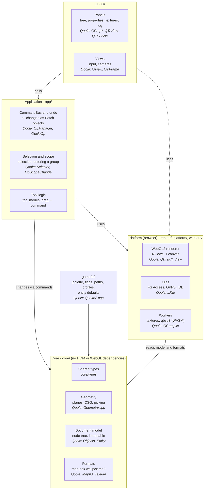

# Joole – Technical specification

Nov 24, 2026 · @Niko Hujanen

## Background and goals

We are building a browser-based, brush-based map editor for Quake 2 in TypeScript and WebGL2. The functional model is Qoole 99 (v0.99, GPL), whose [source code](https://github.com/demoth/qoole) is about 150 C++ files on top of MFC. The editor is released under GNU GPL v2.0 or later (`GPL-2.0-or-later`). Qoole's code is licensed "GPL v2 or later", so it may be used directly. Primarily, however, we adopt Qoole's proven solutions: the object tree, the CSG operations, the game-specific abstraction and the 2D/3D view split.

Goals:

1. **A full Q2 level round trip in the browser.** Open a `.map`, edit it, save the `.map` and test it with the compiler. The aim is that every Q2 map source id has released (base1–base3 in `base100.zip`, and the CTF and match map packs) opens and saves without loss. The game itself ships only compiled `.bsp` files, and decompiling is out of scope.
2. **No installation.** The user selects their game folder or `baseq2/pak0.pak`, and textures and entities are read from there. Nothing is sent to a server, and in production a Content-Security-Policy enforces that the application makes no external requests.
3. **A Qoole-level workflow.** This includes the four-view layout, creating and editing brushes, CSG subtract, hollowing, clipping with a plane, entity properties, a texture browser and prefabs.
4. **A modern foundation.** This includes unlimited undo, autosave to browser storage and a unit-tested geometry core that does not depend on the UI.

## Scope

V1 supports Quake 2 only. Qoole's `Game` abstraction (Quake, Hexen II, Half-Life, Sin, Heretic II) is left out, but game-specific things are still isolated in one module (`game/q2`). That way, adding a new game later requires no changes to the core.

| In v1                                                                                                                              | Not in v1                                                |
| ---------------------------------------------------------------------------------------------------------------------------------- | -------------------------------------------------------- |
| Reading and writing Q2 `.map` (id's original format)                                                                               | The Valve 220 texture format, Quake 3 patches and curves |
| An own JSON project format as the primary save format                                                                              | Importing Qoole `.qle` files (a later phase)             |
| `.wal` textures from `pak` and `pkz` packages and loose directories, including Q2 mod game directories                             | `.wad` textures, Qoole's cross-game map conversion       |
| Brushes, entities, groups, prefabs                                                                                                 | Terrain tools, a model editor                            |
| CSG: subtract, intersect, hollow, plane clip, mirror                                                                               | Opening a BSP file for editing (decompiling)             |
| Entity properties based on a definition file, md2 models as wireframes (other point entities as boxes)                             | Lighting preview (equivalent to qrad3 output)            |
| Running the compiler and displaying the leak file (`.pts`)                                                                         | Multi-user editing (real-time collaborative editing)     |
| Chromium browsers with full file support, Firefox and Safari with load/download-based files; the latest two major versions of each | Mobile and touch use                                     |

Qoole's Windows-specific features, such as the Glide, DirectX and MGL renderers and MFC's docking windows, are replaced by WebGL2 and the browser's own panel layout.

## Architecture

The application is divided into four layers. A layer may depend only on layers below it and on the core. The core has no browser dependencies, so geometry, formats and commands can be tested in Node. The boxes also show which Qoole module each part corresponds to.



_Figure 1. Layered architecture: four layers and the game module. The dashed arrows, `core/types` and the Tool logic box are refinements to the original diagram made on 24.11.2026._

Game-specific data (the palette, surface flags, directory paths, compile profiles and the default texture `e2u1/mine10_1`, as in Qoole) lives in the `game/q2` module. It corresponds to the `Quake2` implementation of Qoole's `Game` class, but v1 has no other games.

**Technologies:** TypeScript (`strict`), Vite, raw WebGL2 without a 3D library (the rendering is narrow and fully controlled), Solid 2 for the panels, Vitest and Playwright for tests, and Emscripten for the Q2 tools. The math is our own code: float64 in the core, and `Float32Array` only in GPU buffers. Versions, purposes and constraints are described in [10-stack.md](10-stack.md).

```text
src/
  main.ts         start-up: creates the layer objects and wires them together
  core/types/     shared data model types (type declarations only)
  core/geom/      planes, windings, CSG, picking, BVH
  core/doc/       document model, commands, patches
  core/formats/   map, pak, pkz, wal, pcx, md2, def, pts, project
  game/q2/        Q2 constants and defaults
  app/            CommandBus and undo, selection and scope, settings, tool logic
  render/         WebGL2, shaders, view drawing
  platform/       files, OPFS, IndexedDB, worker clients
  ui/             panels, view input and cameras
workers/          texture conversion, qbsp3/qvis3/qrad3.wasm
tools/            C source of the Q2 compilers and their Emscripten build
tests/            E2E tests and test data
```

### Layer order and dependency rules

The diagram draws the platform below the core because the platform is closer to the browser than the core is. In terms of dependencies, the order from top to bottom is **UI → application → platform → core**, and the game module sits above the core but below the other layers. The "and on the core" part of the rule means that every layer may use the core directly.

| Layer       | Directories                        | May import                                          | May not import             |
| ----------- | ---------------------------------- | --------------------------------------------------- | -------------------------- |
| UI          | `ui/`                              | `app/`, `render/`, `platform/`, `game/q2/`, `core/` | `workers/` (messages only) |
| Application | `app/`                             | `render/`, `platform/`, `game/q2/`, `core/`         | `ui/`, `workers/`          |
| Platform    | `render/`, `platform/`, `workers/` | `game/q2/`, `core/` (internal limits below)         | `app/`, `ui/`              |
| Game module | `game/q2/`                         | `core/`                                             | everything else            |
| Core        | `core/`                            | only `core/` (internal order below)                 | everything else            |

- **Within the platform**, `render/` may import `platform/` (for example the texture cache in OPFS), but not the other way round. `workers/` is a bundle of its own: it may import `core/` and `game/q2/` modules (for example the `wal` and `pcx` parsers and the palette), but not `app/`, `ui/`, `render/` or `platform/`. Other layers do not import worker code. They start the worker (`new Worker(new URL(…))`) and talk to it with messages through the worker clients in `platform/`.
- **The core's internal order** is `core/types` ← `core/geom` ← `core/doc` ← `core/formats`. Without it there would be a cycle: commands (`core/doc`) run CSG (`core/geom`), and CSG uses the document model's types (`Plane`, `Face`, `FaceTexture`). That is why the data model types live in the `core/types` module, which contains type declarations only and is imported with `import type`. `core/formats` is at the top because the parsers produce a `MapDocument`.
- **Within a layer**, imports are free (for example between `ui/` panels and views), except for the platform and core limits listed above.
- **Start-up:** `src/main.ts` is the Vite entry and the only file that may import every layer. It creates the CommandBus, the renderer and the file services, and wires them together.
- **Patches to the renderer:** the renderer's interface accepts only core types (`MapDocument`, `Patch`, camera data). The application reports changes as a subscription, and `main.ts` (or a UI view) subscribes the renderer. So `render/` does not import `app/`.
- **Tools are split in two.** The tool modes' state machine and logic, that is, which command a drag or click produces and what the preview shows, live in `app/` and can be tested in Node. The `ui/` views convert pointer and key events into world coordinates, handle the cameras and pass the events to the active tool.
- **Enforcement:** the rules are enforced by ESLint's path-based import restriction. In addition, `core/` and `game/q2/` are compiled as a tsconfig project without the `DOM` library and without global `@types` packages, because DOM and WebGL types are global and do not come from imports. The tools and their settings are described in [10-stack.md](10-stack.md).

## Data model

The document is a tree whose nodes are groups, entities or brushes. The solution is the same as in Qoole, where one `Object` class can contain children, a brush (`Geometry`) or an entity (`Entity`). In the browser version, the node kinds are separated into type-safe shapes. Each node has a persistent id that undo, selection and the render cache use. The types below live in the `core/types` module.

```typescript
type Id = string; // nanoid, stays the same across saves
type Vec3 = [number, number, number]; // float64, Q2 coordinates (Z up)

interface Plane {
  n: Vec3;
  d: number;
} // n·p = d, normal points outwards

interface FaceTexture {
  name: string; // e.g. "e1u1/floor1_3" without the .wal extension
  offset: [number, number]; // xoff yoff
  rotation: number; // degrees
  scale: [number, number]; // xscale yscale
  contents: number; // CONTENTS_* bit field
  flags: number; // SURF_* bit field
  value: number; // e.g. light intensity
  attribsInFile: boolean; // contents flags value were present in the .map that was read
}

interface Face {
  points: [Vec3, Vec3, Vec3]; // define the plane as in .map
  tex: FaceTexture;
}

interface BrushNode {
  kind: 'brush';
  id: Id;
  faces: Face[];
}
interface EntityNode {
  kind: 'entity';
  id: Id;
  props: [string, string][];
  children: Id[];
}
interface GroupNode {
  kind: 'group';
  id: Id;
  name: string;
  props: [string, string][];
  children: Id[];
  locked?: boolean;
  hidden?: boolean;
} // props: other keys of the func_group
type MapNode = BrushNode | EntityNode | GroupNode;

interface MapDocument {
  nodes: Map<Id, MapNode>;
  parent: Map<Id, Id>;
  worldspawn: Id; // always present, root node
}
```

Design decisions:

- **A brush's truth is its set of planes, not its vertices.** The stored data is three points per face, as in the `.map` file. Polygons, vertices and edges are a derived cache, computed by clipping a large cube with the planes. Qoole stores a B-rep model (vertices, edges, polygons and planes) and maintains its integrity separately (`IntegrityCheck`). The plane model removes that source of errors, and lossless saving comes for free.
- **Properties as an ordered list.** Entity key–value pairs are kept in their original order, including unknown keys. Opening and saving a file then changes nothing.
- **No local transform matrices.** In Qoole every node has its own `TransSpace`, and coordinates are converted to absolute only when saving (`TransObj2Abs`). In the browser version all coordinates are world coordinates, which simplifies CSG and picking. Moving a group is a command that moves every child.
- **Groups in `.map` files as `func_group` entities.** Q2's `.map` format has no groups, but qbsp3 moves the brushes of a `func_group` entity into worldspawn (`bsp/qbsp3/map.c`), and the game code treats the class like `info_null`. Other editors recognise the same convention. Each group is written as its own `func_group` entity containing the group's direct brushes. The editor's data is stored in keys that start with an underscore, which the game ignores (`g_spawn.c`): `_joole_id`, `_joole_name`, `_joole_parent` (the parent of a nested group), `_joole_locked` and `_joole_hidden`. Entities that belong to a group get the key `_joole_group`. When reading, the keys are turned back into the tree structure. A `func_group` without these keys (for example from another editor) is imported as a group, and its other keys are kept in the `GroupNode.props` list. The primary save format is still the own JSON project format, which keeps all editor data (see File formats).
- **Brush entities** (`func_door` etc.) are `EntityNode`s with brushes as children. Point entities have no children, and their position is in the `origin` property.

## File formats

The editor reads the binary and text formats listed below plus its own project format, and it writes `.map` and project files. All parsers are pure TypeScript functions (an `ArrayBuffer` or `string` in, a data structure out), so they can be tested in Node without a browser. The binary formats are little-endian.

| Format              | Direction    | Structure                                                                                                                                                               | Notes                                                                                                                                                                                                                                                                                                                                                                                                                                                                                           |
| ------------------- | ------------ | ----------------------------------------------------------------------------------------------------------------------------------------------------------------------- | ----------------------------------------------------------------------------------------------------------------------------------------------------------------------------------------------------------------------------------------------------------------------------------------------------------------------------------------------------------------------------------------------------------------------------------------------------------------------------------------------- |
| `.map`              | read + write | Text: entities `{ "key" "value" … { brush } }`, a brush face `( x y z ) ( x y z ) ( x y z ) texture xoff yoff rot xscale yscale [contents flags value]`                 | The last three fields are optional. If they are missing, qbsp3 takes the defaults from the `.wal` header. The editor writes them if they were in the file that was read (`attribsInFile`), if they differ from the texture's defaults, or if the texture cannot be found, in which case the defaults are unknown. qbsp3 reads the plane points and the `xoff`, `yoff` and `rot` values as integers (`atoi`) but the scale as a float (`bsp/qbsp3/map.c`), see below. `//` comments are allowed. |
| `.pak`              | read         | Header `PACK`, directory offset (int32), directory length (int32). An entry is 64 bytes: name (56 bytes), position (int32), length (int32).                             | Uncompressed, so files are read directly with `Blob.slice` without loading the whole pak into memory. Files are looked up in the same order as in the game engine (see Mods below).                                                                                                                                                                                                                                                                                                             |
| `.pkz`              | read         | A ZIP archive (a q2pro extension). The central directory is read from the end of the file, and files are uncompressed (stored) or deflate-compressed.                   | Parsing the directory and headers is pure core code. Deflate decompression is done in the platform layer with the browser's `DecompressionStream('deflate-raw')` API, and the decompression function is passed to the parser as a parameter, because the core does not use browser APIs. The file is read in chunks with `Blob.slice`, like `.pak`. ZIP64 and encrypted archives are not supported.                                                                                             |
| `.wal`              | read         | A 100-byte header: name (32), width, height, 4 mip offsets, next name in the animation chain (32), flags, contents, value. Then 8-bit indexed pixels.                   | The editor uses only mip 0 and lets WebGL generate the mipmaps. The header's flags, contents and value are the face defaults.                                                                                                                                                                                                                                                                                                                                                                   |
| `pics/colormap.pcx` | read         | The last 768 bytes of the PCX are a 256-colour RGB palette.                                                                                                             | The palette converts `.wal` textures to RGBA8. Index 255 is not transparent in Q2, so no alpha channel is used.                                                                                                                                                                                                                                                                                                                                                                                 |
| `.md2`              | read         | Header `IDP2`, version 8, frames and GL commands                                                                                                                        | Optional. Shown as a wireframe preview of point entities (frame 0, see md2 preview below). Qoole showed md2 models as wireframes (`Quake2::LoadModel`).                                                                                                                                                                                                                                                                                                                                         |
| entity definitions  | read         | Radiant's `/*QUAKED class (r g b) (min) (max) FLAG1 FLAG2 … description */` blocks. The Q2 definitions are generated from the game code (see Entity definitions below). | The properties panel, colours, box sizes and spawnflag checkboxes come from here. Qoole's equivalent is its own typed format (`EntList`: VEC, INT, STR, FLAGDEF, COLOR …), so the editor's internal model supports the same types.                                                                                                                                                                                                                                                              |
| `.pts`              | read         | Lines of the form `x y z`                                                                                                                                               | qbsp3's leak path, shown as a line in every view (compare Qoole's `LoadLeakFile`).                                                                                                                                                                                                                                                                                                                                                                                                              |

The `.map` writer turns numbers into text like this: integers without decimals, and other numbers with at most six decimals and no trailing zeros. The writer's output form is called _canonical_. A grid-aligned brush therefore produces the same lines as the original file, if the file was already in canonical form.

**Integer plane points.** The original qbsp3 reads plane points with `atoi`, so decimals are truncated, and the compiled brush may differ from the editor's brush or break. The data model and the project file keep points at float64 precision. Export to a `.map` file and compilation, however, convert every face whose points are not integers into three integer points that define the plane closest to the original. The converted brush is checked (valid and convex). If the conversion breaks the brush or moves its vertices by more than the `POINT_EPS` tolerance, the brush is flagged and the user sees a warning before the export. The clipboard and prefabs keep full precision (at most six decimals), because other editors accept decimals. In addition, Joole's WASM qbsp3 gets a documented fix that reads the points as floats (`atof`). The export does not rely on it, though, so that maps also compile with the original tools.

**Texture offset and rotation.** qbsp3 truncates the decimals of the `xoff`, `yoff` and `rot` values. The values that were read are kept as they are, so that saving is lossless, but rendering and the texture tools use the truncated value, so that the editor shows the same as the game. A warning is shown for faces whose values have decimals. The editor's own operations, including texture lock, always produce integers, and their rounding error counts towards texture lock's 0.5-texel error limit.

**Round-trip criterion** (read → write → read): the data structure must be identical for every test map. The text must be the same line by line, apart from comments and whitespace, when the file is already in canonical form and its plane points are integers (as in every map that compiles correctly with the original qbsp3). Other files are normalised on the first save, after which the round trip produces the same text.

**Own project format (`.joole.json`).** The project is the primary save format, and `.map` is an export format for the compiler and other editors. Ctrl+S saves the project. The `.map` is written separately with the _Export_ command and automatically before compiling. The project stores everything that a `.map` file loses:

```json
{
  "format": "joole-project",
  "version": 1,
  "game": { "baseDir": "baseq2", "modDir": "mymod" },
  "document": {
    "worldspawn": "w0",
    "nodes": [
      { "kind": "entity", "id": "w0", "props": [["classname", "worldspawn"]], "children": ["g1"] },
      {
        "kind": "group",
        "id": "g1",
        "name": "Entrance",
        "props": [],
        "children": ["b1"],
        "locked": false,
        "hidden": false
      },
      {
        "kind": "brush",
        "id": "b1",
        "faces": [
          {
            "points": [
              [0, 0, 0],
              [0, 64, 0],
              [64, 0, 0]
            ],
            "tex": {
              "name": "e1u1/floor1_3",
              "offset": [0, 0],
              "rotation": 0,
              "scale": [1, 1],
              "contents": 0,
              "flags": 0,
              "value": 0,
              "attribsInFile": false
            }
          }
        ]
      }
    ]
  },
  "editor": { "grid": 8, "textureLock": true, "cameras": {}, "compileProfile": "normal" }
}
```

- The nodes are a flat list, and the tree structure comes from the `children` fields. The format corresponds directly to the data model's `MapDocument`.
- Numbers are stored with JavaScript's default conversion, which keeps a float64 value exactly, so opening and saving changes nothing.
- `version` increases with every incompatible change. The reader runs migration functions from the old version to the newest, and there is a test file for every version.
- Textures are not embedded in the project. They are referenced by name from the game directory.
- The `.map` export writes groups as `func_group` entities (see Data model), so a `.map` can also be imported without losing the groups.

**Mods.** The game settings specify `baseq2` and an optional mod directory (for example `rogue`, `xatrix` or one's own). Files are looked up in q2pro's order (`ext/q2pro/src/common/files.c`, `add_game_dir` and `pakcmp`). It is a superset of vanilla Q2's order: first the mod's packages, then the mod's loose files, then `baseq2`'s packages and finally `baseq2`'s loose files. Within a directory, packages are sorted so that `.pak` and `.pkz` files whose names start with `pak` come first in numerical order, and the rest follow in alphabetical order (case-insensitive). The lookup runs in reverse order, so the package sorted last is searched first. Vanilla Q2 (`ext/Quake-2/qcommon/files.c`, `FS_AddGameDirectory`) reads only the files `pak0` to `pak9` and searches the highest number first, so the result is the same on vanilla installations. The orders were verified on 24.11.2026. The texture browser shows the mod's textures as a root folder of their own and marks which source each texture comes from.

**Entity definitions.** Vanilla Q2's definition file `q2.def` is generated with a script from id's GPL-licensed game code (`ext/Quake-2/game/*.c`, 148 `/*QUAKED*/` blocks). The approach is the same as in id's QuakeEd, which read the definitions directly from the game's source code (`ext/Quake-2-Tools/qe4/eclass.c`, `Eclass_InitForSourceDirectory`). The generated file is committed to the `game/q2/` directory with provenance notes, and q2pro's game code (`ext/q2pro/src/game`) is used for comparison. For a mod, the user can load their own `.def` file or select the mod's `.c` source files, from which the blocks are extracted with the same parser. A mod's definitions override vanilla classes with the same name.

**md2 preview.** QUAKED blocks do not contain a model path. That is why `game/q2` contains a class-to-model table for the vanilla classes, compiled from the spawn functions in the game code (`gi.modelindex("models/…")`). The model is shown as a wireframe of frame 0, as in Qoole, and other classes are shown as a box of the size given in the definition.

## Geometry core

The geometry core (`core/geom`) is a dependency-free TypeScript library that computes at float64 precision and is never called directly from the UI, always through commands. In Qoole, the equivalent functionality is in `Geometry.cpp` (about 2,800 lines). The principles of the algorithms are taken from there, but the implementation is based on the plane model.

The tolerances are constants in one place: `PLANE_EPS = 1e-4` (classifying a point against a plane) and `POINT_EPS = 1e-3` (merging vertices). A brush is valid when its volume is greater than 0, it has at least four faces and no face is redundant. The winding order of real `.map` files matches the outward-normal convention: the brushes of id's released map sources validate under it (verified with `JOOLE_MAPS_DIR` on 24.11.2026). A plane that duplicates another within `PLANE_EPS` counts as redundant, because clipping never empties it but it still corrupts the volume sum (verified against the implementation on 24.11.2026). Every operation returns either valid brushes or an error, never broken geometry.

| Operation                     | Qoole equivalent                                    | Algorithm                                                                                                                                                                                                                                                                                                                                                     |
| ----------------------------- | --------------------------------------------------- | ------------------------------------------------------------------------------------------------------------------------------------------------------------------------------------------------------------------------------------------------------------------------------------------------------------------------------------------------------------- |
| Building polygons             | `ConstructEdgeList`, `ConstructPlaneList`           | For each plane, a large square (winding) is created and clipped by all the other planes. A face that ends up empty is redundant and is removed.                                                                                                                                                                                                               |
| New brush                     | prefabs, `MakeSegment`                              | A box is dragged in a 2D view, and its height comes from another view or from a default. The primitives are box, wedge, n-sided cylinder, cone and an approximate sphere.                                                                                                                                                                                     |
| CSG subtract                  | `CSGSubtract`                                       | Each plane of the cutter splits the target in two: the part outside the plane becomes a new brush, and the part inside continues to the next plane. Finally, the part left inside is discarded. New faces get the cutter's texture.                                                                                                                           |
| CSG intersect                 | `CSGIntersect`                                      | The brushes' plane sets are merged and redundant faces are removed.                                                                                                                                                                                                                                                                                           |
| Hollow                        | `HollowInward`, `HollowOutBrush`                    | Each face becomes a shell of thickness d (8 units by default, as in Qoole), either inwards or outwards. The implementation is a subtraction: a copy moved inwards is subtracted from the original.                                                                                                                                                            |
| Plane clip                    | `PlaneClip`                                         | The plane is given in a 2D view by two points and the view's depth axis. Modes: keep the front side, the back side, or both as separate brushes.                                                                                                                                                                                                              |
| Mirror and flip               | `OpPlaneMirror`, `OpPlaneFlip`                      | The points are mirrored, and the point order of each face is reversed so that the normal still points outwards.                                                                                                                                                                                                                                               |
| Vertex, edge and face editing | `MoveVertex`, `MoveEdge`, `MoveFace`, `BreakPlanes` | A derived vertex is moved, and the planes of the touching faces are recomputed. If a face is no longer planar, it is split into triangles, as in Qoole's `BreakPlanes`. Finally, convexity is checked. If the result is not convex, the move is rejected and the view shows it as a dashed `vp-invalid` line (orange, because red is reserved for selection). |
| Move, rotate, scale           | `OpSelectionMove`, `Rotate`, `Scale`                | A 4×4 matrix is applied to all face points. With texture lock on, the texture parameters are recomputed (see Textures).                                                                                                                                                                                                                                       |

In the 2D views, a point's position snaps to the grid (1, 2, 4 … 256 units, 8 by default). Grid-aligned brushes are written as integer points, which avoids qbsp3's precision problems. After a rotation, the plane points are rounded to the grid only if the user chooses the _Snap to grid_ command, because automatic rounding can make a brush non-convex.

The approximate sphere primitive is an octahedron in the first editing implementation: always convex, integer-pointed on an integer grid and cheap to validate. A higher-detail segmented sphere is a possible later refinement, not a correctness requirement. Until the multi-view height workflow arrives, a brush drawn in a 2D view receives a 64-unit depth centred on that view plane.

Editing feedback uses the same incremental GPU cache as document edits: selected brush corners carry small cross handles, brush-tool drags show a red wireframe ghost, and only patch-affected brush ranges are rebuilt. The drag-bandwidth benchmark remains a hardware reference measurement for P5.6; SwiftShader numbers are not meaningful for the 8 ms target.

Clipboard editing serialises the selected brushes in clipboard mode (full float precision). Pasted brushes always receive fresh nanoids; duplicate offsets the copy by one grid step in X and Y. The interoperability check is at the format level in this phase: the emitted text is canonical Q2 `.map`, and the automated round trip parses it back without loss.

Project saving is implemented as versioned `joole-project` JSON with exact JSON float round trips and a migration chain entry point. Ctrl+S uses the File System Access save picker in Chromium and the download path elsewhere or when the picker is unavailable; grid settings and recent-file metadata are persisted in OPFS. Exporting `.map` remains a separate writer path with integer-point warnings.

Autosave writes the current project to OPFS every 30 seconds once a command has made it dirty, and again on `pagehide`. The dirty flag is cleared only by an explicit project save/download. On start-up, a dirty autosave produces a recovery prompt; accepting loads it as `recovered.joole.json`, and discarding clears the recovery metadata.

The qbsp3 oracle is built with Emscripten without `DOUBLEVEC_T`: the upstream makefile defines it for native double-precision experiments, but the wasm build crashed while parsing with that ABI-altering typedef. The browser/editor geometry core remains float64 independently of the oracle. The committed wasm output was rebuilt twice on 25.11.2026 and was bit-for-bit deterministic.

## Rendering with WebGL2

All four views are drawn into one WebGL2 context and one `<canvas>` element using `gl.scissor` and `gl.viewport`. Textures and buffers are then shared between the views, and four browser contexts are not used up. Qoole's `QDraw` abstraction (OpenGL, Glide, DirectX, MGL, software rendering) is replaced by a single renderer.

**Geometry cache.** Each brush's polygons are computed once after a change (a dirty flag keyed by the brush id). The polygons are fan-triangulated and collected into VBOs separated by texture. A change updates only that brush's share (`bufferSubData` and a free-range list). Vertex format: position (3×f32), UV (2×f32), normal (3×i8), brush index (u32) for picking and selection highlighting. The UV is stored in texels and divided by the bound texture's size in the shader, so a texture that finishes loading needs no geometry rebuild. The brush index also addresses a per-node state texture (selected, point entity) that the shaders read.

**2D views (top, front, side).** Orthographic projection on the XY, XZ and YZ axes. The screen axes follow the Radiant convention: Top looks down with +X right and +Y up, Front looks along +Y with +X right and +Z up, and Side looks along −X with +Y right and +Z up, so no view is mirrored. The grid is drawn procedurally in a fragment shader as a view-sized quad, and grid lines fade out when their spacing is under 4 pixels. Brushes are drawn as wireframes from the edge lists, entities in the colour from the definition file and selected objects in red. Until the entity definitions (phase 4), a point entity is a 16-unit box around its `origin` in `vp-entity`. Line width is done with instanced quads, because `gl.lineWidth` is limited to one pixel on most platforms.

**3D view.** A perspective camera and a fly camera (WASD and mouse look). Fly mode is active only while the right mouse button is held down or the pointer is locked, so WASD does not clash with the tool shortcuts (for example S = select). Modes: wireframe, flat colour and textured. In textured mode, a face's brightness depends on its normal so that shapes stand out without lighting. `SURF_TRANS33` and `SURF_TRANS66` faces are drawn transparent and last, `SURF_SKY` in a sky colour, and `SURF_NODRAW`, clip and hint dimmed or hidden depending on a setting. Distant brushes are culled by the view frustum using the brushes' bounding boxes.

**Textures.** A `.wal` is converted to RGBA8 with the palette in a Web Worker and uploaded as a separate `WebGLTexture` (`REPEAT`, mipmaps, `NEAREST_MIPMAP_LINEAR` for an authentic Q2 feel). Textures are loaded lazily: only when they are needed in a view or in the texture browser. Until then, a checker pattern is used. Converted textures are cached in OPFS.

**Picking.** Picking is done on the CPU. A ray is intersected with the half-spaces of the brush's planes (the same principle as Qoole's `HitGeometry`). Brushes are fetched from a dynamic BVH that is updated with the changes. In the 2D views, a hit means the nearest edge within 4 pixels or the brush that contains the point. Repeated clicks at the same spot cycle through overlapping brushes (Qoole's `Selector`). CPU picking is chosen over a GPU id buffer because the same code also serves vertex and face editing and the tests.

**Frame loop.** Drawing happens only when something changes (the document, a camera or the pointer), not continuously in a `requestAnimationFrame` loop. That way a laptop's battery does not drain while the editor is open.

## Textures and surface properties

UV coordinates are computed exactly as in qbsp3, so that the editor's view and the game show the same thing. The port was verified against `textures.c` on 24.11.2026: `rotate`, `shift` and `scale` are `vec_t` floats in `brush_texture_t` (rotation is divided by 180 in floating point, not integer arithmetic), and the base axis vectors of the ceiling are the same as the floor's. The base axis closest to the face normal is chosen from a table of six axes (floor, ceiling and four walls). The axes are then rotated by the `rotation` angle, divided by the `scale` values and shifted by the `offset` values. Finally, the result is divided by the texture's width and height. The function `texAxes(plane, tex)` is in the core, and both the renderer and texture lock use it.

**Texture lock.** On move and rotate, the old texture axes are transformed with the same matrix, and new `offset`, `rotation` and `scale` values are solved from them (compare Qoole's `FaceTex::Transform` and `lockTex`). Quake's parameter form cannot represent shear. If the solution's error exceeds 0.5 texels, the face is flagged and the user sees a warning. A move with lock on is exact when the new offset is an integer (for example a grid-aligned move with scale 1 or 0.5). Otherwise the offset is rounded to qbsp3's integer form, and the error is shown with the same warning (see Texture offset and rotation).

**Texture tools** (Qoole's `OpTextureApply`, `ApplyFace`, `FaceManip`, `BrushManip`):

- setting the texture for a whole brush or the selected faces, and picking a texture from a face with an eyedropper
- shifting and rotating with the arrow keys by the grid step, fit to face, justify to an edge, reset to defaults
- texture browser: a folder tree (`textures/e1u1` …), search by name, an in-use filter, previews and sizes

**Surface properties** are edited in a per-face panel as checkboxes. The values are constants from Q2's `qfiles.h`. The panel shows whether a value differs from the `.wal` texture's default (Qoole's `OpModSurfaceAttrib` and `OpModContentAttrib`).

| Group         | Flags (hexadecimal value)                                                                                                                                                                                                                                         |
| ------------- | ----------------------------------------------------------------------------------------------------------------------------------------------------------------------------------------------------------------------------------------------------------------- |
| Surface flags | LIGHT 0x1, SLICK 0x2, SKY 0x4, WARP 0x8, TRANS33 0x10, TRANS66 0x20, FLOWING 0x40, NODRAW 0x80, HINT 0x100, SKIP 0x200                                                                                                                                            |
| Contents      | SOLID 0x1, WINDOW 0x2, AUX 0x4, LAVA 0x8, SLIME 0x10, WATER 0x20, MIST 0x40, AREAPORTAL 0x8000, PLAYERCLIP 0x10000, MONSTERCLIP 0x20000, CURRENT\_0…CURRENT\_DOWN 0x40000–0x800000, ORIGIN 0x1000000, DETAIL 0x8000000, TRANSLUCENT 0x10000000, LADDER 0x20000000 |
| Value         | an integer; with the LIGHT flag, the light intensity                                                                                                                                                                                                              |

The values were verified on 24.11.2026 against Quake-2-Tools' `common/qfiles.h`, and they match it. Only `CONTENTS_MONSTER` (0x2000000) and `CONTENTS_DEADMONSTER` (0x4000000) are missing from the table. They are runtime values of the game and are not set on brushes, so the editor does not show them.

## Editor features and UI

The default layout has four views in a 2×2 grid (3D, top, front, side), a properties panel on the right, and a texture browser and log pane at the bottom. The top of the properties panel shows the selection's texture (or "Multiple textures"). The panel borders can be moved, and a single view can be maximised to fill the workspace with F1–F4 (3D, Top, Front, Side); the same key restores the grid. Qoole's MFC docking (`Interface2/`) is replaced by CSS Grid. The panels are Solid 2 components. The views are one canvas that the UI library does not render. The UI's look, components, colours, and language and voice are defined in the design system ([design-system/README.md](design-system/README.md)), and the UI text is in English.

**Tool modes** (one at a time, shortcut in parentheses):

| Mode                                                   | Behaviour                                                                                                                      | Qoole equivalent                            |
| ------------------------------------------------------ | ------------------------------------------------------------------------------------------------------------------------------ | ------------------------------------------- |
| Select (S)                                             | click, Shift adds to the selection, box drag, move by dragging, handles for scaling, Ctrl+drag rotates                         | `OpSelect*`, `OpSelectionMove/Rotate/Scale` |
| Brush (B)                                              | dragging in a 2D view creates the chosen primitive                                                                             | prefabs, `QPrefbVw`                         |
| Entity (E)                                             | a click creates an entity of the chosen class. A brush class (`func_*`, `trigger_*`) turns the selected brushes into an entity | `QEntSel`                                   |
| Clip (C)                                               | two points in a 2D view, Enter clips, Tab switches the side to keep                                                            | `OpPlaneClip` (scissors icon)               |
| Vertex and edge (V, pressing again switches), face (F) | handles for the derived elements, dragging snaps to the grid                                                                   | `MoveVertex`, `MoveEdge`, `MoveFace`        |
| Texture (T)                                            | selecting a face in the 3D view, setting and adjusting its texture                                                             | `QPropSrf`, `QPropTex`                      |

**Commands in menus and as shortcuts:** cut, copy, paste and duplicate (as `.map` text on the clipboard, so transfer to another editor works). Also CSG subtract, CSG intersect, hollow inwards and outwards, mirror X/Y/Z, rotate 90°, group and ungroup, hide and show, lock, and grid size \[ and \]. The views have a right-click context menu with Add Brush, Add Entity and Apply Entity → category → class.

**Keyboard shortcut map (defined in P2.5):** tool keys are S, B, E, C, V, F and T as above; grid size is \[ and \]; N steps to the next leak point. Platform-convention command shortcuts use Ctrl on Windows/Linux and Cmd on macOS: Ctrl/Cmd+Z undo, Ctrl/Cmd+Shift+Z and Ctrl/Cmd+Y redo, Ctrl/Cmd+S save, Ctrl/Cmd+X cut, Ctrl/Cmd+C copy, Ctrl/Cmd+V paste, Ctrl/Cmd+D duplicate, Ctrl/Cmd+H hide and Ctrl/Cmd+L lock. Plain tool keys do not fire while 3D fly mode owns WASD, and text-entry controls are never intercepted.

**Tree view and entering a group.** The side panel's tree shows worldspawn, entities and groups, and nodes can be moved by dragging (Qoole's `QTrView` and `OpTreeViewDragMove`). Double-clicking enters a group, so that selection and new brushes are limited to it and the rest of the map is dimmed. This is Qoole's _scope_ concept (`OpScopeChange`).

**Entity panel.** A class picker in two steps, a category and then a class, as in Qoole. The categories come from the class-name prefix (in vanilla Q2: `ammo_`, `func_`, `info_`, `item_`, `key_`, `light`, `misc_`, `monster_`, `path_`, `point_`, `target_`, `trigger_`, `turret_`, `weapon_`; classes without a prefix, such as `worldspawn` and `viewthing`, go under Misc), and classes are listed by their definition names (for example `func_door_secret`). Choosing a brush class turns the selected brushes into that entity. Below it is a form based on the definition file: `spawnflags` as checkboxes, `_color` as a colour picker, `angle` as a compass and `target`/`targetname` as a drop-down of the names that exist in the map. Below the form is a raw key–value table for editing unknown keys. `target` links between entities are drawn as lines in the 2D views.

**Prefabs.** The selection can be saved as a prefab (a `.map` snippet in OPFS) and dragged from the prefab browser into a view (Qoole's `QPrefMgr`).

## Commands, undo/redo and file handling

All document changes go through a single `CommandBus`, and no UI code changes the document directly. Qoole has about 30 `Operation` subclasses and an `OpManager`, and most of them store the old objects and swap them back on undo (`OpObjModification::SwapObjs`). The browser version generalises the same model into a single mechanism.

```typescript
interface Patch {
  // the effect of one command
  before: Map<Id, MapNode | null>; // null = the node did not exist
  after: Map<Id, MapNode | null>; // null = the node was removed
  parentBefore: Map<Id, Id | null>;
  parentAfter: Map<Id, Id | null>;
}
interface Command {
  label: string;
  mergeKey?: string;
  run(doc: Readonly<MapDocument>): Patch;
}
```

- **Undo** applies the `before` state and **redo** the `after` state. Nodes are immutable objects, so a snapshot is cheap: unchanged nodes are not copied.
- **Merging:** commands produced during the same drag that share a `mergeKey` are merged into one undo step.
- **History** is unlimited, but memory use is capped (256 MB estimated by default). The oldest steps are dropped, but the newest step is always kept, even if it alone exceeds the limit, so the last operation can always be undone.
- **Memory estimate:** each step on the undo and redo stacks is charged for the node versions in its patch that are not in the current document (unchanged nodes shared with the document cost nothing). The bytes come from a fixed structural formula: a per-node overhead, plus per face (points, texture name, numeric fields) for brushes, plus the key and value string lengths for entities and groups. The constants are defined in one place and calibrated once against a Chrome heap snapshot. The estimate is deterministic and testable in Node; it is approximate by design.
- **Selection** is not part of the document or the undo history, but undo restores the selection from before the command (compare Qoole's `OpSelectNewObjs`).
- Patches also go to the renderer, the BVH and the tree view as change notifications, so only the changed parts are recomputed.

**File handling in the browser:**

| Need                     | Chromium (Chrome, Edge)                                                                                                                 | Firefox, Safari                                            |
| ------------------------ | --------------------------------------------------------------------------------------------------------------------------------------- | ---------------------------------------------------------- |
| Choosing the game folder | File System Access API: `showDirectoryPicker()`, the handle is stored in IndexedDB, and permission is requested again on the next start | `<input type=file webkitdirectory>` or a single `pak0.pak` |
| Opening a map            | `showOpenFilePicker()`, and the file handle is remembered                                                                               | `<input type=file>` or drag and drop                       |
| Saving                   | Writing directly to the same file (`createWritable`)                                                                                    | Download (`<a download>`)                                  |
| Autosave                 | OPFS every 30 seconds and before the page closes                                                                                        | OPFS                                                       |
| Settings, recent files   | IndexedDB                                                                                                                               | IndexedDB                                                  |

Autosave records whether the document has unsaved changes since the last save or download. If OPFS holds an autosave with this flag set at start-up, the user is asked whether to restore it. This works the same way in every browser, including download-based saving, where no file timestamp is available. The application is a PWA and also works offline.

## Compiling and testing in the game

In v1, compiling is done in the browser with qbsp3, qvis3 and qrad3 compiled to WebAssembly. As a fallback, the `.map` is exported for compiling on the user's own machine. Qoole ran the same three programs as external processes with the parameter `%file%` and started the game with `+map %file%` (`Quake2::Quake2`, `QCompile`). A browser has no external processes, so:

1. **WASM compilation.** The tools' C code is compiled with Emscripten, and each tool runs in its own Web Worker. Input and output pass through Emscripten's in-memory filesystem: the `.map` goes in, and `.bsp`, `.pts` and `.prt` come out. The textures' `.wal` headers are given to the tools from the pak. Stdout is streamed to the log pane in real time. qvis3 and qrad3 can take minutes on large maps, so the user chooses a profile: _fast_ (qbsp3, qvis3 `-fast`, no qrad3), _normal_ or _final_ (qrad3 `-extra`).
2. **Threads.** qvis3 and qrad3 are multithreaded. WASM threads require `SharedArrayBuffer`, which in turn requires the COOP and COEP headers. The hosting must send them, and without them a single-threaded build is used.
3. **Leaks.** If qbsp3 finds a leak, the `.pts` is loaded automatically and the path is shown in every view. The _Next leak point_ command (N) moves the camera along the path.
4. **Testing in the game.** The finished `.bsp` is saved to the game folder's `baseq2/maps/` directory (Chromium) or downloaded. The game cannot be started from the browser, so the editor shows the command `+map <name>` to copy. The reference engine for in-game testing is q2pro (`ext/q2pro`). The compilers are id's original tools, so the BSP stays in the original format and within its limits, even though q2pro itself has higher limits. Embedding a browser-based Q2 port as a preview is a v2 matter.

The tools are compiled from id's original Quake-2-Tools source code (`ext/Quake-2-Tools`). Its file headers give the licence as "GPL v2 or later", which is compatible with Joole's `GPL-2.0-or-later` licence (verified on 24.11.2026). Only the changes Emscripten compilation requires and necessary bug fixes are made to the code (for example reading plane points with `atof`, see Integer plane points), and they are recorded in the README of the `tools/` directory. A single-threaded qbsp3 build for Node is made as early as phase 2, for tests and CI.

## Performance, testing and quality

The targets are sized so that a large Q2 map works on an integrated GPU. They are starting assumptions that will be checked with the first prototype.

| Metric                                          | Target           | Measured with                    | Where                                           |
| ----------------------------------------------- | ---------------- | -------------------------------- | ----------------------------------------------- |
| 3D view frame rate, 20,000 brushes, textures on | ≥ 60 fps         | Chrome on the reference hardware | Manual, at each phase gate                      |
| Opening a `.map`, 5,000 brushes, views ready    | < 2 s            | A Playwright performance test    | CI (loose threshold) and the reference hardware |
| Latency of editing a single brush (drag)        | < 8 ms per frame | The Performance timeline         | Manual, at each phase gate                      |
| CSG subtract, 1 cutter and 50 targets           | < 50 ms          | A Vitest benchmark               | CI (loose threshold) and the reference hardware |
| Memory use without textures, 20,000 brushes     | < 300 MB         | Chrome's memory profiler         | Manual, at each phase gate                      |

**Reference hardware:** a laptop with an Intel Iris Xe (11th–13th gen) or AMD Radeon 680M-class integrated GPU, 16 GB RAM, the current Chrome, on the balanced power profile. Every recorded result names the exact model, the Chrome version and the date. CI runs only the CPU-bound metrics (map opening and, once CSG exists in P3.1, the CSG benchmark), with thresholds of twice the target, to catch regressions; the CI runners render with SwiftShader, so GPU-bound numbers there are meaningless. The GPU-bound metrics (frame rate, drag latency, memory) are measured by hand on the reference hardware at each phase gate.

**P1.12 preliminary baseline (25.11.2026):** the development-machine measurements below are not reference-hardware results. The environment was an AMD Ryzen 7 7800X3D (16 logical CPUs, 15 GiB available to WSL2), WSL2 kernel 5.15.167.4, Playwright Chromium 159.0.8154.6, headless SwiftShader rendering, production preview build. The generated maps were non-overlapping 96³ boxes on a 128-unit cubic lattice.

| Measurement                                                          |                                                                          P1.12 preliminary result | Interpretation                                                                                                  |
| -------------------------------------------------------------------- | ------------------------------------------------------------------------------------------------: | --------------------------------------------------------------------------------------------------------------- |
| Opening the generated 5,000-brush map, views idle                    |                                                               median 261 ms; five runs 229–342 ms | Passes the 2 s target in this environment; CI regression threshold is 4 s                                       |
| Memory after opening the generated 20,000-brush map without textures | 52,180,952 bytes of live JS heap after forced GC, a 50,142,148-byte increase over the empty shell | Within the 300 MB target by this measurement method; the reference-memory measurement remains manual            |
| 3D frame rate, generated 20,000 textured brushes                     |                                                                   7.0 fps in headless SwiftShader | Not a hardware measurement and not evidence for or against the 60 fps target, per the CI/SwiftShader rule above |
| Drag latency                                                         |                                                                         not measurable in phase 1 | Editing does not exist before phase 2; the final target remains measured in P5.6                                |
| CSG subtract                                                         |                                                                         not measurable in phase 1 | CSG does not exist before P3.1, whose benchmark is the phase-3 measurement                                      |

The texture conversion proxy measured on the same machine was 72 ms for 512 synthetic 256×256 textures, single-threaded in Node. No valid measurement shows a target clearly at risk. The GPU frame rate still needs reference-hardware measurement, and P5.6 already contains the profiling/culling work package, so P1.12 adds no new mitigation WP.

**P2.3 picking benchmark (25.11.2026):** measured in Node with Vitest on the same Ryzen 7 7800X3D/WSL2 development machine, using 20,000 valid 96³ box brushes on a 128-unit lattice. Building the initial BVH, including brush analysis and wireframe caches, took about 0.8–1.0 s in this non-reference environment. The steady-state picking measurements were a mean of 3.45 ms for batches of 100 ray picks (about 35 µs per pick) and 44.4 ms for batches of 1,000 2D picks (about 44 µs per pick). Incremental patch updates do not rebuild the whole tree.

**Testing:**

- **Unit tests (Vitest)** for the geometry core and the parsers, with a target of at least 90 % line coverage in the `core/` folder. Every CSG operation gets property-based tests (fast-check): for random convex brushes, the result must be valid, and in subtraction the sum of the volumes must match within tolerance.
- **Round-trip tests:** every `.map` in the test data is read, written and read again. The criterion is described in the File formats section: the data structure is always identical, and the text is identical when the file is in canonical form.
- **Test data:** only small self-made maps and synthetic `.pak`, `.pkz`, `.wal` and `.pcx` files are added to the repository (`tests/fixtures/`), and CI runs the tests with them. id's data (`pak0.pak`, textures and id's released map sources) is not committed. Tests that use it read the path of a Q2 installation from the environment variable `JOOLE_Q2_DIR` and the directory of id's map sources from `JOOLE_MAPS_DIR`, and they are skipped if the variable is not set.
- **Compiler test:** CI writes the test maps and runs the WASM version of qbsp3 in Node. The test fails if the compiler warns about invalid brushes.
- **E2E (Playwright)** for the main workflows: open, create a brush, subtract, undo, save. Plus screenshot comparison tests for the views (pixel comparison with SwiftShader software rendering).

**Code quality:** TypeScript's `strict` mode, ESLint and Prettier. `core/` must not import any DOM or WebGL types. The rule is enforced by ESLint's import restriction and by the core's own tsconfig project without the `DOM` library. The other layer boundaries are described in the _Layer order and dependency rules_ section.

## Implementation phases and decisions

The implementation proceeds in five phases. Each phase ends with a usable version, and the next phase starts only when the previous one's acceptance criterion is met. The detailed work breakdown is in [PLAN.md](../PLAN.md).

1. **Reader and viewer.** Pak, pkz, wal and palette parsers, the search order of mod directories, the `.map` reader and writer, building polygons, the four views and the cameras. _Done when_ id's released Q2 map sources open with their textures and the round-trip test passes.
2. **Brush editing.** CommandBus and undo, selection, move, rotate and scale, new brush, grid, saving the JSON project, `.map` export, autosave, and a single-threaded qbsp3.wasm for Node for the compiler test. _Done when_ a simple room can be built from scratch and saved, and qbsp3 accepts it without warnings.
3. **CSG and textures.** Subtract, intersect, hollow, plane clip, mirror, vertex, edge and face editing, texture tools and lock, and surface flags. _Done when_ the property-based CSG tests pass and textures look the same in the editor and in the game.
4. **Entities and structure.** The definition file parser, the entity panel, brush entities, the tree view, groups and entering a group, prefabs, md2 preview and `target` lines. _Done when_ a working single-player level (player start, door, button, enemy) can be made from start to finish.
5. **Compilation and polish.** WASM tools in the browser (qbsp3, qvis3 and qrad3 in workers, threads), the leak path, compile profiles, PWA, the performance targets and Firefox/Safari support. _Done when_ the targets in the performance table are met and a map compiles to a playable BSP file without leaving the browser.

**Decisions 24.11.2026:**

- **Licence:** GNU General Public License v2.0 or later (`GPL-2.0-or-later`), the same as all source projects. Code from Qoole, q2pro, Q2 and the Q2 tools may be used.
- **Project format:** the own JSON format (`"format": "joole-project"`, extension `.joole.json`) is the primary save format, and `.map` is the export format.
- **Mods:** Q2 mod textures and game directories are supported in v1. Packages are looked up with q2pro's rules, and `.pkz` zips are also supported.
- **`.map` writing:** the round-trip criterion is a lossless data structure and canonical text. The presence of the optional surface fields is remembered. Texture offset and rotation are shown the way qbsp3 interprets them, and the editor's own values are integers.
- **Plane points in `.map` export:** always integers. The converted brush is checked, with a warning when needed. The clipboard and prefabs keep full precision, and Joole's qbsp3 reads points as floats as a safety net.
- **Groups in `.map` files:** as `func_group` entities with `_joole_*` keys, not as comments.
- **Compilers:** id's original Quake-2-Tools. A single-threaded qbsp3.wasm for Node is made as early as phase 2.
- **Entity definitions:** generated from id's GPL game code. The md2 model paths are in a table in `game/q2`.
- **Test data:** only self-made or synthetic data in the repository. id's data is read locally through the `JOOLE_Q2_DIR` (game installation) and `JOOLE_MAPS_DIR` (id's released map sources) environment variables.
- **Vanilla map corpus:** the `.map` sources id has released (base1–base3 in `base100.zip`, the CTF and match map packs), used locally and never committed.
- **In-game test engine:** q2pro.
- **Browser baseline:** the latest two major versions of Chrome/Edge, Firefox and Safari.
- **Content-Security-Policy:** a strict CSP in production enforces the no-external-requests rule.
- **Shortcuts:** WASD works only in fly mode. V switches between vertex and edge editing.
- **Autosave recovery:** based on an unsaved-changes flag, not on timestamps.
- **Qoole `.qle` import** moves to a phase after v1. The reader can be based on the source code's `LoadObjFile` and `ReadBoundGeometry` functions.
- **Technology stack:** the UI library is Solid 2, the language TypeScript 7 (native `tsc`), the development environment Node 26 LTS and the package manager pnpm. The reasoning and versions are in [10-stack.md](10-stack.md).
- **TypeScript project references:** TS 7.0 does not allow `--noEmit` in referenced composite projects (TS6310), so type checking emits declaration files only into the ignored `.tsbuild/` cache. The details are in [10-stack.md](10-stack.md).
- **Layered architecture:** the layer order, dependency rules, the `core/types` module, `src/main.ts` and the split of tools between the `app/` and `ui/` layers were refined (see Architecture).
- **Documentation language:** all project documentation is written in English.
- **Undo memory limit:** a structural estimate of the node versions held only by the history, and the newest step is always kept.
- **Performance reference:** a defined integrated-GPU laptop class. CPU-bound metrics also run in CI with 2× thresholds, and GPU-bound metrics are measured by hand at the phase gates.
- **UI details from the design system:** rejected moves are shown as a dashed `vp-invalid` line instead of red, F1–F4 maximise a view, N steps to the next leak point, entity classes are picked by category, and the views have a context menu. The properties panel shows the selection's texture. The design system and the UI are named Joole.

- **2D view axes (P1.10):** the Radiant convention described under Rendering with WebGL2. id's own `qe4` has only the XY view, and Qoole's orientations are buried in its object transforms, so the widely known Radiant layout was chosen.

**Decisions 25.11.2026:**

- **Performance baseline ordering:** P1.12 measures the map-open path and records preliminary memory/rendering numbers. The CSG benchmark is not moved earlier than P3.1, because implementing CSG only to measure it would violate the phase order. Drag latency likewise remains a later measurement because brush editing does not exist in phase 1. Reference-hardware GPU measurements remain phase-gate checks, with the final target pass in P5.6.
- **Undo history memory calibration:** the initial structural constants are 72 bytes per node, 185 bytes per brush face before the texture-name charge, 16 bytes per entity/group property entry, and 16 bytes plus 1 byte per character per string. They were calibrated on 25.11.2026 with Playwright Chromium 159.0.8154.6 CDP forced-GC heap measurements of 20,000 realistically shaped six-face brush objects (about 1,332 bytes per node). Entity strings are often shared or interned, so the formula is deliberately conservative for entity-heavy histories; it is an estimate, not an exact heap profiler.
- **Selection redo behaviour:** undo restores the selection captured immediately before the command. Redo does not rewrite the user's current selection; it only restores the metadata needed for a later undo. This avoids surprising selection changes when the user has selected something else while the command was undone.
- **View framing during editing:** opening or replacing a document frames the views on its bounds, but ordinary editing commands do not reframe or rezoom the cameras. Continuous reframing makes drag endpoints view-dependent and is disruptive while constructing geometry; the user can pan, zoom or use a later explicit frame command instead.
- **Overlapping selected-object priority:** when a Select-tool drag begins where several brushes overlap in a 2D projection and one hit is already selected, the selected hit is used. This lets the user move the current selection in dense projections. Repeated clicks still use the overlap cycler when no already-selected object is hit.

**To be refined later:**

- [ ] **Performance-panel measurement of the texture pipeline (P1.9):** the 512-texture batch conversion was verified as a single-threaded Node measurement in the unit tests (24.11.2026), well within budget. The browser Performance-panel measurement needs a larger real game-data corpus and is made at Gate 1 when `JOOLE_Q2_DIR` is configured. The E2E test of a texture arriving in the renderer through the worker was added with P1.10 (25.11.2026). The E2E test of the game-data fallback path (P1.8) was added with P1.11 (25.11.2026).
