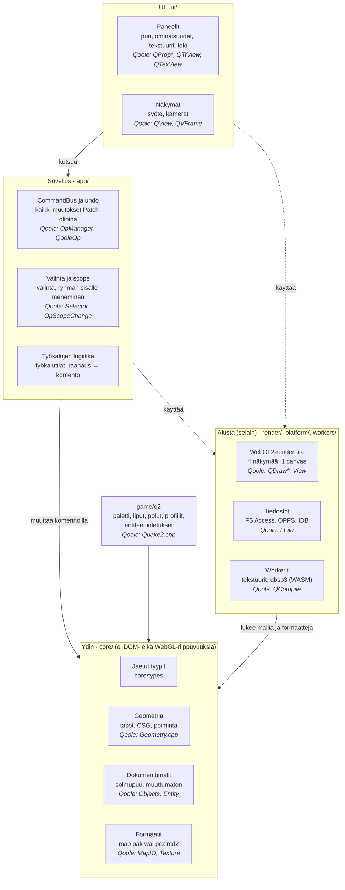

# Joole – tekninen määrittely

Nov 24, 2026 · @Niko Hujanen

## Tausta ja tavoitteet

Rakennetaan selaimessa toimiva brush-pohjainen karttaeditori Quake 2:lle TypeScriptillä ja WebGL2:lla. Toiminnallinen esikuva on Qoole 99 (v0.99, GPL), jonka [lähdekoodi](https://github.com/demoth/qoole) on noin 150 C++-tiedostoa MFC:n päällä. Editori julkaistaan GNU GPL v2.0 tai myöhemmän version lisenssillä (`GPL-2.0-or-later`). Qoolen koodi on lisensoitu "GPL v2 tai myöhempi", joten sitä saa käyttää suoraan. Ensisijaisesti Qoolesta otetaan kuitenkin käyttöön sen todetut ratkaisut: objektipuu, CSG-operaatiot, pelikohtainen abstraktio ja 2D/3D-näkymäjako.

Tavoitteet:

1. **Täysi Q2-kenttäkierros selaimessa.** Avataan `.map`, muokataan, tallennetaan `.map` ja testataan se kääntäjällä. Tavoitteena on, että mikä tahansa vanilla-Q2:n kenttä aukeaa ja tallentuu ilman häviöitä.
2. **Ei asennusta.** Käyttäjä valitsee pelikansionsa tai `baseq2/pak0.pak`:n, ja tekstuurit ja entiteetit luetaan sieltä. Mitään ei lähetetä palvelimelle.
3. **Qoolen tasoinen työnkulku.** Mukana ovat neljän näkymän asettelu, brushien luonti ja muokkaus, CSG-vähennys, ontoksi tekeminen, leikkaus tasolla, entiteettien ominaisuudet, tekstuuriselain ja prefabit.
4. **Moderni perusta.** Mukana ovat rajaton undo, automaattinen tallennus selaimen tallennustilaan ja yksikkötestattu geometriaydin, joka ei riipu UI:sta.

## Rajaus

V1 tukee vain Quake 2:ta. Qoolen `Game`-abstraktio (Quake, Hexen II, Half-Life, Sin, Heretic II) jätetään pois, mutta pelikohtaiset asiat eristetään silti yhteen moduuliin (`game/q2`). Näin uuden pelin lisääminen myöhemmin ei vaadi ytimen muutoksia.

| Mukana v1:ssä | Ei mukana v1:ssä |
| --- | --- |
| Q2 `.map` luku ja kirjoitus (id:n alkuperäinen formaatti) | Valve 220 -tekstuuriformaatti, Quake 3 -patchit ja curvet |
| Oma JSON-projektiformaatti ensisijaisena tallennusmuotona | Qoolen `.qle`-tiedostojen tuonti (myöhempi vaihe) |
| `.wal`-tekstuurit `pak`- ja `pkz`-paketeista ja irtohakemistoista, myös Q2-modien pelihakemistoista | `.wad`-tekstuurit, Qoolen pelien välinen karttamuunnos |
| Brushit, entiteetit, ryhmät, prefabit | Terrain-työkalut, mallieditori |
| CSG: vähennys, leikkaus, onton tekeminen, tasoleikkaus, peilaus | BSP-tiedoston avaaminen muokattavaksi (dekompilointi) |
| Entiteettien ominaisuudet määritystiedoston pohjalta, md2-mallit rautalankana (muut piste-entiteetit laatikkona) | Valaistuksen esikatselu (qrad3-tulosta vastaava) |
| Kääntäjäajo ja vuotopistetiedoston (`.pts`) näyttäminen | Moninpelieditointi (reaaliaikainen yhteismuokkaus) |
| Chromium-selaimet täydellä tiedostotuella, Firefox ja Safari lataus-/tallennuspohjaisesti | Mobiili- ja kosketuskäyttö |

Qoolen omat Windows-erityispiirteet, kuten Glide-, DirectX- ja MGL-renderöijät sekä MFC:n telakoituvat ikkunat, korvataan WebGL2:lla ja selaimen omalla paneeliasettelulla.

## Arkkitehtuuri

Sovellus jaetaan neljään kerrokseen. Kerros saa riippua vain itseään alemmista kerroksista ja ytimestä. Ytimessä ei ole selainriippuvuuksia, joten geometriaa, formaatteja ja komentoja voi testata Nodessa. Laatikoissa näkyy myös, mihin Qoolen moduuliin kukin osa vastaa.



*Kuva 1. Kerrosarkkitehtuuri: neljä kerrosta ja pelimoduuli. Katkoviivanuolet, `core/types` ja Työkalujen logiikka -laatikko ovat 24.11.2026 tehtyjä tarkennuksia alkuperäiseen kaavioon.*

Pelikohtaiset tiedot (paletti, pintaliput, hakemistopolut, käännösprofiilit ja oletustekstuuri `e2u1/mine10_1` kuten Qoolessa) ovat `game/q2`-moduulissa. Se vastaa Qoolen `Game`-luokan `Quake2`-toteutusta, mutta toisia pelejä ei v1:ssä ole.

**Teknologiat:** TypeScript (`strict`), Vite, raaka WebGL2 ilman 3D-kirjastoa (renderöinti on kapea ja hallittu), Solid 2 paneeleihin, Vitest ja Playwright testeihin sekä Emscripten Q2-työkaluille. Matematiikka on omaa koodia: float64 ytimessä ja `Float32Array` vasta GPU-puskureissa. Versiot, käyttötarkoitukset ja rajoitukset on kuvattu tiedostossa [10-stack.md](10-stack.md).

```text
src/
  main.ts         käynnistys: luo kerrosten oliot ja kytkee ne toisiinsa
  core/types/     tietomallin jaetut tyypit (vain tyyppimäärittelyjä)
  core/geom/      tasot, windingit, CSG, poiminta, BVH
  core/doc/       dokumenttimalli, komennot, patchit
  core/formats/   map, pak, pkz, wal, pcx, md2, def, pts, projekti
  game/q2/        Q2-vakiot ja -oletukset
  app/            CommandBus ja undo, valinta ja scope, asetukset, työkalujen logiikka
  render/         WebGL2, varjostimet, näkymien piirto
  platform/       tiedostot, OPFS, IndexedDB, worker-asiakkaat
  ui/             paneelit, näkymien syöte ja kamerat
workers/          tekstuurimuunnos, qbsp3/qvis3/qrad3.wasm
```

### Kerrosjärjestys ja riippuvuussäännöt

Kaavio piirtää alustan ytimen alle, koska alusta on ydintä lähempänä selainta. Riippuvuuksien kannalta järjestys on ylhäältä alas **UI → sovellus → alusta → ydin**, ja pelimoduuli on ytimen yläpuolella mutta muiden kerrosten alapuolella. Säännön "ja ytimestä" -lisäys tarkoittaa, että jokainen kerros saa käyttää ydintä suoraan.

| Kerros | Hakemistot | Saa tuoda | Ei saa tuoda |
| --- | --- | --- | --- |
| UI | `ui/` | `app/`, `render/`, `platform/`, `game/q2/`, `core/` | `workers/` (vain viesteillä) |
| Sovellus | `app/` | `render/`, `platform/`, `game/q2/`, `core/` | `ui/`, `workers/` |
| Alusta | `render/`, `platform/`, `workers/` | `game/q2/`, `core/` (sisäiset rajat alla) | `app/`, `ui/` |
| Pelimoduuli | `game/q2/` | `core/` | kaikki muut |
| Ydin | `core/` | vain `core/` (sisäinen järjestys alla) | kaikki muut |

- **Alustan sisällä** `render/` saa tuoda `platform/`-hakemistoa (esim. tekstuurien välimuisti OPFS:ssä), mutta ei päinvastoin. `workers/` on oma bundlensa: se saa tuoda `core/`- ja `game/q2/`-moduuleja (esim. `wal`- ja `pcx`-jäsentäjät ja paletti), mutta ei `app/`-, `ui/`- eikä `render/`-hakemistoja. Muut kerrokset eivät tuo worker-koodia, vaan käynnistävät workerin (`new Worker(new URL(…))`) ja kommunikoivat sen kanssa viesteillä `platform/`-hakemiston worker-asiakkaiden kautta.
- **Ytimen sisäinen järjestys** on `core/types` ← `core/geom` ← `core/doc` ← `core/formats`. Ilman sitä syntyisi kehä: komennot (`core/doc`) ajavat CSG:tä (`core/geom`), ja CSG käyttää dokumenttimallin tyyppejä (`Plane`, `Face`, `FaceTexture`). Siksi tietomallin tyypit ovat `core/types`-moduulissa, jossa on vain tyyppimäärittelyjä ja jota tuodaan `import type` -muodossa. `core/formats` on ylimpänä, koska jäsentäjät tuottavat `MapDocument`-olion.
- **Kerroksen sisällä** tuonnit ovat vapaita (esim. `ui/`:n paneelit ja näkymät keskenään), lukuun ottamatta yllä lueteltuja alustan ja ytimen sisäisiä rajoja.
- **Käynnistys:** `src/main.ts` on Viten entry ja ainoa tiedosto, joka saa tuoda kaikkia kerroksia. Se luo CommandBusin, renderöijän ja tiedostopalvelut ja kytkee ne toisiinsa.
- **Patchit renderöijälle:** renderöijän rajapinta ottaa vastaan vain ytimen tyyppejä (`MapDocument`, `Patch`, kameran tiedot). Sovellus ilmoittaa muutoksista tilauksena, ja `main.ts` (tai UI:n näkymä) kytkee renderöijän tilaajaksi. `render/` ei siis tuo `app/`-hakemistoa.
- **Työkalut jaetaan kahteen osaan.** Työkalutilojen tilakone ja logiikka, eli mitä komentoa raahaus tai napsautus tuottaa ja mitä esikatselu näyttää, ovat `app/`-hakemistossa ja testattavissa Nodessa. `ui/`:n näkymät muuntavat osoitin- ja näppäintapahtumat maailmakoordinaateiksi, hoitavat kamerat ja välittävät tapahtumat aktiiviselle työkalulle.
- **Valvonta:** säännöt valvotaan ESLintin polkupohjaisella importtirajoituksella. Lisäksi `core/` ja `game/q2/` käännetään tsconfig-projektina ilman `DOM`-kirjastoa ja ilman globaaleja `@types`-paketteja, koska DOM- ja WebGL-tyypit ovat globaaleja eivätkä tule importeista. Työkalut ja asetukset on kuvattu tiedostossa [10-stack.md](10-stack.md).

## Tietomalli

Dokumentti on puu, jonka solmut ovat ryhmiä, entiteettejä tai brusheja. Ratkaisu on sama kuin Qoolessa, jossa yksi `Object`-luokka voi sisältää lapsia, brushin (`Geometry`) tai entiteetin (`Entity`). Selainversiossa solmutyypit erotetaan tyyppiturvallisiksi muodoiksi. Jokaisella solmulla on pysyvä tunniste, jota undo, valinta ja renderöinnin välimuisti käyttävät. Alla olevat tyypit ovat moduulissa `core/types`.

```typescript
type Id = string;               // nanoid, pysyy samana tallennusten yli
type Vec3 = [number, number, number];   // float64, Q2-koordinaatit (Z ylös)

interface Plane { n: Vec3; d: number }  // n·p = d, normaali osoittaa ulospäin

interface FaceTexture {
  name: string;                 // esim. "e1u1/floor1_3" ilman .wal-päätettä
  offset: [number, number];     // xoff yoff
  rotation: number;             // asteina
  scale: [number, number];      // xscale yscale
  contents: number;             // CONTENTS_*-bittikenttä
  flags: number;                // SURF_*-bittikenttä
  value: number;                // esim. valon voimakkuus
  attribsInFile: boolean;       // contents flags value olivat luetussa .map-tiedostossa
}

interface Face {
  points: [Vec3, Vec3, Vec3];   // määrittävät tason kuten .map:ssa
  tex: FaceTexture;
}

interface BrushNode   { kind: 'brush';  id: Id; faces: Face[] }
interface EntityNode  { kind: 'entity'; id: Id; props: [string, string][]; children: Id[] }
interface GroupNode   { kind: 'group';  id: Id; name: string; props: [string, string][]; children: Id[]; locked?: boolean; hidden?: boolean }  // props: func_groupin muut avaimet
type MapNode = BrushNode | EntityNode | GroupNode;

interface MapDocument {
  nodes: Map<Id, MapNode>;
  parent: Map<Id, Id>;
  worldspawn: Id;               // aina olemassa, juurisolmu
}
```

Suunnittelupäätökset:

- **Brushin totuus on tasojoukko, ei verteksit.** Tallennettavat tiedot ovat kolme pistettä per sivu, kuten `.map`-tiedostossa. Polygonit, verteksit ja reunat ovat johdettua välimuistia, joka lasketaan leikkaamalla iso kuutio tasoilla. Qoole tallentaa B-rep-mallin (verteksit, reunat, polygonit ja tasot) ja ylläpitää sen eheyttä erikseen (`IntegrityCheck`). Tasomalli poistaa tämän virhelähteen, ja tallennus ilman häviöitä tulee ilmaiseksi.
- **Ominaisuudet järjestettynä listana.** Entiteettien avain–arvo-parit säilytetään alkuperäisessä järjestyksessä ja myös tuntemattomat avaimet. Silloin tiedoston avaaminen ja tallentaminen ei muuta mitään.
- **Ei paikallisia muunnosmatriiseja.** Qoolessa jokaisella solmulla on oma `TransSpace`, ja koordinaatit muunnetaan absoluuttisiksi vasta tallennuksessa (`TransObj2Abs`). Selainversiossa kaikki koordinaatit ovat maailmakoordinaatteja, mikä yksinkertaistaa CSG:tä ja poimintaa. Ryhmän siirto on komento, joka siirtää jokaisen lapsen.
- **Ryhmät `.map`-tiedostossa `func_group`-entiteetteinä.** Q2:n `.map` ei tunne ryhmiä, mutta qbsp3 siirtää `func_group`-entiteetin brushit worldspawniin (`bsp/qbsp3/map.c`), ja pelikoodi käsittelee luokan kuten `info_null`in. Myös muut editorit tunnistavat tämän käytännön. Jokainen ryhmä kirjoitetaan omana `func_group`-entiteettinään, jonka sisällä ovat ryhmän suorat brushit. Editorin tiedot ovat alaviivalla alkavissa avaimissa, jotka peli ohittaa (`g_spawn.c`): `_joole_id`, `_joole_name`, `_joole_parent` (sisäkkäisen ryhmän vanhempi), `_joole_locked` ja `_joole_hidden`. Ryhmään kuuluvat entiteetit saavat avaimen `_joole_group`. Luettaessa avaimet muutetaan takaisin puurakenteeksi. `func_group`, jossa niitä ei ole (esim. toisesta editorista), tuodaan ryhmänä, ja sen muut avaimet säilyvät `GroupNode.props`-listassa. Ensisijainen tallennusmuoto on kuitenkin oma JSON-projektiformaatti, joka säilyttää kaiken editorin tiedon (ks. Tiedostoformaatit).
- **Brush-entiteetit** (`func_door` ym.) ovat `EntityNode`ja, joiden lapsina on brusheja. Piste-entiteeteillä ei ole lapsia, ja niiden sijainti on `origin`-ominaisuudessa.

## Tiedostoformaatit

Editori lukee alla lueteltuja binääri- ja tekstiformaatteja sekä omaa projektiformaattiaan, ja se kirjoittaa `.map`- ja projektitiedostoja. Kaikki jäsentäjät ovat puhtaita TypeScript-funktioita (`ArrayBuffer` tai `string` sisään, tietorakenne ulos), joten niitä voi testata Nodessa ilman selainta. Binääriformaatit ovat little-endian-muotoisia.

| Formaatti | Suunta | Rakenne | Huomiot |
| --- | --- | --- | --- |
| `.map` | luku + kirjoitus | Tekstiä: entiteetit `{ "avain" "arvo" … { brush } }`, brushin sivu `( x y z ) ( x y z ) ( x y z ) tekstuuri xoff yoff rot xscale yscale [contents flags value]` | Kolme viimeistä kenttää ovat valinnaisia. Jos ne puuttuvat, qbsp3 ottaa oletukset `.wal`-otsakkeesta. Editori kirjoittaa ne, jos ne olivat luetussa tiedostossa (`attribsInFile`), jos ne poikkeavat tekstuurin oletuksista tai jos tekstuuria ei löydy, jolloin oletuksia ei tiedetä. qbsp3 lukee tasopisteet sekä `xoff`-, `yoff`- ja `rot`-arvot kokonaislukuina (`atoi`) mutta skaalan liukulukuna (`bsp/qbsp3/map.c`), ks. alla. `//`-kommentit sallitaan. |
| `.pak` | luku | Otsake `PACK`, hakemiston offset (int32), hakemiston pituus (int32). Merkintä on 64 tavua: nimi (56 tavua), sijainti (int32), pituus (int32). | Pakkaamaton, joten tiedostot luetaan suoraan `Blob.slice`-kutsulla ilman koko pakin lataamista muistiin. Tiedostot haetaan samassa järjestyksessä kuin pelimoottorissa (ks. Modit alla). |
| `.pkz` | luku | ZIP-arkisto (q2pro:n laajennus). Keskushakemisto luetaan tiedoston lopusta, ja tiedostot ovat pakkaamattomia (stored) tai deflate-pakattuja. | Hakemiston ja otsakkeiden jäsennys on puhdasta ydinkoodia. Deflate-purku tehdään alustakerroksessa selaimen `DecompressionStream('deflate-raw')`-rajapinnalla, ja purkufunktio annetaan jäsentäjälle parametrina, koska ydin ei käytä selainrajapintoja. Tiedosto luetaan osina `Blob.slice`-kutsulla kuten `.pak`. ZIP64 ja salatut arkistot eivät ole tuettuja. |
| `.wal` | luku | 100-tavuinen otsake: nimi (32), leveys, korkeus, 4 mip-offsetia, animaatioketjun seuraava nimi (32), flags, contents, value. Sen jälkeen 8-bittiset indeksoidut pikselit. | Editori käyttää vain mip 0:aa ja antaa WebGL:n generoida mipmapit. Otsakkeen flags, contents ja value ovat sivun oletusarvot. |
| `pics/colormap.pcx` | luku | PCX:n 768 viimeistä tavua ovat 256 värin RGB-paletti. | Paletti muuntaa `.wal`-tekstuurit RGBA8-muotoon. Indeksi 255 ei ole läpinäkyvä Q2:ssa, joten alfakanavaa ei käytetä. |
| `.md2` | luku | Otsake `IDP2`, versio 8, kehykset ja GL-komennot | Valinnainen. Näytetään piste-entiteettien esikatseluna rautalankana (kehys 0, ks. md2-esikatselu alla). Qoole näytti md2-mallit rautalankana (`Quake2::LoadModel`). |
| entiteettimääritykset | luku | Radiantin `/*QUAKED luokka (r g b) (min) (max) LIPPU1 LIPPU2 … kuvaus */` -lohkot. Q2:n määritykset generoidaan pelikoodista (ks. Entiteettimääritykset alla). | Ominaisuuspaneeli, värit, laatikoiden koot ja spawnflags-valintaruudut tulevat tästä. Qoolessa vastaava on oma tyypitetty formaatti (`EntList`: VEC, INT, STR, FLAGDEF, COLOR …), joten editorin sisäinen malli tukee samoja tyyppejä. |
| `.pts` | luku | Rivejä muodossa `x y z` | qbsp3:n vuotopolku, joka näytetään viivana kaikissa näkymissä (vrt. Qoolen `LoadLeakFile`). |

`.map`-kirjoittaja muuntaa luvut tekstiksi näin: kokonaisluvut ilman desimaaleja ja muut enintään kuudella desimaalilla ilman peränollia. Kirjoittajan tuottamaa muotoa kutsutaan *kanoniseksi*. Hilaan kohdistettu brush tuottaa siis samat rivit kuin alkuperäinen tiedosto, jos tiedosto oli jo kanonisessa muodossa.

**Kokonaislukupisteet.** Alkuperäinen qbsp3 lukee tasopisteet `atoi`-funktiolla, joten desimaalit katkeavat ja käännetty brush voi poiketa editorin brushista tai rikkoutua. Tietomalli ja projektitiedosto säilyttävät pisteet float64-tarkkuudella. `.map`-tiedostoon vienti ja käännös kuitenkin muuntavat jokaisen sivun, jonka pisteet eivät ole kokonaislukuja, kolmeksi kokonaislukupisteeksi, jotka määrittävät mahdollisimman lähellä alkuperäistä olevan tason. Muunnettu brush tarkistetaan (validi ja kupera). Jos muunnos rikkoo brushin tai siirtää sen verteksejä yli `POINT_EPS`-toleranssin, brush merkitään ja käyttäjä näkee varoituksen ennen vientiä. Leikepöytä ja prefabit säilyttävät täyden tarkkuuden (enintään kuusi desimaalia), koska muut editorit hyväksyvät desimaalit. Joolen WASM-qbsp3:een tehdään lisäksi dokumentoitu korjaus, joka lukee pisteet liukulukuina (`atof`). Vienti ei kuitenkaan luota siihen, jotta kartat kääntyvät myös alkuperäisillä työkaluilla.

**Tekstuurin siirto ja kierto.** qbsp3 katkaisee `xoff`-, `yoff`- ja `rot`-arvojen desimaalit. Luetut arvot säilytetään sellaisinaan, jotta tallennus on häviötön, mutta renderöinti ja tekstuurityökalut käyttävät katkaistua arvoa, jotta editori näyttää saman kuin peli. Sivuista, joiden arvoissa on desimaaleja, näytetään varoitus. Editorin omat operaatiot, myös tekstuurilukko, tuottavat aina kokonaislukuja, ja niiden pyöristysvirhe lasketaan mukaan tekstuurilukon 0,5 tekselin virherajaan.

**Kierrostestin kriteeri** (luku → kirjoitus → luku): tietorakenteen täytyy olla identtinen kaikille testikartoille. Tekstin täytyy olla rivitasolla sama kommentteja ja välilyöntejä lukuun ottamatta, kun tiedosto on jo kanonisessa muodossa ja sen tasopisteet ovat kokonaislukuja (kuten kaikissa kartoissa, jotka kääntyvät oikein alkuperäisellä qbsp3:lla). Muut tiedostot normalisoituvat ensimmäisellä tallennuksella, minkä jälkeen kierros tuottaa saman tekstin.

**Oma projektiformaatti (`.joole.json`).** Projekti on ensisijainen tallennusmuoto, ja `.map` on vientiformaatti kääntäjälle ja muille editoreille. Ctrl+S tallentaa projektin. `.map` kirjoitetaan erikseen *Vie*-komennolla ja automaattisesti ennen käännöstä. Projekti tallentaa kaiken, mikä `.map`-tiedostosta katoaa:

```json
{
  "format": "joole-project",
  "version": 1,
  "game": { "baseDir": "baseq2", "modDir": "mymod" },
  "document": {
    "worldspawn": "w0",
    "nodes": [
      { "kind": "entity", "id": "w0", "props": [["classname", "worldspawn"]], "children": ["g1"] },
      { "kind": "group", "id": "g1", "name": "Eteinen", "props": [], "children": ["b1"], "locked": false, "hidden": false },
      { "kind": "brush", "id": "b1", "faces": [ { "points": [[0,0,0],[0,64,0],[64,0,0]], "tex": { "name": "e1u1/floor1_3", "offset": [0,0], "rotation": 0, "scale": [1,1], "contents": 0, "flags": 0, "value": 0, "attribsInFile": false } } ] }
    ]
  },
  "editor": { "grid": 8, "textureLock": true, "cameras": {}, "compileProfile": "normal" }
}
```

- Solmut ovat tasaisena listana, ja puun rakenne tulee `children`-kentistä. Muoto vastaa suoraan tietomallin `MapDocument`ia.
- Luvut tallennetaan JavaScriptin oletusmuunnoksella, joka säilyttää float64-arvon tarkasti, joten avaus ja tallennus ei muuta mitään.
- `version` kasvaa jokaisessa yhteensopimattomassa muutoksessa. Lukija ajaa siirtofunktiot vanhasta versiosta uusimpaan, ja jokaiselle versiolle on testitiedosto.
- Tekstuureja ei upoteta projektiin, vaan niihin viitataan nimellä pelihakemistosta.
- `.map`-vienti kirjoittaa ryhmät `func_group`-entiteetteinä (ks. Tietomalli), joten `.map` voidaan myös tuoda ilman, että ryhmät katoavat.

**Modit.** Pelin asetuksissa annetaan `baseq2` ja valinnainen modin hakemisto (esim. `rogue`, `xatrix` tai oma). Tiedostot haetaan q2pro:n järjestyksessä (`ext/q2pro/src/common/files.c`, `add_game_dir` ja `pakcmp`). Se on vanilla-Q2:n järjestyksen yläjoukko: ensin modin paketit, sitten modin irtotiedostot, sitten `baseq2`:n paketit ja lopuksi `baseq2`:n irtotiedostot. Hakemiston sisällä paketit lajitellaan niin, että `pak`-alkuiset `.pak`- ja `.pkz`-tiedostot tulevat ensin numerojärjestyksessä ja muut sen jälkeen aakkosjärjestyksessä (kirjainkoosta riippumatta). Haku tehdään käänteisessä järjestyksessä, eli viimeisenä lajiteltu paketti haetaan ensin. Vanilla-Q2 (`ext/Quake-2/qcommon/files.c`, `FS_AddGameDirectory`) lukee vain tiedostot `pak0`–`pak9` ja hakee suurimman numeron ensin, joten vanilla-asennuksissa tulos on sama. Järjestykset on tarkistettu 24.11.2026. Tekstuuriselain näyttää modin tekstuurit omana juurikansionaan ja merkitsee, mistä lähteestä kukin tekstuuri tulee.

**Entiteettimääritykset.** Vanilla-Q2:n määritystiedosto `q2.def` generoidaan skriptillä id:n GPL-lisensoidusta pelikoodista (`ext/Quake-2/game/*.c`, 148 `/*QUAKED*/`-lohkoa). Tapa on sama kuin id:n QuakeEdissä, joka luki määritykset suoraan pelin lähdekoodista (`ext/Quake-2-Tools/qe4/eclass.c`, `Eclass_InitForSourceDirectory`). Generoitu tiedosto commitoidaan `game/q2/`-hakemistoon alkuperämerkinnöin, ja q2pro:n pelikoodia (`ext/q2pro/src/game`) käytetään vertailuna. Modia varten käyttäjä voi ladata oman `.def`-tiedoston tai valita modin `.c`-lähdekoodit, joista lohkot poimitaan samalla jäsentäjällä. Modin määritykset korvaavat samannimiset vanilla-luokat.

**md2-esikatselu.** QUAKED-lohkoissa ei ole mallin polkua. Siksi `game/q2` sisältää vanilla-luokille taulukon luokasta malliin, ja se kootaan pelikoodin spawn-funktioista (`gi.modelindex("models/…")`). Malli näytetään rautalankana kehyksestä 0 kuten Qoolessa, ja muut luokat näytetään määrityksen kokoisena laatikkona.

## Geometriaydin

Geometriaydin (`core/geom`) on riippuvuudeton TypeScript-kirjasto, joka laskee float64-tarkkuudella ja jota ei kutsuta suoraan UI:sta, vaan aina komentojen kautta. Qoolessa vastaavat toiminnot ovat tiedostossa `Geometry.cpp` (noin 2 800 riviä). Algoritmien periaatteet otetaan sieltä, mutta toteutus perustuu tasomalliin.

Toleranssit ovat vakioita yhdessä paikassa: `PLANE_EPS = 1e-4` (pisteen luokittelu tason suhteen) ja `POINT_EPS = 1e-3` (verteksien yhdistäminen). Brush on validi, kun sen tilavuus on yli 0, sillä on vähintään neljä sivua eikä yksikään sivu ole tarpeeton. Jokainen operaatio palauttaa joko validit brushit tai virheen, ei koskaan rikkinäistä geometriaa.

| Operaatio | Qoolen vastine | Algoritmi |
| --- | --- | --- |
| Polygonien muodostus | `ConstructEdgeList`, `ConstructPlaneList` | Jokaiselle tasolle luodaan iso neliö (winding), joka leikataan kaikilla muilla tasoilla. Tyhjäksi jäävä sivu on tarpeeton ja poistetaan. |
| Uusi brush | prefabit, `MakeSegment` | Laatikko vedetään 2D-näkymässä, ja korkeus tulee toisesta näkymästä tai oletuksesta. Primitiivejä ovat laatikko, kiila, n-kulmainen lieriö, kartio ja pallon likiarvo. |
| CSG-vähennys | `CSGSubtract` | Leikkurin jokaisella tasolla leikattava jaetaan kahtia: tason ulkopuolinen osa jää uudeksi brushiksi, ja sisäpuolinen osa jatkaa seuraavaan tasoon. Lopulta sisälle jäävä osa hävitetään. Uudet sivut saavat leikkurin tekstuurin. |
| CSG-leikkaus | `CSGIntersect` | Brushien tasojoukot yhdistetään ja tarpeettomat sivut poistetaan. |
| Onton tekeminen | `HollowInward`, `HollowOutBrush` | Jokaisesta sivusta tehdään kuori, jonka paksuus on d (oletus 8 yksikköä, kuten Qoolessa), joko sisään- tai ulospäin. Toteutus on vähennys: alkuperäisestä vähennetään sen sisään siirretty kopio. |
| Tasoleikkaus | `PlaneClip` | Taso annetaan 2D-näkymässä kahdella pisteellä ja näkymän syvyysakselilla. Tilat: säilytä etupuoli, takapuoli tai molemmat erillisinä brusheina. |
| Peilaus ja kääntö | `OpPlaneMirror`, `OpPlaneFlip` | Pisteet peilataan, ja jokaisen sivun pisteiden järjestys käännetään, jotta normaali osoittaa yhä ulospäin. |
| Verteksi-, reuna- ja sivumuokkaus | `MoveVertex`, `MoveEdge`, `MoveFace`, `BreakPlanes` | Liikutetaan johdettua verteksiä, ja koskettavien sivujen tasot lasketaan uudelleen. Jos sivu ei ole enää tasomainen, se jaetaan kolmioiksi, kuten Qoolen `BreakPlanes`. Lopuksi tarkistetaan kuperuus. Jos tulos ei ole kupera, siirto hylätään ja näkymä näyttää sen punaisena. |
| Siirto, kierto, skaalaus | `OpSelectionMove`, `Rotate`, `Scale` | Kaikkiin sivujen pisteisiin sovelletaan 4×4-matriisia. Tekstuurilukon ollessa päällä tekstuurin parametrit lasketaan uudelleen (ks. Tekstuurit). |

Pisteen paikka 2D-näkymissä kohdistetaan hilaan (1, 2, 4 … 256 yksikköä, oletus 8). Hilaan kohdistetut brushit kirjoitetaan kokonaislukupisteinä, mikä välttää qbsp3:n tarkkuusongelmat. Kierron jälkeen tasopisteet pyöristetään hilaan vain, jos käyttäjä valitsee *Snap to grid* -komennon, koska automaattinen pyöristys voi tehdä brushista epäkuperan.

## Renderöinti WebGL2:lla

Kaikki neljä näkymää piirretään yhteen WebGL2-kontekstiin ja yhteen `<canvas>`-elementtiin `gl.scissor`- ja `gl.viewport`-kutsuilla. Silloin tekstuurit ja puskurit jaetaan näkymien kesken eikä selaimen konteksteja kulu neljää. Qoolen `QDraw`-abstraktio (OpenGL, Glide, DirectX, MGL, ohjelmistopiirto) korvautuu yhdellä renderöijällä.

**Geometrian välimuisti.** Jokaisesta brushista lasketaan polygonit kerran muutoksen jälkeen (likainen-lippu brushin tunnisteen mukaan). Polygonit kolmioidaan viuhkaksi ja kootaan tekstuureittain eriteltyihin VBO-puskureihin. Muutos päivittää vain kyseisen brushin osuuden (`bufferSubData` ja vapaiden välien lista). Verteksiformaatti: sijainti (3×f32), UV (2×f32), normaali (3×i8), brushin indeksi (u32) poimintaa ja valintakorostusta varten.

**2D-näkymät (ylä, etu, sivu).** Ortografinen projektio akseleille XY, XZ ja YZ. Hila piirretään proseduraalisesti fragmenttivarjostimessa koko näkymän kokoisena neliönä, ja hilaviivat himmenevät, kun niiden väli on alle 4 pikseliä. Brushit piirretään rautalankana reunalistoista, entiteetit määritystiedoston värillä ja valitut punaisella. Viivanleveys tehdään instansoiduilla nelikulmioilla, koska `gl.lineWidth` on useimmilla alustoilla rajattu yhteen pikseliin.

**3D-näkymä.** Perspektiivikamera ja lentokamera (WASD ja hiiren katselu). Lentotila on päällä vain hiiren oikean painikkeen ollessa pohjassa tai osoittimen lukituksen aikana, joten WASD ei törmää työkalujen pikanäppäimiin (esim. S = valinta). Tilat: rautalanka, tasaväriä ja tekstuurit. Tekstuuritilassa sivun kirkkaus riippuu sen normaalista, jotta muodot erottuvat ilman valaistusta. `SURF_TRANS33`- ja `SURF_TRANS66`-sivut piirretään läpinäkyvinä viimeisenä, `SURF_SKY` taivaanvärillä ja `SURF_NODRAW`, clip ja hint himmeänä tai piilotettuina asetuksen mukaan. Kaukaiset brushit karsitaan näkyvyyskartiolla brushien rajauslaatikoiden perusteella.

**Tekstuurit.** `.wal` muunnetaan paletin avulla RGBA8-muotoon Web Workerissa ja ladataan erillisinä `WebGLTexture`-olioina (`REPEAT`, mipmapit, `NEAREST_MIPMAP_LINEAR` aidon Q2-tuntuman vuoksi). Tekstuurit ladataan laiskasti: vasta kun niitä tarvitaan näkymässä tai tekstuuriselaimessa. Siihen asti käytetään ruudukkokuviota. Muunnetut tekstuurit tallennetaan välimuistiin OPFS:ään.

**Poiminta.** Poiminta tehdään prosessorilla. Säde leikataan brushin tasojen puoliavaruuksilla (sama periaate kuin Qoolen `HitGeometry`). Brushit haetaan dynaamisesta BVH-puusta, joka päivitetään muutosten yhteydessä. 2D-näkymissä osuma tarkoittaa lähintä reunaa 4 pikselin säteellä tai sisältävää brushia. Toistuva napsautus samassa kohdassa kiertää päällekkäisiä brusheja (Qoolen `Selector`). Prosessoripoiminta valitaan GPU:n ID-puskurin sijaan, koska sama koodi palvelee myös verteksi- ja sivumuokkausta sekä testejä.

**Kehyssilmukka.** Piirto tehdään vain, kun jokin muuttuu (dokumentti, kamera tai osoitin), ei jatkuvasti `requestAnimationFrame`-silmukassa. Näin kannettavan akku ei tyhjene editorin ollessa auki.

## Tekstuurit ja pintojen ominaisuudet

UV-koordinaatit lasketaan täsmälleen kuten qbsp3:ssa, jotta editorin näkymä ja peli näyttävät saman. Sivun normaalia lähimpänä oleva perusakseli valitaan kuuden akselin taulukosta (lattia, katto ja neljä seinää). Sen jälkeen akselit kierretään `rotation`-kulmalla, jaetaan `scale`-arvoilla ja siirretään `offset`-arvoilla. Lopuksi tulos jaetaan tekstuurin leveydellä ja korkeudella. Funktio `texAxes(plane, tex)` on ytimessä, ja sitä käyttävät sekä renderöijä että tekstuurilukko.

**Tekstuurilukko.** Siirrossa ja kierrossa vanhat tekstuuriakselit muunnetaan samalla matriisilla, ja niistä ratkaistaan uudet `offset`-, `rotation`- ja `scale`-arvot (vrt. Qoolen `FaceTex::Transform` ja `lockTex`). Quaken parametrimuoto ei pysty esittämään vinoutusta. Jos ratkaisun virhe ylittää 0,5 tekseliä, sivu merkitään ja käyttäjä näkee varoituksen. Siirto lukon kanssa on tarkka, kun uusi siirtymä on kokonaisluku (esim. hilaan kohdistettu siirto skaalalla 1 tai 0,5). Muuten siirtymä pyöristetään qbsp3:n kokonaislukumuotoon, ja virhe näkyy samalla varoituksella (ks. Tekstuurin siirto ja kierto).

**Tekstuurityökalut** (Qoolen `OpTextureApply`, `ApplyFace`, `FaceManip`, `BrushManip`):

- tekstuurin asetus koko brushille tai valituille sivuille, ja tekstuurin poiminta sivulta pipetillä
- siirto ja kierto nuolinäppäimillä hilan mukaan, sovita sivuun (fit), tasaa reunaan (justify), palauta oletukset
- tekstuuriselain: kansiopuu (`textures/e1u1` …), haku nimellä, käytössä olevat tekstuurit -suodatin, esikatselu ja koko

**Pinnan ominaisuudet** muokataan sivukohtaisessa paneelissa valintaruutuina. Arvot ovat Q2:n `qfiles.h`:n vakioita. Paneeli näyttää, poikkeaako arvo `.wal`-tekstuurin oletuksesta (Qoolen `OpModSurfaceAttrib` ja `OpModContentAttrib`).

| Ryhmä | Liput (heksadesimaaliarvo) |
| --- | --- |
| Surface flags | LIGHT 0x1, SLICK 0x2, SKY 0x4, WARP 0x8, TRANS33 0x10, TRANS66 0x20, FLOWING 0x40, NODRAW 0x80, HINT 0x100, SKIP 0x200 |
| Contents | SOLID 0x1, WINDOW 0x2, AUX 0x4, LAVA 0x8, SLIME 0x10, WATER 0x20, MIST 0x40, AREAPORTAL 0x8000, PLAYERCLIP 0x10000, MONSTERCLIP 0x20000, CURRENT\_0…CURRENT\_DOWN 0x40000–0x800000, ORIGIN 0x1000000, DETAIL 0x8000000, TRANSLUCENT 0x10000000, LADDER 0x20000000 |
| Value | kokonaisluku, LIGHT-lipun kanssa valon voimakkuus |

Arvot on tarkistettu 24.11.2026 Quake-2-Toolsin tiedostosta `common/qfiles.h`, ja ne vastaavat sitä. Taulukosta puuttuvat vain `CONTENTS_MONSTER` (0x2000000) ja `CONTENTS_DEADMONSTER` (0x4000000). Ne ovat pelin ajonaikaisia arvoja, eikä niitä aseteta brusheille, joten editori ei näytä niitä.

## Editoritoiminnot ja käyttöliittymä

Oletusasettelussa on neljä näkymää 2×2-ruudukossa (3D, ylä, etu, sivu), oikealla ominaisuuspaneeli ja alhaalla tekstuuriselain ja lokiruutu. Paneelien rajoja voi siirtää, ja yksittäisen näkymän voi suurentaa koko ruudulle. Qoolen MFC-telakat (`Interface2/`) korvautuvat CSS Gridillä. Paneelit ovat Solid 2 -komponentteja. Näkymät ovat yksi canvas, jota UI-kirjasto ei renderöi.

**Työkalutilat** (yksi kerrallaan, pikanäppäin suluissa):

| Tila | Toiminta | Qoolen vastine |
| --- | --- | --- |
| Valinta (S) | napsautus, Shift lisää valintaan, alueen raahaus, siirto raahaamalla, kahvat skaalaukseen, Ctrl+raahaus kiertää | `OpSelect*`, `OpSelectionMove/Rotate/Scale` |
| Brush (B) | raahaus 2D-näkymässä luo valitun primitiivin | prefabit, `QPrefbVw` |
| Entiteetti (E) | napsautus luo valitun luokan entiteetin. Brush-luokka (`func_*`, `trigger_*`) muuttaa valitut brushit entiteetiksi | `QEntSel` |
| Leikkaus (C) | kaksi pistettä 2D-näkymässä, Enter leikkaa, Tab vaihtaa säilytettävän puolen | `OpPlaneClip` (scissors-ikoni) |
| Verteksi ja reuna (V, uusi painallus vaihtaa), sivu (F) | kahvat johdetuille elementeille, raahaus hilaan kohdistettuna | `MoveVertex`, `MoveEdge`, `MoveFace` |
| Tekstuuri (T) | sivun valinta 3D-näkymässä, tekstuurin asetus ja säätö | `QPropSrf`, `QPropTex` |

**Komennot valikoissa ja pikanäppäiminä:** leikkaa, kopioi, liitä ja monista (leikepöydällä `.map`-tekstinä, jolloin siirto toiseen editoriin toimii). Lisäksi CSG-vähennys, CSG-leikkaus, onton tekeminen sisään ja ulos, peilaus X/Y/Z, kierto 90°, ryhmittely ja purku, piilota ja näytä, lukitse sekä hilan koko \[ ja \].

**Puunäkymä ja ryhmän sisälle meneminen.** Sivupaneelin puu näyttää worldspawnin, entiteetit ja ryhmät, ja solmuja voi siirtää raahaamalla (Qoolen `QTrView` ja `OpTreeViewDragMove`). Kaksoisnapsautus vie ryhmän sisälle, jolloin valinta ja uudet brushit rajautuvat siihen ja muu kartta himmenee. Tämä on Qoolen *scope*-käsite (`OpScopeChange`).

**Entiteettipaneeli.** Lomake määritystiedoston mukaan: `spawnflags` valintaruutuina, `_color` värinvalitsimena, `angle` kompassina ja `target`/`targetname` pudotusvalikkona kartan olemassa olevista nimistä. Lomakkeen alla on raaka avain–arvo-taulukko, jolla tuntemattomia avaimia voi muokata. Kohteiden väliset `target`-yhteydet piirretään viivoina 2D-näkymiin.

**Prefabit.** Valinnan voi tallentaa prefabiksi (`.map`-pätkä OPFS:ään) ja raahata prefabiselaimesta näkymään (Qoolen `QPrefMgr`).

## Komennot, undo/redo ja tiedostojen käsittely

Kaikki dokumentin muutokset kulkevat yhden `CommandBus`-väylän kautta, eikä mikään UI-koodi muuta dokumenttia suoraan. Qoolessa on noin 30 `Operation`-aliluokkaa ja `OpManager`, ja suurin osa niistä tallentaa vanhat objektit ja vaihtaa ne undossa takaisin (`OpObjModification::SwapObjs`). Selainversio yleistää saman mallin yhdeksi mekanismiksi.

```typescript
interface Patch {                // yhden komennon vaikutus
  before: Map<Id, MapNode | null>;   // null = solmua ei ollut
  after:  Map<Id, MapNode | null>;   // null = solmu poistettiin
  parentBefore: Map<Id, Id | null>;
  parentAfter:  Map<Id, Id | null>;
}
interface Command { label: string; mergeKey?: string; run(doc: Readonly<MapDocument>): Patch }
```

- **Undo** soveltaa `before`-tilan ja **redo** `after`-tilan. Solmut ovat muuttumattomia olioita, joten tilannekuva on halpa: muuttumattomia solmuja ei kopioida.
- **Yhdistäminen:** saman raahauksen aikana syntyvät komennot, joilla on sama `mergeKey`, yhdistetään yhdeksi undo-askeleeksi.
- **Historia** on rajaton, mutta muistin käytölle asetetaan yläraja (oletus 256 Mt arvioituna). Vanhimmat askeleet poistetaan.
- **Valinta** ei ole osa dokumenttia eikä undo-historiaa, mutta undo palauttaa komentoa edeltäneen valinnan (vrt. Qoolen `OpSelectNewObjs`).
- Patchit menevät myös renderöijälle, BVH:lle ja puunäkymälle muutosilmoituksina, jolloin vain muuttuneet osat lasketaan uudelleen.

**Tiedostojen käsittely selaimessa:**

| Tarve | Chromium (Chrome, Edge) | Firefox, Safari |
| --- | --- | --- |
| Pelikansion valinta | File System Access API: `showDirectoryPicker()`, kahva tallennetaan IndexedDB:hen, ja lupa pyydetään uudelleen seuraavalla käynnistyskerralla | `<input type=file webkitdirectory>` tai yksittäinen `pak0.pak` |
| Kartan avaus | `showOpenFilePicker()`, ja tiedostokahva muistetaan | `<input type=file>` tai raahaus |
| Tallennus | Kirjoitus suoraan samaan tiedostoon (`createWritable`) | Lataus (`<a download>`) |
| Automaattinen tallennus | OPFS 30 sekunnin välein ja ennen sivun sulkemista | OPFS |
| Asetukset, viimeisimmät tiedostot | IndexedDB | IndexedDB |

Automaattinen tallennus kirjaa, onko dokumentissa tallentamattomia muutoksia viimeisimmän tallennuksen tai latauksen jälkeen. Jos OPFS:ssä on käynnistyksen aikaan automaattinen tallennus, jossa tämä lippu on päällä, käyttäjältä kysytään, palautetaanko se. Tapa toimii samoin kaikissa selaimissa, myös latauspohjaisessa tallennuksessa, jossa tiedoston aikaleimaa ei saada. Sovellus on PWA ja toimii myös ilman verkkoyhteyttä.

## Kartan kääntäminen ja testaus pelissä

V1:ssä käännös tehdään selaimessa WebAssemblyksi käännetyillä qbsp3-, qvis3- ja qrad3-työkaluilla. Varavaihtoehtona `.map` vietään käyttäjän omalle koneelle käännettäväksi. Qoole ajoi samat kolme ohjelmaa ulkoisina prosesseina parametrilla `%file%` ja käynnisti pelin parametrilla `+map %file%` (`Quake2::Quake2`, `QCompile`). Selaimessa ulkoisia prosesseja ei ole, joten:

1. **WASM-käännös.** Työkalujen C-koodi käännetään Emscriptenillä, ja jokainen työkalu ajetaan omassa Web Workerissaan. Syöte ja tuloste välitetään Emscriptenin muistitiedostojärjestelmän kautta: `.map` sisään, `.bsp`, `.pts` ja `.prt` ulos. Tekstuurien `.wal`-otsakkeet annetaan työkaluille pakista. Stdout ohjataan lokiruutuun reaaliajassa. qvis3 ja qrad3 voivat kestää isoilla kartoilla minuutteja, joten käyttäjä valitsee profiilin: *nopea* (qbsp3, qvis3 `-fast`, ei qrad3:a), *normaali* tai *lopullinen* (qrad3 `-extra`).
2. **Säikeistys.** qvis3 ja qrad3 ovat monisäikeisiä. WASM-säikeet vaativat `SharedArrayBuffer`in, joka puolestaan vaatii COOP- ja COEP-otsakkeet. Isännöinnin täytyy lähettää ne, ja ilman niitä käytetään yhden säikeen käännöstä.
3. **Vuodot.** Jos qbsp3 löytää vuodon, `.pts` ladataan automaattisesti ja polku näytetään kaikissa näkymissä. Komento *Seuraava vuotopiste* siirtää kameran polkua pitkin.
4. **Testaus pelissä.** Valmis `.bsp` tallennetaan pelikansion `baseq2/maps/`-hakemistoon (Chromium) tai ladataan. Peliä ei voi käynnistää selaimesta, joten editori näyttää kopioitavan komennon `+map <nimi>`. Selaimessa toimivan Q2-portin upottaminen esikatseluun on v2:n asia.

Työkalut käännetään id:n alkuperäisestä Quake-2-Tools-lähdekoodista (`ext/Quake-2-Tools`). Sen tiedostojen otsakkeissa lisenssi on "GPL v2 tai myöhempi", mikä on yhteensopiva Joolen `GPL-2.0-or-later`-lisenssin kanssa (tarkistettu 24.11.2026). Koodiin tehdään vain Emscripten-käännöksen vaatimat muutokset ja välttämättömät bugikorjaukset (esim. tasopisteiden luku `atof`-funktiolla, ks. Kokonaislukupisteet), ja ne kirjataan `tools/`-hakemiston README:hen. Yksisäikeinen qbsp3-build Nodelle tehdään jo vaiheessa 2 testejä ja CI:tä varten.

## Suorituskyky, testaus ja laatu

Tavoitteet on mitoitettu niin, että iso Q2-kartta toimii integroidulla näytönohjaimella. Ne ovat lähtöoletuksia, jotka tarkistetaan ensimmäisellä prototyypillä.

| Mittari | Tavoite | Mittaustapa |
| --- | --- | --- |
| 3D-näkymän kuvataajuus, 20 000 brushia, tekstuurit päällä | ≥ 60 fps | Kannettava, jossa integroitu näytönohjain, Chrome |
| `.map`-tiedoston avaus, 5 000 brushia, näkymät valmiina | < 2 s | Suorituskykytesti Playwrightilla |
| Yksittäisen brushin muokkauksen viive (raahaus) | < 8 ms per kehys | Performance-aikajana |
| CSG-vähennys, 1 leikkuri ja 50 leikattavaa | < 50 ms | Vitest-benchmark |
| Muistinkäyttö ilman tekstuureja, 20 000 brushia | < 300 Mt | Chromen muistiprofiili |

**Testaus:**

- **Yksikkötestit (Vitest)** geometriaytimelle ja jäsentäjille, tavoitteena vähintään 90 % rivikattavuus `core/`-kansiossa. Jokaiselle CSG-operaatiolle ominaisuuspohjaiset testit (fast-check): satunnaisista kuperista brusheista tuloksen pitää olla validi, ja vähennyksessä tilavuuksien summan pitää täsmätä toleranssin rajoissa.
- **Kierrostestit:** jokainen testiaineiston `.map` luetaan, kirjoitetaan ja luetaan uudelleen. Kriteeri on kuvattu kohdassa Tiedostoformaatit: tietorakenne on aina identtinen, ja teksti on identtinen, kun tiedosto on kanonisessa muodossa.
- **Testiaineisto:** repoon (`tests/fixtures/`) lisätään vain itse tehtyjä pieniä karttoja sekä synteettisiä `.pak`-, `.pkz`-, `.wal`- ja `.pcx`-tiedostoja, ja CI ajaa testit niillä. id:n pelidataa (vanilla-kartat, `pak0.pak`, tekstuurit) ei commitoida. Sitä käyttävät testit lukevat Q2-asennuksen polun ympäristömuuttujasta `JOOLE_Q2_DIR`, ja ne ohitetaan, jos muuttujaa ei ole asetettu.
- **Kääntäjätesti:** CI kirjoittaa testikartat ja ajaa qbsp3:n WASM-versiona Nodessa. Testi epäonnistuu, jos kääntäjä varoittaa virheellisistä brusheista.
- **E2E (Playwright)** päätyönkulkuihin: avaa, luo brush, vähennä, undo, tallenna. Lisäksi kuvavertailutestit näkymille (pikselivertailu SwiftShader-ohjelmistorenderöinnillä).

**Koodin laatu:** TypeScriptin `strict`-tila, ESLint ja Prettier. `core/` ei saa tuoda mitään DOM- tai WebGL-tyyppejä. Sääntö valvotaan ESLintin import-rajoituksella ja ytimen omalla tsconfig-projektilla ilman `DOM`-kirjastoa. Muut kerrosrajat on kuvattu kohdassa *Kerrosjärjestys ja riippuvuussäännöt*.

## Toteutusvaiheet ja päätökset

Toteutus etenee viitenä vaiheena. Jokaisen vaiheen lopussa on käyttökelpoinen versio, ja seuraava vaihe alkaa vasta, kun edellisen hyväksymiskriteeri täyttyy.

1. **Lukija ja katselin.** Pak-, pkz-, wal- ja paletti-jäsentäjät, modihakemistojen hakujärjestys, `.map`-lukija ja -kirjoittaja, polygonien muodostus, neljä näkymää ja kamerat. *Valmis, kun* vanilla-Q2:n kartta aukeaa tekstuureineen ja kierrostesti menee läpi.
2. **Brushien muokkaus.** CommandBus ja undo, valinta, siirto, kierto ja skaalaus, uusi brush, hila, JSON-projektin tallennus, .map-vienti, automaattinen tallennus sekä yksisäikeinen qbsp3.wasm Nodelle kääntäjätestiä varten. *Valmis, kun* yksinkertaisen huoneen voi rakentaa tyhjästä ja tallentaa, ja qbsp3 hyväksyy sen ilman varoituksia.
3. **CSG ja tekstuurit.** Vähennys, leikkaus, onton tekeminen, tasoleikkaus, peilaus, verteksi-, reuna- ja sivumuokkaus, tekstuurityökalut ja -lukko sekä pinnan liput. *Valmis, kun* ominaisuuspohjaiset CSG-testit menevät läpi ja tekstuurit näkyvät editorissa ja pelissä samoin.
4. **Entiteetit ja rakenne.** Määritystiedoston jäsennin, entiteettipaneeli, brush-entiteetit, puunäkymä, ryhmät ja ryhmän sisälle meneminen, prefabit, md2-esikatselu ja `target`-viivat. *Valmis, kun* toimiva yksinpelikenttä (pelaajan aloituspiste, ovi, nappi, vihollinen) voidaan tehdä alusta loppuun.
5. **Käännös ja viimeistely.** WASM-työkalut selaimessa (qbsp3, qvis3 ja qrad3 workereissa, säikeistys), vuotopolku, käännösprofiilit, PWA, suorituskykytavoitteet ja Firefox/Safari-tuki. *Valmis, kun* suorituskykytaulukon tavoitteet täyttyvät ja kartta kääntyy pelattavaksi BSP-tiedostoksi poistumatta selaimesta.

**Päätökset 24.11.2026:**

- **Lisenssi:** GNU General Public License v2.0 tai myöhempi (`GPL-2.0-or-later`), sama kuin kaikilla lähdeprojekteilla. Qoolen, q2pro:n, Q2:n ja Q2-työkalujen koodia saa käyttää.
- **Projektiformaatti:** oma JSON-formaatti (`"format": "joole-project"`, pääte `.joole.json`) on ensisijainen tallennusmuoto, ja `.map` on vientiformaatti.
- **Modit:** Q2-modien tekstuurit ja pelihakemistot tuetaan v1:ssä. Paketit haetaan q2pro:n säännöillä, ja myös `.pkz`-zipit tuetaan.
- **`.map`-kirjoitus:** kierrostestin kriteeri on häviötön tietorakenne ja kanoninen teksti. Valinnaisten pintakenttien läsnäolo muistetaan. Tekstuurin siirto ja kierto näytetään kuten qbsp3 ne tulkitsee, ja editorin omat arvot ovat kokonaislukuja.
- **Tasopisteet `.map`-viennissä:** aina kokonaislukuja. Muunnettu brush tarkistetaan ja siitä varoitetaan tarvittaessa. Leikepöytä ja prefabit säilyttävät täyden tarkkuuden, ja Joolen qbsp3 lukee pisteet liukulukuina varmuuden vuoksi.
- **Ryhmät `.map`-tiedostossa:** `func_group`-entiteetteinä `_joole_*`-avaimin, ei kommentteina.
- **Kääntäjät:** id:n alkuperäinen Quake-2-Tools. Yksisäikeinen qbsp3.wasm Nodelle tehdään jo vaiheessa 2.
- **Entiteettimääritykset:** generoidaan id:n GPL-pelikoodista. md2-mallien polut ovat `game/q2`:n taulukossa.
- **Testiaineisto:** repoon vain itse tehtyä tai synteettistä aineistoa. id:n data luetaan paikallisesti ympäristömuuttujan `JOOLE_Q2_DIR` kautta.
- **Pikanäppäimet:** WASD toimii vain lentotilassa. V vaihtaa verteksi- ja reunamuokkauksen välillä.
- **Automaattisen tallennuksen palautus:** perustuu tallentamattomien muutosten lippuun eikä aikaleimoihin.
- **Qoolen `.qle`-tuonti** siirtyy v1:n jälkeiseen vaiheeseen. Lukija voidaan tehdä lähdekoodin `LoadObjFile`- ja `ReadBoundGeometry`-funktioiden pohjalta.
- **Teknologiapino:** UI-kirjasto on Solid 2, kieli TypeScript 7 (natiivi `tsc`), kehitysympäristö Node 26 LTS ja paketinhallinta pnpm. Perustelut ja versiot ovat tiedostossa [10-stack.md](10-stack.md).
- **Kerrosarkkitehtuuri:** kerrosjärjestys, riippuvuussäännöt, `core/types`-moduuli, `src/main.ts` ja työkalujen jako `app/`- ja `ui/`-kerroksiin tarkennettiin (ks. Arkkitehtuuri).

**Tarkennetaan myöhemmin:**

- [ ] Undo-historian muistinkäytön arviointitapa (oletusraja 256 Mt). Päätös tarvitaan vaiheessa 2.
