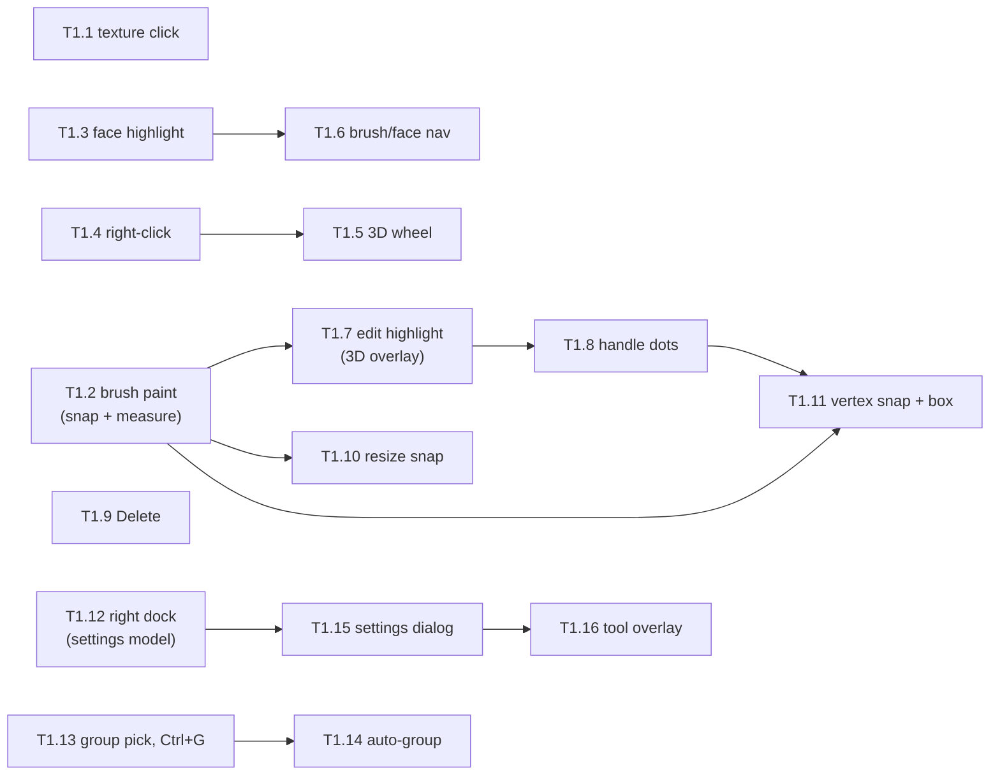

# Joole – Build 2, phase 1 work order

This document is the work order for phase 1 ("New features") of [`TODO.md`](../TODO.md): 24 editor improvements that follow the v1.0 release. It breaks the TODO items into work packages, puts them in order, and gives each one its design, scope, tests and acceptance criteria.

Status: draft, 26.11.2026. The normative sources are unchanged: [00-spec.md](00-spec.md) says what to build, [10-stack.md](10-stack.md) says which technologies to use, and [AGENTS.md](../AGENTS.md) says how to work. This document only sets the order and slicing of the work, plus the design proposals that the spec will absorb. **Each work package updates the spec in the same change**, as AGENTS.md requires. Where this document and the spec disagree after a WP merges, the spec wins and this document is corrected.

TODO phases 2 (projects, layouts, undo/redo, `.qle`, BSP import) and 3 (desktop build, Q2 in the browser) are out of scope here. A finding about phase 2 is noted at the end.

## How to use this document

- **Work packages** have IDs of the form `T1.<n>` (TODO phase 1, package _n_), so they do not clash with the `P<phase>.<n>` IDs in [PLAN.md](../PLAN.md). Each WP lists the TODO items it covers by their position in the TODO list (`#1` … `#24`).
- Each WP has:
  - _Goal_
  - _Current state_: what the v1.0 code does today, checked against the source on 26.11.2026
  - _Design_
  - _Scope_: modules and files
  - _Tests_
  - _Docs_
  - _Depends on_
  - _Done when_
- **Order:** WPs are listed in the order they should be built. That order follows the TODO priority order, with two exceptions: shared foundations are built inside the first WP that needs them, and items that change the same code are combined into one WP. Both exceptions are explained where they happen. WPs marked ⇄ do not depend on the WPs right before them and can be built in parallel.
- **Status:** tick the checkbox next to a WP title when it is merged and its _Done when_ holds.
- **The Definition of Done from PLAN.md applies to every WP.** In short:
  1. Tests are written first for `app/` and `core/` code.
  2. `pnpm check` passes, and so does `pnpm e2e` for UI and renderer changes.
  3. The layer rules hold without `eslint-disable`.
  4. The spec, the manual (`manual/README.md`), the design system and this document are updated in the same change.
  5. Screenshot baselines change only on purpose, and the commit message gives the reason.
- **Layer reminders** for this phase:
  - Tool state machines and "which command does this input produce" go in `app/` (rule 9).
  - Panel logic such as navigation order and settings validation goes in `app/`. `ui/` only presents it.
  - The renderer accepts only core types (rule 8).
  - Every document change goes through the `CommandBus` (rule 7).

## Implementation notes

Operational facts learned while building this phase:

- **Kill the stale preview server before every local Playwright run.** `reuseExistingServer` keeps an old `vite preview` on port 4173 serving an old `dist/`, so changes silently do not reach the tests. `ss -tlnp | grep 4173`, kill the pid, then run the test — the server command rebuilds. The dev server on 5173 serves live sources and can stay.
- **Browsers report `button` as -1 on every `pointermove`** (verified in Chromium). Tools must never filter move events by button; drag state lives in the tool's own mode. T1.2 fixed this for the brush and clip tools.
- Playwright probes (one-off debug specs) go in `tests/e2e/` temporarily and are deleted after use; never commit them.

## Clarified requirements (26.11.2026)

The owner answered these questions before planning. Each WP records its answer in the spec's _Decisions_ section when it merges.

| TODO item             | Question                                                       | Answer                                                                                                                                                                                                                             |
| --------------------- | -------------------------------------------------------------- | ---------------------------------------------------------------------------------------------------------------------------------------------------------------------------------------------------------------------------------- |
| #9 "handling a brush" | Hover highlight, or highlight while the brush is being edited? | **While it is being edited:** the brushes changed by the current drag (move, rotate, resize, vertex/edge/face drag, brush paint) are highlighted in 2D and 3D for as long as the drag lasts.                                       |
| #6 right-click        | What happens to right-hold fly in 3D?                          | **Right-hold fly is removed.** Right-click in 3D does nothing. Mouse-look and WASD work only in pointer-lock mode (middle-click). The mouse wheel moves the camera (#7).                                                           |
| #20 G                 | What does "grouping mode" do?                                  | **Group-pick mode:** G toggles a mode in which clicking a brush selects its whole group. Ctrl+G groups the selection and Shift+G ungroups it, in any mode.                                                                         |
| #22 automatic groups  | Which results get a group?                                     | **Only when there is more than one fragment:** Hollow groups its wall brushes. Subtract groups the fragments of each target separately, and only for targets that split into two or more brushes. Intersect never creates a group. |

## Findings from the code review

Several TODO items describe behaviour that is partly built already, or that is missing for a reason other than the one the TODO assumes. Each WP starts from these facts.

| Item     | Finding (v1.0, `main` at `ad25850`)                                                                                                                                                                                                                                                                                                                                                                                 |
| -------- | ------------------------------------------------------------------------------------------------------------------------------------------------------------------------------------------------------------------------------------------------------------------------------------------------------------------------------------------------------------------------------------------------------------------- |
| #1, #2   | Clicking a texture tile only sets the current texture (`TextureBrowser` → `EditorApp.setCurrentTexture`). Applying it takes **Edit → Apply Texture**, which calls `applyCurrentTexture()` on `textureTargets()`. `textureTargets()` uses the face picks even when the texture tool is not active. `allFacesOf()` covers only brushes that are directly selected, not the brushes inside a selected group or entity. |
| #3       | The Brush tool already returns a box preview (`boxSegments`) in the 2D views. It shows no size, and nothing is drawn in 3D because `draw3d` draws only entity lines (`drawLines(…, entitiesOnly = true)`).                                                                                                                                                                                                          |
| #4       | `BrushTool.pointer` already snaps the start and end points to the grid on the two view axes. The rest is not on the grid: the depth is a fixed ±32 around the snapped view plane, so it is off-grid for grid sizes above 32. There is also no snapped-cursor feedback before the mouse is pressed. Reproduce what the user actually sees before changing code (see T1.2).                                           |
| #5       | Face picks have no visual feedback. The renderer's state is per node (`STATE_SELECTED` per brush), so it cannot mark a single face.                                                                                                                                                                                                                                                                                 |
| #6       | The view area's `contextmenu` handler calls `preventDefault` everywhere, but it opens a menu only in the 2D views. Right-hold in 3D starts fly mode (`rightFly`). Panels such as the texture browser, tree, properties and log still show the browser's own context menu.                                                                                                                                           |
| #7       | `wheel` returns early for the 3D view, so the wheel does nothing there.                                                                                                                                                                                                                                                                                                                                             |
| #9       | Selected brushes are tinted in 3D but have no outline there. Tool previews (the brush-paint ghost, clip line, handle crosses, invalid dashes) are drawn only in the 2D views.                                                                                                                                                                                                                                       |
| #10, #11 | `VertexTool.handlePreview` draws small world-space crosses whose size equals the pick tolerance. Picking is 2D only. Edges are picked by distance to the segment and faces by distance to their centre. The renderer can draw only lines and faces, with no screen-space points.                                                                                                                                    |
| #12      | **No Delete command exists**, so there is no confirmation to remove. `removeSelectionPatch` (used by Cut) already exists. The WP adds Delete, and Delete never asks for confirmation.                                                                                                                                                                                                                               |
| #13      | `SelectTool` scale mode computes its factors from the raw pointer position with no snapping, and it applies them step by step, which adds up float error.                                                                                                                                                                                                                                                           |
| #14, #15 | `VertexTool` snaps the **step** (`snap(point - last)`), not the **position**. A vertex that starts off the grid stays off the grid.                                                                                                                                                                                                                                                                                 |
| #17–#19  | The texture browser is a tab in the bottom panel (`PanelTabs`, `BottomTab = 'textures'`). Its cell size is a constant (`cellWidth = 92`, `thumbSize = 64`). The right panel is 224 px wide by default, and at most 480 px.                                                                                                                                                                                          |
| #20, #21 | `shortcutAction` has no G bindings, and it returns `null` for every Shift combination that has no Ctrl. Group and Ungroup are available only as Tree buttons. The browser's Ctrl+G (find next) is not suppressed.                                                                                                                                                                                                   |
| #22      | `hollowSelectionPatch` and `subtractSelectionPatch` put the fragments next to the original under the same parent. `groupNodesPatch` exists and refuses parents that cannot hold a group.                                                                                                                                                                                                                            |
| #23      | Settings are persisted through `ProjectStore.saveSettings`, but `main.ts` writes only `{ gridSize }`, so each save overwrites the whole object. The theme is not persisted at all. There is no dialog component in the design system.                                                                                                                                                                               |
| #24      | The **Entity** and **Texture** toolbar buttons do nothing when clicked (`Toolbar.tsx` forwards only select, brush, clip, vertex and face). The design system allows no animation except for menus opening.                                                                                                                                                                                                          |

## Shared foundations

Several items need the same new parts. Each part is built in the first WP that needs it, and later WPs reuse it.

| Foundation                                                                                                                           | Built in | Reused by                  |
| ------------------------------------------------------------------------------------------------------------------------------------ | -------- | -------------------------- |
| **Absolute grid snapping helpers** in `app/` (`snapPoint`, `snapAxes`, snapped-cursor state)                                         | T1.2     | T1.10, T1.11               |
| **Measure overlay:** a `measure` field in `ToolOutput` (an AABB plus the view) and a DOM overlay in `ui/` that draws the size labels | T1.2     | T1.10 (optional), T1.11    |
| **Face highlight** in the renderer: a translucent face overlay in 3D and outlined polygons in 2D                                     | T1.3     | T1.6                       |
| **3D overlay pass:** tool previews and selected outlines drawn in the 3D view                                                        | T1.7     | T1.8                       |
| **Edit-state bit:** a renderer state flag for the brushes under edit                                                                 | T1.7     | T1.10, T1.11               |
| **Screen-space handle dots:** a new instanced renderer program                                                                       | T1.8     | T1.11                      |
| **Settings model** in `app/settings.ts`, with merge-safe persistence                                                                 | T1.12    | T1.15, T1.16               |
| **Tool metadata table:** id, name, shortcut and description for each tool, in `app/`                                                 | T1.16    | Toolbar titles, the manual |

## Overview and order

| WP    | TODO items    | Summary                                                                       | Depends on |
| ----- | ------------- | ----------------------------------------------------------------------------- | ---------- |
| T1.1  | #1, #2        | Clicking a texture tile applies it to the selected brushes or faces           | –          |
| T1.2  | #3, #4        | Brush painting: size box with labels, full grid lock, snapped cursor          | –          |
| T1.3  | #5            | Texture tool: the current face or brush is highlighted in 2D and 3D           | –          |
| T1.4  | #6            | Right-click policy; right-hold fly removed                                    | – ⇄        |
| T1.5  | #7            | The mouse wheel moves the 3D camera forward and back                          | T1.4 ⇄     |
| T1.6  | #8            | Previous/next navigation through a brush and its faces in Properties          | T1.3       |
| T1.7  | #9            | Brushes under edit are highlighted in 2D and 3D during a drag                 | T1.2       |
| T1.8  | #10, #11      | Large handle dots for vertices, edge midpoints and face centres               | T1.7       |
| T1.9  | #12           | The Delete key deletes the selection without confirmation                     | – ⇄        |
| T1.10 | #13           | Resizing snaps to the grid                                                    | T1.2       |
| T1.11 | #14, #15, #16 | Vertex, edge and face drags snap to the grid and show a size box              | T1.2, T1.8 |
| T1.12 | #17, #18, #19 | Right dock: collapsible Properties, the texture list, a thumbnail-size slider | –          |
| T1.13 | #20, #21      | Group-pick mode (G), Ctrl+G, Shift+G                                          | – ⇄        |
| T1.14 | #22           | Hollow and Subtract group their fragments                                     | T1.13      |
| T1.15 | #23           | Persistent settings dialog                                                    | T1.12      |
| T1.16 | #24           | Tool overlay: shortcut, icon, name and description                            | T1.15      |

**Milestones** for sequencing pull requests and releases:

- **M1 – Texturing and creation (T1.1–T1.6):** the eight highest-priority items.
- **M2 – Editing precision (T1.7–T1.11):** highlighting, handles, Delete and grid snapping.
- **M3 – Panels, groups and settings (T1.12–T1.16).**

Each milestone can ship as its own minor release. Tag the releases as the owner decides, for example v1.1, v1.2 and v1.3. None of the WPs changes the `.map` or `.joole.json` format, so the project format version stays the same.

---

## M1 – Texturing and creation

### [x] T1.1 Clicking a texture applies it to the selection (#1, #2)

- **Goal:**
  - Clicking a tile in the texture list applies that texture to the selected brushes.
  - In the texture tool, it applies the texture to the picked faces instead.
- **Current state:**
  - A click only sets the current texture. Applying it takes Edit → Apply Texture.
  - Face picks stay in effect after the user leaves the texture tool, so `textureTargets()` can surprise the user.
- **Design:**
  - Add `EditorApp.chooseTexture(name)`, which the texture browser calls. It always sets the current texture, and then it applies the texture to the targets:
    - In the texture tool with face picks: the picked faces (#2).
    - Otherwise: every face of every selected brush, including the brushes below a selected group or brush entity (#1). This uses a new `brushesOf(doc, selection)` helper, so a selected `func_door` gets textured as a whole.
    - With no target, the texture is not applied, which matches today's behaviour.
  - The apply step is one undo step labelled `Apply Texture`. If every target already has that texture, no command runs and no warning is logged. Today `editTextures` logs "Texture edit did not apply…", and the browser click path must stay quiet.
  - Selecting a tile with the keyboard (Enter or Space on a focused tile) applies the texture just like a click. The browser has no mouse-only shortcut.
  - **Decision (to record): face picks belong to the texture tool.** Leaving the texture tool clears the face picks, so the Apply, Fit and Justify commands outside the tool always target whole brushes. The face selection is not part of the document or the undo history, so clearing it loses no data.
  - Locked or hidden groups are already filtered out of the selection by `setSelection`, so they cannot be textured by accident.
- **Scope:**
  - `app/editor.ts`: `chooseTexture`, and clearing the face picks in `setToolMode`.
  - `app/textureOps.ts`: `brushesOf`.
  - `ui/TextureBrowser.tsx`: the `onSelect` handler calls `chooseTexture`.
  - `ui/EditorShell.tsx`: wiring.
- **Tests:**
  - Unit tests (`editor.texture.test.ts`):
    - brush selection → all faces change, in one undo step
    - face picks → only those faces change
    - a group selection → its descendant brushes change
    - same texture → no history entry
    - no selection → only the current texture changes
    - leaving the texture tool clears the face picks
  - E2E: extend `textureBrowser.spec.ts`. Select a brush, click a tile, and check `window.joole.project()` for the new texture name. Undo restores the old one.
- **Docs:**
  - spec: _Textures and surface properties_ / _Editor features_ (texture browser behaviour), plus a _Decisions_ entry for the face-pick scope
  - manual: _Texture browser_ and _Texture tool_ sections
- **Depends on:** –
- **Done when:** a single click textures the selected brush, or the picked faces in the texture tool, it can be undone in one step, and the E2E test passes.

### [x] T1.2 Brush painting: size box and grid lock (#3, #4)

- **Goal:**
  - While the user paints a brush, a box shows its current size in every view.
  - The brush always lands on the grid, and the cursor shows the snapped point before the button is pressed.
- **Current state:** see the findings. The in-plane snapping exists. The depth is a fixed ±32, there are no size labels, nothing is drawn in 3D, and there is no snapped-cursor feedback.
- **First step: reproduce.** Write an E2E test that paints a brush at grid sizes 8, 16 and 128 with the pointer off the grid lines, and check that every bound is a multiple of the grid. Record which of the suspected gaps actually show in the browser, so the fix addresses the root cause. This follows the AGENTS.md debugging rule.
- **Design:**
  - **Grid helpers (foundation).** Add `app/snap.ts` with `snap(value, grid)` (moved out of `tools.ts`), `snapPoint(point, view, grid)` for the two view axes, and `snapDepthExtent(center, grid, minimum = 64)`.
    - The depth becomes the smallest multiple of the grid that is at least 64, placed so that both depth faces lie on grid lines: `min = snap(center − extent / 2)`.
    - At grid 8 this keeps today's 64-unit depth. At grid 128 the depth becomes 128 and stays on the grid.
    - `ClipTool`, `EntityTool` and the prefab drop in `EditorShell` switch to the same helpers.
  - **Snapped cursor (the "auto-lock").** On a `move` event with no button pressed, the Brush tool returns `cursor: Vec3`, the snapped point. The renderer draws it as a small cross in `vp-handle`, and the view title's coordinate readout shows the snapped values instead of the raw ones. The same `cursor` output is reused later by the Clip tool and T1.11.
  - **Measure overlay (foundation).**
    - `ToolOutput` gets `measure?: { min: Vec3; max: Vec3 }`.
    - A new `ui/MeasureOverlay.tsx` is laid over the canvas, like the view titles. In each 2D view it labels the two in-plane extents next to the box edges in `mono-small`, with a `surface-2` chip at 85 % opacity, for example `128` on the horizontal edge and `64` on the vertical edge.
    - The active view's title bar shows the full size `128 × 64 × 64` (W × D × H, in X × Y × Z order).
    - The positions come from the existing ortho camera helpers (`ui/cameras.ts`), so the renderer is unchanged. Labels hide when their edge is shorter than the label itself.
  - **3D ghost.** The preview box is also drawn in 3D. This needs the 3D overlay pass, which T1.7 builds. For T1.2, a minimal version is enough: draw the tool-preview line batch in 3D with the depth test off. T1.7 then generalises it.
- **Scope:**
  - `app/snap.ts` (new)
  - `app/tools.ts`: BrushTool depth, `cursor` and `measure`
  - `app/editor.ts`: forwarding
  - `ui/MeasureOverlay.tsx` and `.module.css` (new)
  - `ui/EditorShell.tsx`
  - `render/renderer.ts` and `render/geometryCache.ts`: the cursor cross, and the preview lines in 3D
- **Tests:**
  - Unit tests: `snap.test.ts`, including fast-check properties:
    - snapped values are multiples of the grid
    - `snapDepthExtent` bounds lie on the grid and are at least 64 units apart
  - Unit tests: BrushTool `measure` and `cursor` output, and every created brush lying on the grid at grid sizes 1–256.
  - E2E: the reproduction test above, plus a renderer-harness screenshot of the painting state.
- **Docs:**
  - spec: the Brush tool row and the _New brush_ algorithm row (the depth rule)
  - design system: _MeasureLabel_ in the ViewportPane README, using existing tokens only
  - manual: _Brush tool_
- **Depends on:** –
- **Done when:**
  - Every painted brush lies on the grid at every grid size.
  - The box and its size labels follow the cursor in all four views.
  - The snapped cursor is visible before the button is pressed.

### [x] T1.3 Texture tool: highlight the current face or brush (#5)

- **Goal:** in the texture tool, the faces being worked on (the picked faces, or the selected brushes when no faces are picked) are clearly highlighted in 2D and 3D.
- **Design:**
  - New renderer API: `setFaceHighlight(polygons: readonly (readonly Vec3[])[])`. It takes core types only, so rule 8 holds.
    - **3D:** the polygons are drawn as a fill blended over the faces in `vp-select` at 35 % opacity, with a `vp-select` outline on top. The fill uses `polygonOffset` so it does not z-fight with the face. It is drawn after the opaque batches and is depth-tested without writing depth.
    - **2D:** the polygon edges are drawn in `vp-select` in the selected line pass. A face that is seen edge-on in a view becomes a line, which correctly shows where it is.
  - The app builds the polygons from `analyzeBrush(node).polygons` for the current targets and pushes them on `tool` and `document` events, and only while the texture tool is active. A brush target uses the existing selection styling and gets no face overlay. The overlay is only for face picks, which the per-node state cannot express.
  - The stack of overlays from bottom to top: selection tint, face highlight, tool previews.
- **Scope:**
  - `render/geometryCache.ts`: a face-overlay store
  - `render/renderer.ts`
  - shader reuse: the face program with a uniform for the highlight colour, so no new program is needed
  - `app/editor.ts`: `faceHighlightPolygons()`
  - `src/main.ts`: subscribe the renderer
- **Tests:**
  - Unit test: `faceHighlightPolygons()` for face picks, brush targets, and leaving the tool.
  - Renderer harness: a new `faces=` query parameter and a screenshot of a face highlight in 3D and 2D, in both themes.
  - E2E: in `texture.spec.ts`, pick a face and check that a highlight frame is drawn, using the harness screenshot or `stats()`.
- **Docs:**
  - spec: the texture tool row in _Editor features_ and _Rendering with WebGL2_
  - design system: the README's _Color_ section (`vp-select` also marks picked faces)
  - manual: _Texture tool_
- **Depends on:** –
- **Done when:** a picked face is visibly highlighted in 3D and in every 2D view where it is not seen edge-on, and the highlight follows undo and redo.

### [x] T1.4 Right-click policy (#6) ⇄

- **Goal:** right-click does nothing anywhere unless that view or panel has its own context menu.
- **Design:**
  - **Remove right-hold fly** (the owner's decision). In `EditorShell`, the `rightFly` state, its pointer capture, the right-button branch of `pointerEnd` and the log message "Hold the right mouse button to fly instead" are removed. Mouse-look and WASD stay in pointer-lock mode, which middle-click toggles.
  - **One `contextmenu` policy for the whole shell.** A listener on the shell root calls `preventDefault` unless the target is a text-entry control (`isEditableTarget`). Text fields keep the browser's menu so that copy and paste in the entity key–value table still work.
    - **Decision (to record):** editable controls are the only exception.
    - The 2D views keep their menu. The 3D view, the texture list, tree, prefabs, log, properties and the toolbar do nothing on right-click.
  - A right button press must not change the selection or start a tool action in any view. The current code already ignores `button !== 0` for tools; the WP adds a test for it.
- **Scope:** `ui/EditorShell.tsx`, and `ui/mount.tsx` if the root listener lives there.
- **Tests:**
  - E2E (`ui.spec.ts`):
    - Right-click on each panel and on the 3D view shows no menu, and the selection and camera do not change.
    - Right-click in Top still opens the view menu.
    - Right-click in an entity-panel text field is not prevented: `defaultPrevented` is false.
- **Docs:**
  - spec: _Editor features_ (context menus), plus a _Decisions_ entry that also replaces the right-hold fly text
  - manual: _View navigation_, the mouse table, and _Current UI gaps_
- **Depends on:** –
- **Done when:** the E2E test passes in Chromium, Firefox and WebKit.

### [x] T1.5 The mouse wheel moves the 3D camera (#7)

- **Goal:** the wheel over the 3D view moves the camera forward and back along its view direction, whether or not pointer lock is on.
- **Design:**
  - Add `dollyPerspective(camera, distance)` to `ui/cameras.ts`, next to `movePerspective`. It is pure and unit-tested.
  - The distance per notch (`deltaY` 120) is `WHEEL_DOLLY_UNITS = 64`, normalised by `deltaMode`, so trackpads move smoothly. Holding Shift moves 4× as far. **Decision (to record):** the step is a constant rather than tied to the grid, because the grid size is a 2D construction setting. The setting is added to the settings dialog in T1.15.
  - The wheel moves the camera in 3D in every state, including pointer lock. Wheel up moves forward.
  - Drawing still happens only on change: one `setCamera` per wheel event, and no animation loop.
- **Scope:** `ui/cameras.ts` (+ test), `ui/EditorShell.tsx` (the `wheel` handler).
- **Tests:**
  - Unit tests (`cameras.test.ts`):
    - the direction and distance of the move
    - `deltaMode` normalisation
    - Shift
  - E2E: a wheel over 3D changes `window.joole.camera('3d').position` along its forward vector, and the 2D zoom is unchanged.
- **Docs:**
  - spec: the _Keyboard shortcut map_ and mouse behaviour
  - manual: _View navigation_ and the mouse table
- **Depends on:** T1.4, which touches the same handlers. If the two are built in parallel, merge T1.4 first.
- **Done when:** the wheel moves the 3D camera forward and back, and the unit and E2E tests pass.

### [x] T1.6 Brush and face navigation in Properties (#8)

- **Goal:** in the texture tool, with a brush or a face selected, ◀ and ▶ buttons in Properties step through the brush as a whole and then each of its faces.
- **Design:**
  - **Model in `app/`** (`app/textureFocus.ts`, which is pure).
    - The **anchor brush** is the brush of the current face pick. If there are no face picks, it is the single selected brush.
    - The navigation sequence is `[brush, face 0, face 1, …, face n−1]`, in document face order. Faces whose derived polygon is empty are skipped.
    - The steps wrap around at both ends.
    - Navigation is unavailable, and the buttons are disabled, when there is no anchor: several brushes are selected with no face picks, or the face picks span several brushes.
  - **Effect:** stepping to `face i` sets the face picks to `[{ brush, face: i }]`. Stepping to `brush` clears the face picks, so the texture targets become the whole brush. The surface-flag form, the texture preview and the T1.3 highlight follow automatically, because they already read `textureTargets()`.
  - **UI:** a row above the selection preview in `PropertiesPanel`: `◀  Face 3 of 6  ▶`, or `Brush (6 faces)`. It uses icon buttons with `aria-label`s "Previous Face" and "Next Face". The row is shown only in the texture tool.
  - **Shortcut:** none, because the TODO did not ask for one. Recording a suggestion in the spec's _To be refined later_ list is enough.
- **Scope:**
  - `app/textureFocus.ts` (+ test)
  - `app/editor.ts`: `textureFocus()` and `stepTextureFocus(direction)`
  - `ui/PropertiesPanel.tsx` and its CSS
- **Tests:**
  - Unit tests:
    - the sequence and wrap-around
    - when the anchor is resolved
    - the disabled cases
    - skipping empty polygons
    - the face picks after each step
  - E2E: select a box brush in the texture tool, press ▶ seven times and check that it cycles through Brush and faces 1 to 6. The surface-flag form changes with it.
- **Docs:**
  - spec: the texture tool row and _Editor features_ (properties panel)
  - design system: the ObjectPreview README (the navigation row)
  - manual: _Texture tool_ and _Properties panel_
- **Depends on:** T1.3, so the current item is visible.
- **Done when:** the buttons step through the brush and all of its faces, and the form, preview and highlight follow.

---

## M2 – Editing precision

### [x] T1.7 Brushes under edit are highlighted (#9)

- **Goal:** while a drag edits brushes (move, rotate, resize, vertex/edge/face drag, or brush paint), the brushes it changes are drawn in the selection style in every view, including 3D.
- **First step: audit.** List the drags where the edited brush is not visibly highlighted today. The review found these:
  - In 3D, selected brushes are only tinted and have no outline.
  - The brush-paint ghost is not drawn in 3D.
  - In vertex mode with several brushes selected, nothing marks which brush the drag is changing.
- **Design:**
  - **Edit state.** `ToolOutput` gets `editing?: ReadonlySet<Id>`. Tools report it on `down` and clear it on `up` or cancel. The app forwards it as an `edit` event, and `main.ts` calls `renderer.setEditing(ids)`.
  - The renderer sets a new state bit, `STATE_EDITING` (32), which the line and face shaders treat like `STATE_SELECTED` and draw in `vp-select`. The editing pass is also drawn on top in 3D.
  - **3D overlay pass (foundation).** After the faces, `draw3d` draws:
    - the outlines of selected and editing brushes, depth-tested with `LEQUAL` and a small depth bias
    - the tool-preview, invalid and handle segments without depth testing
      This replaces T1.2's minimal version. The 3D view then shows the same edit feedback as the 2D views.
  - The brush-paint ghost is drawn as `vp-select` lines in all views. Brush paint has no node yet, so its "edited brush" is the ghost itself.
- **Scope:**
  - `app/tools.ts`: the `editing` output for SelectTool, VertexTool and BrushTool
  - `app/editor.ts`
  - `src/main.ts`
  - `render/geometryCache.ts`, `render/renderer.ts`
  - `render/shaders/line.vert.glsl`, `face.frag.glsl`
- **Tests:**
  - Unit tests: each tool reports `editing` exactly from down to up, and cancel clears it.
  - Renderer harness: new screenshots of a selected brush outlined in 3D and of a ghost brush in 3D. Update the existing 3D baselines on purpose and give the reason in the commit message.
  - Performance: drawing the outline pass in 3D must not regress the Gate 5 orbit frame rate measurably. Run `pnpm measure` on the reference hardware and record the result in the spec's performance section.
- **Docs:**
  - spec: _Rendering with WebGL2_ (the 3D overlay pass and the editing state)
  - design system: the Color section
  - manual: _Selecting and transforming_
- **Depends on:** T1.2
- **Done when:** every drag type shows its edited brushes highlighted in all four views, and the screenshots and the performance measurement are recorded.

### [x] T1.8 Large handle dots (#10, #11)

- **Goal:**
  - In vertex mode, vertices are shown as large dots.
  - In edge mode, each edge has a large dot at its midpoint.
  - In face mode, each face has a large dot at its centre.
  - The dots are easier to see and to hit than today's crosses.
- **Design:**
  - **Renderer primitive (foundation).** Add `setHandles(handles: readonly { point: Vec3; state: 'idle' | 'hover' | 'active' }[])`.
    - A new instanced program (`render/shaders/handle.vert.glsl`, `handle.frag.glsl`) draws screen-space squares of a fixed CSS-pixel size, scaled by `backingRatio()`, with a 1-px `vp-bg` border so they stand out over wireframes.
    - Sizes: idle 7 px, hover 9 px, active (dragged) 9 px. The size constants live in `render/` in one place.
    - Handles are drawn after everything else in 2D and 3D, without depth testing.
    - Colours: `vp-handle` when idle, `vp-select` on hover and when active.
  - **Handle model in `app/`.** `VertexTool.handles()` already computes the positions. Edges gain a `dot` (the midpoint) and faces a `dot` (the polygon centroid, which today's code computes but does not use).
    - `pickHandle` measures the screen distance to the **dot** in all submodes. Edges no longer use the segment distance, so every hit target is a fixed-size dot. **Decision (to record).**
    - The pick tolerance is passed as the dot radius plus 3 CSS px, converted to world units by the view, as today.
  - **Hover.** `VertexTool` returns the hovered handle on idle `move` events. Edge mode also highlights the hovered edge itself as a `vp-select` segment, so the TODO's "the edge should be highlighted" holds for both the dot and the line.
  - The world-space crosses (`handlePreview`, `cross3`) are removed.
  - **3D:** the dots are drawn in 3D for orientation, but picking and dragging stay 2D, as the spec says ("dragging snaps to the grid" in the 2D views). 3D handle dragging is out of scope, and the spec's _To be refined later_ list records it.
- **Scope:**
  - `render/` (the new program, cache store and API)
  - `app/tools.ts`: VertexTool handles, picking and hover
  - `app/editor.ts`
  - `src/main.ts`
- **Tests:**
  - Unit tests:
    - dot positions for each submode
    - picking by dot distance at the edge of the tolerance
    - the hover output
  - Renderer harness: screenshots of the three submodes.
  - E2E: extend `vertex.spec.ts` to grab an edge by its midpoint dot and a face by its centre dot.
- **Docs:**
  - spec: the vertex/edge/face row
  - design system: a _Handle_ section in the ViewportPane README (sizes and states)
  - manual: _Vertex, edge and face editing_
- **Depends on:** T1.7 (the 3D overlay pass and the drawing order)
- **Done when:** the dots are drawn in all three submodes, hover and drag change their state, and grabbing by a dot works in the E2E test.

### [x] T1.9 Delete deletes the selection without confirmation (#12) ⇄

- **Goal:** Delete (and Backspace on macOS) deletes the selected brushes right away. The action can be undone.
- **Current state:** no Delete command exists (see the findings).
- **Design:**
  - A new `ShortcutAction` called `'delete'`, for the keys `Delete` and `Backspace` with no modifier.
  - `EditorApp.deleteSelection()` reuses `removeSelectionPatch` as one command labelled `Delete`, then clears the selection. Undo restores the nodes and the selection, through the existing selection-restore mechanism.
  - Delete applies to the whole selection: brushes, point entities, groups and brush entities, together with their subtrees. **Decision (to record):** there is no confirmation for any node kind, because every deletion can be undone in one step. The TODO asks only about brushes, but a different rule for groups would be surprising.
  - Delete does nothing:
    - in the texture tool when faces are picked, because faces are not nodes
    - during a drag
    - in a text-entry control
    - when worldspawn is the only node selected
  - An **Edit → Delete** menu item shows the shortcut `Del`.
- **Scope:** `app/shortcuts.ts`, `app/editor.ts`, `ui/EditorShell.tsx`, `ui/Toolbar.tsx`.
- **Tests:**
  - Unit tests:
    - `shortcutAction` for Delete and Backspace, and none with modifiers
    - `deleteSelection` for each node kind
    - undo restores the nodes and the selection
    - the no-op cases
  - E2E: select a brush, press Delete, check it is gone with no dialog shown, press Ctrl+Z, and check it is back.
- **Docs:**
  - spec: the shortcut map and the command list
  - manual: _Editing commands_ and the Edit menu
- **Depends on:** –
- **Done when:** the unit and E2E tests pass.

### [x] T1.10 Resizing snaps to the grid (#13)

- **Goal:** resizing with the Select tool's corner handles moves the dragged corner only to grid positions.
- **Design:**
  - When the drag starts, store the original bounds and the anchor, which is the opposite corner. On each move:
    - snap the pointer to the grid on the view axes (`snapPoint`, from T1.2)
    - compute the target bounds from the anchor to the snapped corner
    - apply one transform from the **current** bounds to the target bounds
      The step is computed from the original bounds each time rather than by multiplying each step's factor onto the last, so float error does not build up during long drags.
  - **Limits:**
    - the size along an axis is at least one grid step
    - the corner cannot cross the anchor, so there is no accidental mirroring; mirroring is its own command
    - when the snapped corner does not change, no command is issued
  - If the anchor is off the grid (an imported brush), the moved faces still land on the grid, and the anchored faces stay where they were.
  - **Optional (outside the TODO; drop it if the reviewer prefers):** show the measure overlay from T1.2 during the resize, because it is nearly free once that overlay exists.
  - Texture lock is unchanged: scale still does not pass `textureLock`, which matches today's behaviour and the spec.
- **Scope:** `app/tools.ts` (SelectTool scale mode).
- **Tests:**
  - Unit tests:
    - the moved faces are multiples of the grid for random starting bounds and grid sizes (a fast-check property)
    - the minimum size and no crossing of the anchor
    - a long drag of many steps ends at the same geometry as one direct step
  - E2E: resize a brush in Top and check its bounds in `project()`.
- **Docs:**
  - spec: the Select tool row
  - manual: _Selecting and transforming_
- **Depends on:** T1.2
- **Done when:** resized brushes lie on the grid and the property test passes.

### [x] T1.11 Vertex, edge and face drags snap to the grid and show the size (#14, #15, #16)

- **Goal:**
  - Vertex, edge and face drags move the grabbed element to grid positions, not just by grid-sized steps.
  - The tool shows a snapped cursor.
  - A box shows the brush's current size while the drag lasts.
- **Design:**
  - **Absolute snapping (#15).** When the drag starts, the tool records a **reference point**:
    - the vertex itself, in vertex mode
    - the edge endpoint nearest the cursor, in edge mode
    - the face vertex nearest the cursor, in face mode
      On each move, the step is `snapPoint(reference + raw pointer offset) − reference`, on the two view axes.
    - The grabbed point therefore always lands on a grid line.
    - For axis-aligned faces and edges, all of their points land on grid lines.
    - An element that starts off the grid snaps onto it with its first step.
      **Decision (to record):** "the grabbed point snaps" is the rule, because it is the easiest to predict when dragging by a dot.
  - **Grid lock and cursor (#14).** The same `cursor` output as the Brush tool (T1.2) shows the snapped target during the drag. When idle, it shows the snapped pointer position over the hovered handle. Changing the grid size during a drag takes effect on the next move.
  - **Size box (#16).** During the drag, the tool returns `measure` with the AABB of the edited brush after the step. The measure overlay draws it in the 2D views, and T1.7 has already highlighted the brush. A rejected step shows the last valid size, together with the existing dashed `vp-invalid` preview.
  - The validation in `moveVertices` is unchanged. Snapping can only make a step bigger or smaller; it cannot skip the validity check.
- **Scope:** `app/tools.ts` (VertexTool), `app/snap.ts`, `app/editor.ts`.
- **Tests:**
  - Unit tests:
    - off-grid vertices land on the grid after the first step
    - edge and face reference points
    - `measure` after valid and rejected steps
    - a fast-check property: the reference point is always on the grid after any drag
  - E2E: extend `vertex.spec.ts` with an off-grid fixture brush. Drag a vertex and check that it lies on the grid.
- **Docs:**
  - spec: the vertex/edge/face row ("snaps to the grid" becomes "the grabbed point snaps to absolute grid positions")
  - manual: _Vertex, edge and face editing_
- **Depends on:** T1.2 (snap helpers, cursor and measure overlay), T1.8 (handle model)
- **Done when:** the property test passes, and the size box follows every vertex, edge and face drag.

---

## M3 – Panels, groups and settings

### [x] T1.12 Right dock: collapsible Properties, the texture list and a thumbnail slider (#17, #18, #19)

These three items are one WP because they rebuild the same panel. Splitting them would mean three passes over the same layout, CSS and E2E tests.

- **Goal:**
  - The right panel becomes a dock with two sections, Properties and Textures.
  - Properties can be collapsed.
  - The texture list has a slider for the thumbnail size.
- **Design:**
  - **Layout.** The right panel (`--right-panel-width`) is split vertically:
    - the **Properties** section on top
    - a horizontal splitter (`size-splitter`, keyboard-resizable like the existing splitters)
    - the **Textures** section below
      Each section has a `size-titlebar` header with a disclosure button (`chevronDown` / `chevronRight`, `aria-expanded`) and its title.
    - Collapsing a section leaves only its header, and the other section takes the space.
    - With both sections collapsed, both headers stay at the top.
  - **Bottom panel.** The Textures tab is removed from `PanelTabs`. The bottom keeps Tree, Prefabs and Log, and Tree becomes the default tab. `BottomTab` loses `'textures'`. The keyboard navigation in `PanelTabs.move` must cycle all the remaining tabs; it currently toggles only between two.
  - **Width.** A useful texture grid needs more width. The default right width goes from 224 to 320 px and the maximum from 480 to 640 px. **Decision (to record).** Check that the four views keep a usable size at a 1280 × 720 window.
  - **Thumbnail slider (#19).** A range input in the texture section's control row, labelled "Thumbnail size", from 32 to 128 px in 16-px steps, default 64.
    - `cellWidth`, `cellHeight` and `thumbSize` become values derived from it.
    - The virtualised grid recomputes its columns and rows reactively.
    - Thumbnails are drawn from the cached `ImageBitmap` at the new size without converting the texture again. The canvas size follows the slider, and the pixels stay unsmoothed.
  - **Persistence.** The section collapse states, the dock splitter position, the right width and the thumbnail size are saved. This needs the settings model, which is built here as a foundation for T1.15:
    - `app/settings.ts`: a typed `EditorSettings` with defaults and a `parseSettings(unknown)` that validates each field and keeps unknown keys, plus a merge-safe `update(partial)`.
    - `main.ts` stops writing `{ gridSize }` alone and saves the whole merged object. This fixes the overwrite problem from the findings.
    - Writes are debounced to at most one every 500 ms.
- **Scope:**
  - `app/settings.ts` (+ test)
  - `src/main.ts`
  - `ui/EditorShell.tsx` and its CSS
  - `ui/PropertiesPanel.tsx`
  - `ui/TextureBrowser.tsx` and its CSS
  - `ui/PanelTabs.tsx`
  - a new `ui/DockSection.tsx` for the collapsible section header
- **Tests:**
  - Unit tests (`settings.test.ts`):
    - defaults
    - invalid values fall back to their defaults
    - unknown keys survive
    - a partial update merges and does not overwrite
  - E2E:
    - collapse and expand Properties
    - the texture list is in the right dock and the bottom panel has no Textures tab
    - the slider changes the number of columns
    - the state survives a reload
  - Update the existing `textureBrowser.spec.ts` and `ui.spec.ts`, which open the bottom Textures tab today.
  - Renderer and UI screenshots: the default layout changes, so update the baselines on purpose.
- **Docs:**
  - spec: _Editor features and UI_ (the default layout: "a texture browser and log pane at the bottom" changes)
  - design system:
    - the README's _Layout_ section
    - the Workspace README
    - the TextureBrowser README (the slider, and derived cell sizes)
    - the PanelTabs README
    - a new _DockSection_ component README with a preview
  - manual: _Panels and splitters_ and _Texture browser_, plus new screenshots (`overview-*.png`, `texture-browser.png`)
- **Depends on:** –
- **Done when:**
  - The texture list works in the right dock.
  - Properties collapses and expands.
  - The slider resizes the thumbnails.
  - The dock state survives a reload.
  - The layout fits at 1280 × 720.

### [x] T1.13 Group-pick mode (G), Ctrl+G and Shift+G (#20, #21) ⇄

- **Goal:**
  - G toggles a group-pick mode in which clicking in a view selects whole groups.
  - Ctrl+G groups the selection, and Shift+G ungroups it.
  - The views show visibly when the mode is on.
- **Design:**
  - **Mode.** `EditorApp.groupPick: boolean` is toggled by G, which works with every tool. It is not part of the document, and it is not persisted, so each session starts with the mode off.
    - While the mode is on, the Select tool's hits resolve to the **outermost group** that contains the hit brush and lies below the current scope.
    - A brush that belongs to no group is selected as itself.
    - Box selection resolves in the same way.
    - Moving and rotating a selected group already work, because `brushTargets` expands groups.
    - Locked groups stay unselectable.
    - **Decision (to record):** the mode resolves to groups only, not to brush entities. Selecting a brush entity's brushes as a whole is already done through the Tree, and doing it here would change what "group" means.
  - **Visual indication (the TODO's "visually in 2D and 3D").**
    - While the mode is on, each view's title bar shows a `Group` chip, in `accent` with `on-accent` text, next to the view name. The state is not shown by colour alone.
    - The bounding box of every group in scope is drawn in 2D and 3D as dashed lines in `vp-handle`, using the overlay segments.
    - The hovered group's box is drawn in `vp-select`.
  - **Shortcuts.**
    - `shortcutAction`: `g` → `'toggle-group-pick'`, Ctrl+G → `'group'`, Shift+G → `'ungroup'`. Ctrl+G must call `preventDefault`, because the browser uses it for find-next.
    - Ctrl+G calls the existing `groupSelection()`, and Shift+G calls `ungroupSelection()`.
    - `ungroupSelection()` is extended to dissolve **every** selected group in one undo step. Today it dissolves only the first one.
    - With group-pick mode on, a click selects a group, so Shift+G right after a click ungroups that group, which is the natural order of steps.
    - The plain G key is a tool-style key, so it does not fire while pointer-lock fly mode owns the keyboard.
  - **Edit menu:** Group (`Ctrl+G`), Ungroup (`Shift+G`) and Group Pick Mode (`G`, a checkable item).
- **Scope:**
  - `app/shortcuts.ts`, `app/editor.ts`, `app/tools.ts` (hit resolution), `app/groups.ts` (`outermostGroupInScope`)
  - `render/` (dashed group boxes: an overlay segment list plus a dash flag, reusing `dashedSegment`)
  - `ui/EditorShell.tsx` (title chip), `ui/Toolbar.tsx`
- **Tests:**
  - Unit tests:
    - the shortcuts, including that Shift+G does not resolve to null
    - group resolution with nested groups and scope
    - locked groups
    - ungrouping several groups in one step
    - box selection in the mode
  - E2E: extend `groups.spec.ts`:
    - G, click a grouped brush → the group is selected
    - Ctrl+G on two brushes → a new group, and the browser's find-next is not triggered
    - Shift+G → the group is dissolved
- **Docs:**
  - spec: the shortcut map, _Tree view and entering a group_, and _Decisions_
  - design system: the ViewportPane README (the mode chip)
  - manual: _Groups, the tree and prefabs_ and the shortcut tables
- **Depends on:** –
- **Done when:** the unit and E2E tests pass, and the mode is visible in all four views.

### [x] T1.14 Hollow and Subtract group their fragments (#22)

- **Goal:** Hollow and CSG Subtract put their results into a group when an operation produces more than one brush.
- **Design (the owner's answer: only when there is more than one fragment):**
  - **Hollow:** when it produces two or more wall brushes, the brushes are put into one new group named `hollow`.
  - **Subtract:** for each target that splits into two or more fragments, those fragments are put into a new group named `subtract`. A target that is trimmed to one brush, or removed completely, gets no group.
  - **Intersect** never groups, because it produces a single brush. **Clip** is not covered by the TODO and is unchanged.
  - **Atomicity.** The CSG patch and the group patches are merged into **one** command, so a single undo restores the original brushes and removes the groups. This uses `mergePatches` and the patch-chaining pattern from `removeSelectionPatch`.
  - **Parents and nesting.** **Decision (to record):** no group is created when the target's parent cannot hold a group (`groupNodesPatch` refuses it, for example a brush entity), or when the parent is already a group whose children are all fragments of this target. The second rule stops repeated cuts on the same wall from building deep chains of nested `subtract` groups. In every other case the new group is placed under the target's original parent.
  - **Selection** after the operation: Hollow selects the new group. Subtract keeps today's behaviour and selects the fragments; with group-pick mode on (T1.13), it selects the new groups instead.
  - The existing log lines are extended, for example "… into 3 fragments (grouped)."
  - The `.map` export writes these groups as `func_group` entities, as it does for every group. qbsp3 moves `func_group` brushes into worldspawn, so the compiled result does not change.
  - **Optional:** a settings switch, "Group CSG results", default on, in T1.15. It is recorded here so that T1.15 includes it.
- **Scope:** `app/csg.ts` (the grouping step as a pure function), `app/editor.ts`, `app/groups.ts`.
- **Tests:**
  - Unit tests:
    - Hollow → one group with all the walls
    - Subtract with two targets, one split into three and one trimmed to one → exactly one group
    - one undo restores the original state exactly (deep-equal document)
    - parents that cannot hold a group → no group
    - the no-nesting rule
  - Extend the fast-check CSG properties: the volume sums are unchanged by grouping.
  - Compiler test: a hollowed room exported to `.map` still compiles with no warnings.
  - E2E: extend `groups.spec.ts` or `gate2.spec.ts` to Hollow a brush and check that the Tree shows one `hollow` group.
- **Docs:**
  - spec: the Hollow and CSG subtract rows in _Geometry core_, plus _Decisions_
  - manual: _CSG_ and _Groups_
- **Depends on:** T1.13 (the selection behaviour with group-pick mode, and the multi-group ungroup used to dissolve the groups again)
- **Done when:** the unit tests, the property tests, the compiler test and the E2E test pass.

### [x] T1.15 Persistent settings dialog (#23)

- **Goal:** a Settings dialog, opened from the menu bar, whose values survive reloads.
- **Design:**
  - **Entry points:** **File → Settings…** with the shortcut `Ctrl+,` (Cmd+, on macOS). The ellipsis follows the design system's rule that an ellipsis opens a dialog.
  - **Component.** A new design-system _Dialog_ component:
    - a modal on a `surface-0` scrim at 60 %
    - a `surface-1` body with a `radius-md` corner and `shadow-float`
    - a `ui-heading` title and `space-lg` padding
    - focus trapped inside, Escape closes it, the opener gets focus back, and `role="dialog"` with `aria-modal="true"`
    - no animation
      It is implemented as `ui/Dialog.tsx`.
  - **Behaviour.** Changes apply immediately and are saved through the T1.12 settings model, so the dialog has no OK/Cancel step. A **Reset to Defaults** button restores the defaults. **Decision (to record):** applying immediately matches the live preview a map editor needs for things like the theme and thumbnail size.
  - **Initial contents.** Only settings that exist after this phase. Each one lives in `EditorSettings`, and its validation lives in `app/`.
    - _General:_ Theme (Dark, Light). The theme is now persisted; today it is lost on reload.
    - _Views:_ the 3D wheel step (T1.5) and the mouse-look sensitivity (`MOUSE_LOOK_DEGREES_PER_PIXEL` becomes a setting).
    - _Grid:_ the default grid size at start-up. This replaces the implicit "last used" grid. **Decision (to record):** keep "last used" as the default value of this setting, so today's behaviour holds unless the user changes it.
    - _Textures:_ the thumbnail size (T1.12).
    - _Tools:_ Show tool overlay, on by default (T1.16). Group CSG results, on by default (T1.14).
  - Panel sizes and collapse states persist without appearing in the dialog.
- **Scope:**
  - `app/settings.ts`: new fields and validation
  - `src/main.ts`: applying settings at start-up and on change
  - `ui/Dialog.tsx` and its CSS (new)
  - `ui/SettingsDialog.tsx` (new)
  - `ui/Toolbar.tsx`: the menu item
  - `app/shortcuts.ts`: `'settings'`
  - `ui/cameras.ts`: the mouse-look sensitivity becomes a parameter
- **Tests:**
  - Unit tests: the validation of each setting, including out-of-range values, and Reset to Defaults.
  - E2E:
    - open the dialog with Ctrl+, and from the menu
    - change the theme and the thumbnail size, reload, and check that both are kept
    - Escape closes the dialog and returns focus
    - the focus trap
  - Check the storage fallback: the settings also persist in WebKit, where the IndexedDB fallback is used (see the decision of 26.11.2026).
- **Docs:**
  - spec: _Editor features and UI_ (settings), the storage row in _File handling_, and _Decisions_
  - design system: a new `components/Dialog/` README, a preview, and a `q2-dialog` class in `bundle.css`
  - manual: a new _Settings_ section and the File menu
- **Depends on:** T1.12 (the settings model)
- **Done when:** every setting in the list persists across reloads in Chromium, Firefox and WebKit.

### [ ] T1.16 Tool overlay (#24)

- **Goal:** when a tool is chosen from the toolbar or with its shortcut, a translucent overlay shows the tool's icon, name, shortcut and a one-line description for a few seconds. Settings can turn it off.
- **Design:**
  - **Tool metadata (foundation).** `app/toolInfo.ts` holds one table with `{ id, name, shortcut, description }` for each tool, including the Edge submode, for example `{ id: 'clip', name: 'Clip', shortcut: 'C', description: 'Click two points in a 2D view. Tab picks the side to keep, Enter clips.' }`.
    - The Toolbar's `title`s ("Clip (C)") are generated from it, so the text exists in one place.
    - `ui/` maps the ids to icons.
  - **Triggers:**
    - the toolbar buttons
    - the tool shortcuts
    - V toggling between vertex and edge, which shows "Edge (V)"
    - the context menu's **Add Brush**
      Programmatic tool changes do not trigger it, for example opening a document or the app's start-up state. The app reports the source of the change in the `tool` event: `{ type: 'tool', source: 'user' | 'internal' }`.
  - **Fix:** the Entity and Texture toolbar buttons start forwarding `onTool`, which does not happen today (see the findings).
  - **Presentation.** A new design-system _ToolHint_ component, placed bottom-centre over the view area:
    - a `surface-2` chip at 85 % opacity, `radius-md`, `shadow-float`
    - the 16-px icon, the name in `ui-title`, the shortcut in a `mono-small` key cap, and the description in `ui-small` `ink-muted`
    - `pointer-events: none`, so it never blocks the views
    - `aria-live="polite"`, so screen readers announce the tool
  - **Timing.** The overlay is visible for 2.5 s. A new tool change replaces it and restarts the timer. **Decision (to record):** it appears and disappears **without** a fade, because the design system allows animation only when menus open. An exception would have to be recorded in the design system first.
  - **Setting:** Show tool overlay, from T1.15. The overlay also stays hidden while pointer-lock fly mode is on.
- **Scope:**
  - `app/toolInfo.ts` (+ test)
  - `app/editor.ts`: the source of the `tool` event
  - `ui/ToolHint.tsx` and its CSS (new)
  - `ui/Toolbar.tsx`: titles from the table, and the Entity/Texture fix
  - `ui/EditorShell.tsx`
- **Tests:**
  - Unit tests:
    - every `EditorToolMode` has a table entry
    - the shortcuts in the table match `shortcutAction`, so the two cannot drift apart
    - the `tool` event's source
  - E2E:
    - pressing C shows the overlay with "Clip" and "C", and it hides after the timeout (use Playwright's clock)
    - clicking the Texture button activates the texture tool and shows the overlay
    - with the setting off, no overlay appears
- **Docs:**
  - spec: _Editor features and UI_ (tool modes)
  - design system: a new `components/ToolHint/` README and preview
  - manual: _Toolbar_, _Settings_ and _Current UI gaps_ (remove the Entity/Texture button gap)
- **Depends on:** T1.15 (the setting)
- **Done when:** the overlay appears for every user-initiated tool change, it can be turned off, and the E2E tests pass.

---

## Phase gate

**[ ] Gate T1:**

- All 24 TODO phase-1 items are accepted by the owner in the running editor.
- `pnpm check` and `pnpm e2e` (Chromium, Firefox, WebKit) are green in CI.
- The manual has been updated with new screenshots.
- The Gate 5 performance targets are measured again on the reference hardware after T1.7 and T1.8 (the 3D overlay and handle passes) and recorded in the spec's performance section.

## Documentation impact summary

| Document              | Changes                                                                                                                                                                                                                                                                                                                                       |
| --------------------- | --------------------------------------------------------------------------------------------------------------------------------------------------------------------------------------------------------------------------------------------------------------------------------------------------------------------------------------------- |
| `docs/00-spec.md`     | the tool modes table, the shortcut map (Delete, G, Ctrl+G, Shift+G, Ctrl+,), mouse behaviour (wheel in 3D, no right-hold fly), the default layout (the texture list in the right dock), the settings, the rendering overlays, the brush-depth and grid-snapping rules, CSG grouping, and the _Decisions 2x.xx.2026_ entries listed in the WPs |
| `docs/design-system/` | new components (MeasureLabel, Handle, DockSection, Dialog, ToolHint); updates to Layout, Workspace, TextureBrowser, PanelTabs, ViewportPane and ObjectPreview                                                                                                                                                                                 |
| `manual/README.md`    | every affected section, the shortcut and mouse tables, _Current UI gaps_ (remove the right-hold fly and Entity/Texture button gaps), and new screenshots                                                                                                                                                                                      |
| `docs/10-stack.md`    | no change expected. No new dependencies: the dialog, slider and overlay are built on the platform with Solid 2                                                                                                                                                                                                                                |
| `AGENTS.md`           | the documentation table lists this file                                                                                                                                                                                                                                                                                                       |
| `PLAN.md`             | no change. The v1.0 plan is complete, and this document carries the post-1.0 work                                                                                                                                                                                                                                                             |

## Risks

| Risk                                                                         | Mitigation                                                                                                                                      | WP         |
| ---------------------------------------------------------------------------- | ----------------------------------------------------------------------------------------------------------------------------------------------- | ---------- |
| The 3D overlay and handle passes cost frame time on large maps               | Only selected and editing brushes are outlined, handles exist only for the selected brushes, and the reference hardware is measured at the gate | T1.7, T1.8 |
| A texture click changes the selection by accident while the user is browsing | It is one undoable step. Browsing without a selection is unchanged. A "click only selects" setting can be added later if users ask for it       | T1.1       |
| Removing right-hold fly breaks existing users' habits                        | The wheel moves the camera (T1.5), middle-click pointer lock stays, and the manual and release notes say so                                     | T1.4       |
| The texture list in a narrow right dock                                      | A wider default and maximum width, the thumbnail slider, and a layout check at 1280 × 720                                                       | T1.12      |
| Auto-grouping makes deep group trees                                         | The no-nesting rule, and the "Group CSG results" setting                                                                                        | T1.14      |
| The existing E2E tests and screenshots depend on the bottom Textures tab     | T1.12 updates them in the same PR, and changes the baselines on purpose                                                                         | T1.12      |

## Observations outside this phase

These came up during the review. They are not TODO phase-1 items and are not scheduled here.

- **TODO phase 2, "Redo/undo functionality":** undo and redo already exist (Ctrl+Z, Ctrl+Shift+Z and Ctrl+Y through the `CommandBus`). What is missing is the toolbar buttons, which are disabled placeholders (`Toolbar.tsx`), and Save is disabled in the same way. The phase-2 item should be reworded to "enable the toolbar Undo, Redo and Save buttons" when that phase is planned.
- New brushes always get the default texture (`BrushTool` uses `DEFAULT_FACE_TEXTURE`), not the texture chosen in the browser. With T1.1, users may expect the current texture to be used. This is a candidate for a follow-up.
- The manual records that `S` does not move the fly camera backwards, because the Select-tool shortcut takes the key first. T1.4 touches the fly code, so the fix is cheap there, but it is not in the TODO.
