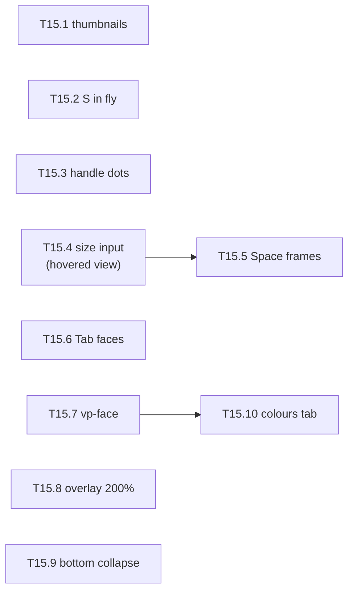

# Joole – Build 3 work order (TODO phase 1.5)

This document is the work order for phase 1.5 ("More features and fixes") of [`TODO.md`](../TODO.md): eleven fixes and features found while using the build-2 editor. It breaks the TODO items into work packages, puts them in order, and gives each one its design, scope, tests and acceptance criteria. It continues [50-build2.md](50-build2.md), which did the same for phase 1.

Status: draft, 27.11.2026. The normative sources are unchanged: [00-spec.md](00-spec.md) says what to build, [10-stack.md](10-stack.md) says which technologies to use, and [AGENTS.md](../AGENTS.md) says how to work. This document only sets the order and slicing of the work, plus the design proposals that the spec will absorb. **Each work package updates the spec in the same change.** Where this document and the spec disagree after a WP is done, the spec wins and this document is corrected.

## How to use this document

- **Work packages** have IDs of the form `T15.<n>` (TODO phase 1.5, package _n_). The TODO items continue phase 1's numbering: `#25` is the first phase-1.5 item and `#35` the last.
- Each WP has the same parts as in build 2: _Goal_, _Current state_, _Design_, _Scope_, _Tests_, _Docs_, _Depends on_ and _Done when_. WPs marked ⇄ do not depend on the WPs right before them.
- **Delivery:** one branch, `feature/build3-phase1.5`, and one pull request. Each WP is its own commit, or a small series of commits (for example a `test:` commit before its `feat:`). The first commit adds the phase-1.5 TODO items and this plan. Verification fixes (baselines, test adjustments) are separate `test:` commits at the end. The PR title follows Conventional Commits, because it becomes the squash commit on `main`.
- **Status:** tick a WP's checkbox in the same commit that finishes it. The checkboxes are the progress record when work resumes after a context reset.
- **The Definition of Done of build 2 applies to every WP:** tests first for `app/` and `core/` code; `pnpm check` passes, and `pnpm e2e` for UI and renderer changes; the layer rules hold without `eslint-disable`; the spec, the manual, the design system and this document are updated in the same commit; screenshot baselines change only on purpose, and the commit message says why.

## Implementation notes

Operational facts carried over from build 2:

- **Kill the stale preview server before every local Playwright run** (`ss -tlnp | grep 4173`, kill the pid). An old `vite preview` on port 4173 serves an old `dist/`.
- **Run the local suite with `--workers=2`.** The default worker count on a many-core machine starves the software-GL browsers and produces timeouts that are not regressions. CI's runners use two workers.
- **Browsers report `button` as -1 on every `pointermove`.** Tools never filter move events by button.
- **Fly mode in E2E runs on a Pointer Lock stand-in** (an init script in the `ui.spec.ts` fly test that fakes `pointerLockElement`, `requestPointerLock` and `pointerlockchange`). Playwright's WebKit denies the real lock, and headless Chromium starves Playwright's input and `evaluate` calls while the real lock is held (verified 27.11.2026: held keys, clicks and evaluations time out). Reuse the stand-in for any new fly-mode test.
- Playwright 1.65 has `page.clock.fastForward`, not `tick`. Solid 2 has `Element` (not `JSX.Element`) and `onSettled` (not `onMount`); values read once from props go through `untrack`.
- **`tokens.css` and `components/bundle.css` say "generated from tokens.json", but the repository has no generator script.** A token change edits `tokens.json`, `tokens.css` and `bundle.css` by hand, in step.
- One-off probe and screenshot-capture specs go in `tests/e2e/` temporarily and are deleted before committing.

## Clarified requirements (27.11.2026)

The owner answered these questions before planning. Each WP records its answer in the spec's _Decisions_ section when it merges.

| TODO item                  | Question                                                                                     | Answer                                                                                                                                                                                                      |
| -------------------------- | -------------------------------------------------------------------------------------------- | ----------------------------------------------------------------------------------------------------------------------------------------------------------------------------------------------------------- |
| #29 brush size input       | Which point of the new brush is the clicked "origin"?                                        | **The centre of the brush.** The clicked point, snapped to the grid, becomes the box centre on the view's two axes. The depth is centred on the view's working plane.                                       |
| #29 editing a selection    | How does the size input open for the selected brush in Select?                               | **The Enter key.** Enter opens the input in the hovered 2D view, prefilled with the selection's current size in that view's orientation.                                                                    |
| #30 Space "~50% out"       | Zoom out from the current zoom, or a fixed framing?                                          | **A fixed framing:** the selection fills about half of the view's width or height, whatever the zoom was before.                                                                                            |
| #35 configurable colours   | Which colours are configurable?                                                              | **Viewport and UI colours:** every colour token of the design system — the `vp-*` view tokens and the UI tokens (surfaces, lines, ink, accent, select, status colours). The overrides are stored per theme. |
| #29 off-grid sizes         | A typed size that is not an even multiple of the grid puts the faces off the grid. Nudge it? | **No.** The clicked point is the exact centre and the typed size is exact; the faces may be off the grid.                                                                                                   |
| #27 dot size               | How much larger?                                                                             | **A setting:** 14 px by default (twice the old size), with a Handle size slider in Settings → General.                                                                                                      |
| #35 view colours           | Shared by both themes, or per theme?                                                         | **Per theme**, like the interface colours: every override belongs to the theme it was made in.                                                                                                              |
| #34 errors while collapsed | Open the panel on an error?                                                                  | **No.** The panel stays collapsed and the Log tab shows an error marker with a count until it is opened.                                                                                                    |

## Findings from the code review

Checked against `main` at `271be2e` on 27.11.2026.

| Item | Finding                                                                                                                                                                                                                                                                                                                                                                                                                                                                                                           |
| ---- | ----------------------------------------------------------------------------------------------------------------------------------------------------------------------------------------------------------------------------------------------------------------------------------------------------------------------------------------------------------------------------------------------------------------------------------------------------------------------------------------------------------------- |
| #25  | Two causes in `TextureBrowser.tsx`. The `.thumb` class fixes the canvas at `64px × 64px` in CSS, so a larger backing canvas is shrunk back to 64 px. `ThumbCanvas` also caps the draw scale at 1 (`Math.min(size / w, size / h, 1)`), so a 64 × 64 texture never grows past its own size. The cells follow the slider, but the images do not.                                                                                                                                                                     |
| #26  | In `EditorShell` `keyDown`, `S` maps to `tool-select` before the fly keys are checked. In pointer-lock mode the tool branch is skipped (`!pointerLocked`), but the generic `if (action) { preventDefault(); return; }` returns before `flyKeys.add('s')`. W, A and D have no shortcut action, so only S is lost. The manual already lists this as a known gap. `shortcutAction` also has a duplicate `case 'e'`.                                                                                                  |
| #27  | `handle.vert.glsl` draws idle dots at 7 CSS px and hover/active dots at 9 px. `VertexTool.pickHandle` uses the generic 4 px `event.tolerance`, so the hit target is smaller than the visible dot.                                                                                                                                                                                                                                                                                                                 |
| #28  | `VertexTool.pointer` returns `handles: this.handleDots()` together with the move command. `handleDots()` reads `this.getDocument()`, which is the document **before** the shell runs that command, so the dots always show the previous step's geometry. The shell sets the dots only from tool outputs (`applyToolFeedback`), and a `tool` event clears them. So the dots are also stale after Ctrl+Z or Ctrl+Y in vertex mode, and missing right after the tool is chosen, until the pointer moves over a view. |
| #29  | `BrushTool` returns no command when the release point equals the press point after snapping (`min[axis] === max[axis]`), so a click does nothing. There is no inline input component. `SelectTool` scale mode (T1.10) already scales a selection about an anchor with grid-snapped factors, and the size-edit path can reuse its scale command.                                                                                                                                                                   |
| #30  | Space is unbound. `render/camera.ts` already has `frameOrtho(axis, box, w, h, margin)` and `framePerspective(box, aspect, yaw, pitch)`. A margin of 0.5 per side gives exactly the 50% framing. `framePerspective` has no distance factor. The shell has no "hovered view" state; it has `activeView`, which follows clicks.                                                                                                                                                                                      |
| #31  | `app.stepTextureFocus(±1)` (T1.6) is the Properties ◀ ▶ action. Tab is handled only for the Clip tool. Everywhere else the browser moves focus.                                                                                                                                                                                                                                                                                                                                                                   |
| #32  | `GeometryCache.setFaceHighlight` puts the face outlines into the selected-line pass (`vp-select`), and the 3D fill uses `vp-select` at 35% opacity, so a focused face looks the same as its selected brush. No yellow face token exists. `vp-handle` is yellow (`#ffd60a`). The design system says selection "is never shown in any other color", which this item changes on purpose.                                                                                                                             |
| #33  | `ToolHint.module.css` sizes the chip in absolute pixels: a 16 px icon, a 13 px name, an 11 px keycap and a 12 px description.                                                                                                                                                                                                                                                                                                                                                                                     |
| #34  | The bottom panel has a height splitter (`bottomHeight`, persisted) but cannot be collapsed. Tree is the default tab.                                                                                                                                                                                                                                                                                                                                                                                              |
| #35  | The renderer reads every view colour from the computed style (`readViewportColors`, `VIEWPORT_COLOR_TOKENS`) and has `refreshColors()` for theme changes. The UI reads the same CSS custom properties. Setting an override as an inline custom property on `<html>` reaches both with no renderer change. The `vp-*` defaults are the same in both themes; the UI tokens differ. The settings dialog has no tabs; General and Views are sections of one form.                                                     |

## Shared foundations

| Foundation                                                                                                        | Built in | Reused by                        |
| ----------------------------------------------------------------------------------------------------------------- | -------- | -------------------------------- |
| **Size input:** `parseSizeInput` and the view-orientation mapping in `app/`, and the `SizeInput` overlay in `ui/` | T15.4    | the Select-mode size edit        |
| **Hovered-view state** in the shell (the view under the pointer, or the last one)                                 | T15.4    | T15.5                            |
| **`vp-face` token** and a separate face-outline line batch in the renderer                                        | T15.7    | T15.10 (it is configurable)      |
| **Colour token catalogue** in `app/`: every configurable token with its label, group and per-theme default        | T15.10   | the manual and the design system |

## Overview and order

The order follows the TODO priority. Two items are combined because they change the same code (#27 and #28, the handle dots). T15.7 comes before T15.10 because the colours tab must include the new face colour.

| WP     | TODO items | Summary                                                                       | Depends on |
| ------ | ---------- | ----------------------------------------------------------------------------- | ---------- |
| T15.1  | #25        | Thumbnail images follow the size slider                                       | –          |
| T15.2  | #26        | S moves the fly camera backwards                                              | – ⇄        |
| T15.3  | #27, #28   | Larger handle dots that stay on the dragged element                           | – ⇄        |
| T15.4  | #29        | Typed brush size: a click in Brush mode, Enter in Select mode                 | –          |
| T15.5  | #30        | Space frames the selection in the hovered view                                | T15.4      |
| T15.6  | #31        | Tab and Shift+Tab step through the faces in the texture tool                  | – ⇄        |
| T15.7  | #32        | The focused face is outlined in yellow (`vp-face`)                            | –          |
| T15.8  | #33        | Tool overlay at 200% size                                                     | – ⇄        |
| T15.9  | #34        | Collapsible bottom panel, collapsed by default                                | – ⇄        |
| T15.10 | #35        | Settings tabs (General, Colors), per-theme colour overrides and Reset colours | T15.7      |

None of the WPs changes the `.map` or `.joole.json` format. The settings gain new keys; `parseSettings` already keeps unknown keys and fills missing ones, so stored settings from phase 1 load unchanged.

## Work packages

### [x] T15.1 Thumbnail images follow the size slider (#25)

**Goal:** moving the thumbnail slider scales the texture images, not only their cells.

**Current state:** see the finding for #25.

**Design:**

- The canvas gets its CSS size from the `size` prop (an inline `width`/`height` style), and the fixed 64 px rule in `.thumb` is removed. The backing size becomes the CSS size times `devicePixelRatio` (today it is the CSS size, with no ratio), so the thumbnail is sharp on HiDPI screens.
- The draw scale is `min(size / w, size / h)` with no cap, so small textures scale up. Upscaling stays pixelated (`imageSmoothingEnabled = false`, `image-rendering: pixelated`), which is how a texel grid should look. Non-square textures keep their aspect ratio and are centred.
- Cached `ImageBitmap`s are redrawn, never reconverted (unchanged from T1.12).

**Scope:** `ui/TextureBrowser.tsx`, `ui/TextureBrowser.module.css`.

**Tests:**

- E2E (`dock.spec.ts`): set the slider to its maximum and check that the first tile's canvas has a bounding box of the slider size, and that the drawn pixels cover more than the 64 px default (sample a pixel outside the old 64 px square).
- The thumbnail screenshot in the manual is retaken at the end of the phase.

**Docs:** design system TextureBrowser (the image scales with the slider; upscaling is pixelated).

**Depends on:** –

**Done when:** at every slider position the images fill their cells, sharp and centred, in all three browsers.

### [x] T15.2 S moves the fly camera backwards (#26) ⇄

**Goal:** W, A, S and D all move the camera in pointer-lock fly mode.

**Current state:** see the finding for #26.

**Design:**

- In `keyDown`, the fly keys are checked **before** shortcut dispatch while pointer lock is active. In fly mode W, A, S and D belong to the camera, which matches the existing rule "tool keys never fire while 3D fly mode owns WASD".
- The decision is pulled out of the shell into a small pure helper, `flyKey(key, pointerLocked)`, so it can be unit tested without pointer lock. That matters because Playwright's WebKit denies pointer lock (Gate T1).
- Remove the duplicate `case 'e'` in `shortcutAction`.

**Scope:** `ui/EditorShell.tsx`, the helper next to `ui/cameras.ts` (UI-only logic, so it stays in `ui/`), `app/shortcuts.ts`.

**Tests:**

- Unit: `flyKey` returns the key for w/a/s/d (either case) when locked and `null` when not locked. `shortcutAction` still maps S to `tool-select` without a lock.
- E2E (`ui.spec.ts`): hold W, then S, and check that the S step is opposite to the W step. The fly test now runs on a Pointer Lock stand-in in every browser (see _Implementation notes_).

**Docs:** manual — remove the S entry from _Current UI gaps_; spec shortcut map note.

**Depends on:** –

**Done when:** S moves the camera backwards in fly mode and still selects the Select tool outside it.

### [ ] T15.3 Larger handle dots that stay on the dragged element (#27, #28) ⇄

**Goal:** the vertex, edge and face dots are easier to see and hit, and during a drag the dot sits exactly where the element is.

**Current state:** see the findings for #27 and #28.

**Design:**

- **Size:** a new persisted setting **`handleSize`**, the idle dot's diameter in CSS px: default **14** (twice today's 7), range 7–28. Hover and active dots are 9/7 of it (18 px by default), as today. The renderer gets the size through a `setHandleSize` call and passes it to the handle shader as a uniform instead of the literals. Settings → General gets a **Handle size** slider that applies at once.
- **Hit target:** `VertexTool.pickHandle` uses its own pick radius, half the idle dot size, converted to world units with the view's pixel ratio, instead of the generic 4 px tolerance. The shell passes the radius in the tool event (`handleRadius`), so the visible dot and the hit target always match the setting. When two dots overlap, the nearest still wins.
- **No lag:** `handleDots` takes an optional replacement brush. During a drag, the move branch builds the dots from the moved brush it has just computed (`result.value`), not from the document that has not yet been changed. The rejected branch keeps returning the last valid dots. **Refresh on every change:** `EditorApp` exposes the active tool's current dots (`handleDots()`, empty outside the vertex and face tools), and the shell sets them after every document, selection and tool event. That covers the end of a drag, undo and redo, and choosing the tool with the pointer outside the views. The hover state still comes from pointer moves.
- The same "computed from the pre-command document" pattern is checked in the other tools that return previews with commands (SelectTool move/rotate/scale, the clip tool). Any that lag are fixed in this WP and noted in the commit.

**Scope:** `app/settings.ts` (`handleSize`), `app/tools.ts` (`VertexTool`), `app/editor.ts` (`handleDots()`), `render/shaders/handle.vert.glsl`, `render/renderer.ts`, `ui/EditorShell.tsx` (the refresh and the radius), `ui/SettingsDialog.tsx` (the slider), `main.ts`.

**Tests:**

- Unit (written first): a vertex drag of (+16, +16) returns dots whose active dot equals the vertex's **new** position; an edge drag's active dot is the moved midpoint; a rejected step returns the previous valid dots. With the default size, a pick 6 px from a dot centre hits and 9 px misses; with `handleRadius` doubled, 12 px hits. `parseSettings` defaults `handleSize` to 14 and rejects values outside 7–28. After an undo, `handleDots()` matches the restored brush.
- E2E (`vertex.spec.ts`): drag a vertex two grid steps, stop without releasing, read the handle positions through the test hook (`joole.stats()` gains a `handles` field if it has none) and compare them with the brush's vertices.
- Screenshot baselines that show dots change on purpose.

**Docs:** design system Handle (sizes, the setting and the hit radius); spec rendering overlays and settings; manual vertex/edge/face and settings sections.

**Depends on:** –

**Done when:** dots are 14 px by default and follow the Handle size setting, the hit target matches the dot, and during and after a drag, undo or redo the active dot is on the element in 2D and 3D.

### [ ] T15.4 Typed brush size: a click in Brush mode, Enter in Select mode (#29)

**Goal:** a brush can be created, or the selection resized, by typing its size.

**Current state:** see the finding for #29.

**Design:**

- **Parsing (app):** `parseSizeInput(text)` returns a result: three positive, finite numbers separated by spaces, commas or both (`"128 64 32"`, `"128,64,32"`, `"128, 64, 32"`). Decimals are allowed. Nothing typed is snapped: the size is exact and the clicked point is the exact centre, so faces may be off the grid (owner decision). Anything else is an error with a short message (`Enter three sizes, such as 128 64 32`). Zero and negative sizes are errors.
- **Orientation (app):** `sizeAxes(view)` maps the typed X Y Z to world axes as _width, height, depth_ of the view: Top → x, y, z; Front → x, z, y; Side → y, z, x. The 3D view never opens the input.
- **Creating (Brush mode):** a press and release that produce no extent after snapping (the current no-op) returns a new `sizePrompt` output: the view, the snapped click point, and the prefill (empty, with the last typed size as the placeholder). The shell opens `SizeInput` there. Enter creates the brush with the **current primitive and side count**, centred on the clicked point on the view's two axes and on the working plane along the depth (the same plane as drag painting, T1.2). It is one undo step and the new brush is selected — the same command as a drag-painted brush, built by the existing `createPrimitiveBrush`. The last valid size is remembered for the session.
- **Editing (Select mode):** Enter with a resizable selection (one that T1.10's scale handles accept) opens the input in the hovered 2D view, prefilled with the selection's current size in that view's orientation (`128 64 32`, trimmed trailing zeros). The field sits at the selection's centre in that view. Enter resizes the selection's bounding box to the typed size **about its centre**, with the transform command the resize drag uses (`createTransformCommand` with a scaling about a point, here on all three axes), as one undo step. An axis on which the selection is flat keeps its size. Non-box brushes scale like a resize drag. With no resizable selection, Enter does nothing. Enter keeps its normal meaning when a button or another control has keyboard focus (the focus rule of T15.5).
- **Hovered view (shell):** a new `hoveredView` signal follows `pointermove`/`pointerleave` over the views and keeps the last view when the pointer leaves. If it is the 3D view, the most recent 2D view is used, and Top if there was none.
- **`SizeInput` (ui):** a small text field drawn over the view at the click point (clamped inside the view), focused on open, with `aria-label="Brush size, width height depth"`. Enter applies, Escape and blur cancel. An invalid value keeps the field open with `aria-invalid` and the message under it; nothing is created. While it is open, keyboard shortcuts do not fire (it is an editable target). Styles use the design-system input tokens.
- Enter is already used by the Clip tool; that branch runs first and only in Clip mode, so there is no conflict. The open prompt is cancelled when the tool changes or the document is replaced.

**Scope:** `app/sizeInput.ts` (new, parsing and axes), `app/tools.ts` (`BrushTool` click output), `app/editor.ts` (`createBrushAt`, `resizeSelectionTo`), `ui/SizeInput.tsx` + CSS module (new), `ui/EditorShell.tsx`.

**Tests:**

- Unit (written first): `parseSizeInput` — the separators, decimals, wrong count, zero, negative, junk. `sizeAxes` for every view. `BrushTool` returns `sizePrompt` on a zero-extent click and still creates on a drag. `createBrushAt` in the Front view builds a box of x × z × y with the clicked point at its centre. `resizeSelectionTo` keeps the centre and lands on the typed size; one undo restores the original.
- E2E (new `sizeInput.spec.ts`): Brush tool, click in Top, type `128 64 32`, Enter → one new brush with that size, centred on the snapped click point; Escape cancels; an invalid entry shows the message and creates nothing. Select a brush, hover Front, Enter, check the prefill, type a new size, Enter → resized; Ctrl+Z restores it.

**Docs:** spec (tool behaviour, the orientation mapping, the decision "the clicked point is the centre"); design system SizeInput (new component, preview page); manual Brush tool and Select sections; shortcut table (Enter in Select).

**Depends on:** –

**Done when:** both flows work in all three 2D views with the right orientation, each in one undo step, and invalid input never changes the document.

### [ ] T15.5 Space frames the selection in the hovered view (#30)

**Goal:** Space centres the hovered view on the selection, with the selection filling about half of the view.

**Current state:** see the finding for #30.

**Design:**

- `shortcutAction` maps Space (no modifiers) to `frame-selection`. It does nothing while pointer lock is active or an editable field has focus.
- **Focus rule (shared with T15.4 and T15.6):** a toolbar button keeps the focus after a mouse click, and Space would press it again. So the shortcut is taken when the focused element is the page body, inside the views, or a control that does **not** match `:focus-visible` (it was focused by the mouse). A control focused with the keyboard keeps Space, Enter and Tab for itself, so keyboard operation of the panels is unchanged. The rule is one helper in `ui/`, `viewShortcutAllowed(target)`. _Decision to record._
- The target is the selection's bounding box: brushes, entities and groups alike. The TODO says "a brush"; framing any selection is the natural generalisation and costs nothing. _Decision to record._ With an empty selection, Space does nothing.
- **2D view:** `frameOrtho(axis, box, w, h, 0.5)` gives the 50% framing. The camera keeps its depth coordinate so the working plane for new brushes does not jump. A box that is flat in this view (zero extent on one axis) is framed by its other axis.
- **3D view:** the camera keeps its yaw and pitch and moves back along its forward axis so the selection's bounding sphere fills half of the narrower field of view. `framePerspective` gains a `fill` parameter (default 1/1.05 for the existing callers, 0.5 here).
- The view is the hovered view from T15.4. Only that view moves.

**Scope:** `app/shortcuts.ts`, `app/editor.ts` (`selectionBounds()` if not already available), `render/camera.ts` (`framePerspective` fill), `ui/EditorShell.tsx`.

**Tests:**

- Unit: `shortcutAction(' ')` is `frame-selection`, and Shift/Ctrl+Space is not. `frameOrtho` with margin 0.5 makes the box half the view. `framePerspective` with fill 0.5 is twice as far away as with fill 1.
- Unit: `viewShortcutAllowed` for the body, a view, a mouse-focused button and a keyboard-focused button.
- E2E: select a brush, click the grid-lock toolbar button so that it holds mouse focus, hover Front, press Space → the button is not pressed again, and the brush's screen rectangle is centred and about 50% (±5%) of the view's limiting dimension; the other views did not move.

**Docs:** spec shortcut map and camera behaviour; manual navigation section and shortcut table.

**Depends on:** T15.4 (hovered view).

**Done when:** Space frames the selection in whichever view is under the pointer, 2D and 3D.

### [ ] T15.6 Tab and Shift+Tab step through the faces in the texture tool (#31) ⇄

**Goal:** Tab is a keyboard shortcut for the Properties "next face" button.

**Current state:** see the finding for #31.

**Design:**

- With the texture tool active, Tab calls `app.stepTextureFocus(1)` and Shift+Tab calls `stepTextureFocus(-1)` — the same wrap-around order as ◀ ▶, including the "whole brush" stop.
- **Focus stays reachable:** the focus rule of T15.5 applies. When a control has keyboard focus, Tab keeps moving focus, so keyboard users are not trapped in texture mode. _Decision to record._
- Nothing happens (and Tab behaves normally) when no brush is in focus.

**Scope:** `ui/EditorShell.tsx` (the key branch next to the Clip-tool Tab handling).

**Tests:**

- E2E (`texture.spec.ts`): texture tool, pick a face, press Tab three times and check the Properties face counter advances and wraps like the ▶ button; Shift+Tab steps back; with focus on a dock button, Tab moves focus instead.

**Docs:** manual texture tool section and shortcut table; spec shortcut map.

**Depends on:** –

**Done when:** Tab and Shift+Tab step through the faces in the views and leave panel focus order alone.

### [ ] T15.7 The focused face is outlined in yellow (#32)

**Goal:** in the texture tool, the focused face stands out from its red selected brush.

**Current state:** see the finding for #32.

**Design:**

- New token **`--vp-face: #ffd60a`** in both themes (the handle yellow; a separate token so it can be changed on its own in T15.10). It is added to `VIEWPORT_COLOR_TOKENS`, `tokens.json`, `tokens.css` and `components/bundle.css` (by hand; see _Implementation notes_).
- The face outlines move from the selected-line pass into their own line batch drawn in `vp-face`, after the selected outlines so they win where they overlap, in every view. In 3D they are depth-tested like the other selected lines.
- The 3D face fill changes from `vp-select` to `vp-face`, still at 35% opacity, so fill and outline agree.
- The design-system rule for `vp-select` gains one exception: the texture tool's focused face is yellow. _Decision to record._

**Scope:** `docs/design-system/tokens.css`, `tokens.json`, `render/colors.ts`, `render/geometryCache.ts`, `render/renderer.ts`.

**Tests:**

- Unit: `readViewportColors` reads `vp-face`.
- E2E (`texture.spec.ts`): pick a face with the brush deselected and selected; sample the canvas along the face outline in a 2D view and check the pixel is yellow, not red. Affected screenshot baselines change on purpose.

**Docs:** design system tokens and ViewportPane; spec rendering overlays; manual texture tool section.

**Depends on:** –

**Done when:** a focused face is yellow in all four views while its brush stays red.

### [ ] T15.8 Tool overlay at 200% size (#33) ⇄

**Goal:** the tool overlay is easy to read at a glance.

**Current state:** see the finding for #33.

**Design:**

- Every dimension of the chip doubles: the icon to 32 px, the name to 26 px, the keycap to 22 px, the description to 24 px, and the padding, gap and border radius. The sizes stay in `ToolHint.module.css`; one `--hint-scale: 2` custom property multiplies the base sizes, so a later setting can change it without touching the rules.
- The chip gets `max-width: calc(100% - 2 * var(--space-lg))` and the description may wrap, so it still fits a maximised view at 1280 × 720.
- Behaviour (timing, the off switch in settings) is unchanged.

**Scope:** `ui/ToolHint.module.css`, `ui/Icon` size prop if the icon size is fixed there.

**Tests:**

- E2E (`toolHint.spec.ts`): the chip's height is at least twice the phase-1 height (measured as a constant in the test), and the chip stays inside the views at 1280 × 720.

**Docs:** design system ToolHint (README and preview page).

**Depends on:** –

**Done when:** the overlay is twice as large and fits the views at the smallest supported window.

### [ ] T15.9 Collapsible bottom panel, collapsed by default (#34) ⇄

**Goal:** the bottom panel (Tree, Prefabs, Log) gives its space to the views until it is needed.

**Current state:** see the finding for #34.

**Design:**

- New persisted setting **`bottomCollapsed`, default `true`**. Users upgrading from phase 1 have no stored value, so they also start collapsed. _Decision to record._
- Collapsed, the panel shows only its tab strip (one title-bar height). A disclosure button at the strip's start collapses and expands it, with `aria-expanded` and the same chevron as `DockSection`. Clicking a tab while collapsed expands the panel on that tab. The height splitter is hidden while collapsed, and the stored `bottomHeight` is kept for the next expand.
- **Errors stay visible without opening the panel:** while the panel is collapsed, or another tab is selected, the Log tab shows an error marker — the error icon and the count of _error_ entries added since the Log tab was last shown (`Log ⚠ 2`, with `aria-label="Log, 2 new errors"`). Icon and number, not colour alone. Opening the Log tab clears it. The panel never opens by itself.
- The view title-bar shortcuts F1–F4 on the strip stay visible when collapsed.

**Scope:** `app/settings.ts`, `ui/PanelTabs.tsx`, `ui/EditorShell.tsx` + CSS module, `main.ts` (persistence is generic).

**Tests:**

- Unit: `parseSettings` defaults `bottomCollapsed` to true and keeps a stored false. The new-error count (a small pure function in `app/` over the log entries and the last-seen entry id) counts only _error_ entries after the last one seen.
- E2E (`dock.spec.ts`): a fresh profile starts collapsed; clicking Tree expands; the disclosure button collapses; the state survives reload; a compile error shows the marker with its count on the collapsed Log tab, and opening the tab clears it. Existing specs that use the Tree, Prefabs or Log tab expand the panel first (a helper in the shared test utilities).

**Docs:** spec default layout and settings; design system PanelTabs (the collapse button and the error marker) and Layout; manual panels section; screenshots retaken.

**Depends on:** –

**Done when:** the panel starts collapsed, expands and collapses by button or tab, remembers its state, and marks new errors on the Log tab.

### [ ] T15.10 Settings tabs, colour overrides and Reset colours (#35)

**Goal:** every colour of the editor can be changed in Settings and reset to the defaults.

**Current state:** see the finding for #35.

**Design:**

- **Tabs:** the Settings dialog gets a tab list with **General** and **Colors**. General holds everything the dialog has today (the theme, views, grid, thumbnails, tool overlay, CSG grouping). The tabs follow the `PanelTabs` keyboard pattern (arrow keys, roving tabindex, `role="tablist"`), and the focus trap of `Dialog` still holds.
- **Catalogue (app):** `app/colors.ts` lists every configurable token with a label, a group and its default per theme: the **Views** group (`vp-bg`, the grid and axis colours, brush, selection, face, entity, target, handle, invalid, leak, sky, tool faces, scope dim, label) and the **Interface** group (`surface-0`…`surface-3`, `line`, `line-strong`, `ink`, `ink-muted`, `ink-disabled`, `accent`, `on-accent`, `accent-soft`, `focus-ring`, `select`, `on-select`, `warn`, `error`, `ok`). Shadows, spacing, sizes and fonts are not colours and are not included. A unit test keeps the catalogue in step with `tokens.json`, so a new colour token cannot be forgotten.
- **Storage:** a new setting **`colors: { dark: Record<token, '#rrggbb'>, light: Record<token, '#rrggbb'> }`** holds only the changed tokens. `parseSettings` gets a check for this nested value that drops unknown tokens and invalid values instead of rejecting the whole object. `updateSettings` merges only the top level, so a colour change always passes the complete `colors` object. The Colors tab edits the overrides of the **current theme**, and its heading names the theme.
- **Applying (ui/main):** the overrides of the current theme are written as inline custom properties on `document.documentElement` (`--vp-select: #…`). Removing an override removes the property, so the token file's value returns. On a theme change the inline properties are swapped. After every change the renderer's `refreshColors()` runs, so the views redraw at once. No renderer or component code changes beyond that.
- **Controls:** each row has a colour swatch input (`<input type="color">`, six-digit hex) and the hex value as text; a changed row shows a small per-row reset button. **Reset colours** at the bottom of the tab removes all colour overrides of **both** themes, after which everything is back to the design system. It is one action with no confirmation, like the existing "Reset to defaults" (which now also clears colours).
- **Contrast:** the user can choose colours with poor contrast; no check blocks it. Reset colours is the way back. _Decision to record._
- Colours apply immediately and persist like the other settings (debounced save, merge-safe).

**Scope:** `app/colors.ts` (new), `app/settings.ts`, `ui/SettingsDialog.tsx` + CSS, `ui/EditorShell.tsx` (applying the overrides, theme switch), `main.ts` (`refreshColors` wiring), `docs/design-system/tokens.json` reference in the test.

**Tests:**

- Unit (written first): the catalogue matches every colour token in `tokens.json` for both themes; `parseSettings` keeps valid overrides and drops bad ones; resetting colours clears both themes and leaves the other settings alone.
- E2E (new cases in `settings.spec.ts`): open Settings, switch to Colors with the keyboard, set `vp-select` to blue, close, select a brush and sample a blue outline pixel; reload and it is still blue; switch to the light theme and the dark override does not apply; Reset colours restores red. Change an Interface colour (`surface-1`) and check the computed style of a panel.

**Docs:** spec settings (the colour overrides and the tabs, the decisions); design system Dialog (tabs) and tokens README (overrides exist); manual settings section with a new screenshot.

**Depends on:** T15.7 (`vp-face` is in the catalogue).

**Done when:** every colour token can be changed per theme from the Colors tab, the views and panels update at once, the choice persists, and Reset colours returns every colour to its default.

## Phase gate

**[ ] Gate T15:**

- [ ] All eleven phase-1.5 TODO items are accepted by the owner in the running editor (owner work).
- [ ] `pnpm check` and `pnpm e2e` (Chromium, Firefox, WebKit) are green, locally with `--workers=2` and in CI.
- [ ] The manual's screenshots are retaken where the UI changed (the texture browser, the collapsed bottom panel, the overview, Settings with the Colors tab, the size input).
- [ ] The decisions marked _to record_ are in the spec's _Decisions_ section.

## Documentation impact summary

| Document              | Changes                                                                                                                                                                                                            |
| --------------------- | ------------------------------------------------------------------------------------------------------------------------------------------------------------------------------------------------------------------ |
| `docs/00-spec.md`     | the shortcut map (Space, Tab in the texture tool, Enter in Select, S in fly mode), typed brush size, camera framing, handle sizes, the face colour, the settings (tabs, colours, `bottomCollapsed`), the decisions |
| `docs/design-system/` | tokens (`vp-face`), new SizeInput component, updates to Handle, TextureBrowser, ToolHint, PanelTabs, Layout, Dialog (tabs) and ViewportPane                                                                        |
| `manual/README.md`    | Brush and Select (typed size), navigation (Space), the texture tool (Tab, yellow face), panels (collapsed bottom panel), settings (Colors), shortcuts, _Current UI gaps_ (S fixed), screenshots                    |
| `docs/10-stack.md`    | no change: no new dependencies                                                                                                                                                                                     |
| `AGENTS.md`           | the documentation table entry for this file mentions phase 1.5                                                                                                                                                     |

## Risks

| Risk                                                                                         | Mitigation                                                                                                                         | WP     |
| -------------------------------------------------------------------------------------------- | ---------------------------------------------------------------------------------------------------------------------------------- | ------ |
| Larger dots cover each other on small brushes at low zoom                                    | The nearest dot wins; the Handle size setting lets the user choose; the sizes are named constants, easy to tune after owner review | T15.3  |
| Every E2E spec that uses the Tree, Prefabs or Log tab breaks when the panel starts collapsed | One shared "expand the bottom panel" helper, updated in the same commit                                                            | T15.9  |
| A user picks unreadable colours                                                              | Reset colours and per-row reset; overrides are per theme, so the other theme stays usable                                          | T15.10 |
| A click meant as a tiny drag opens the size input                                            | The input opens only when the snapped extent is zero; Escape or a click elsewhere cancels it with no change                        | T15.4  |
| Tab handling traps keyboard focus                                                            | Tab is captured only when focus is on the page or the views                                                                        | T15.6  |
