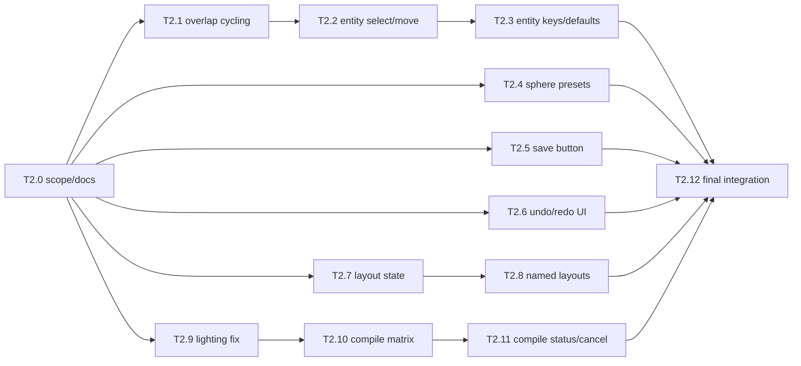

# Build 5 – work order for the TODO phase-2 items

**Status:** active work order. Implementation has started on `phase-2`.  
**Base:** `main` at `e73d6e9` / `v1.5.0`, plus the owner's currently uncommitted `TODO.md` Phase-2 list.  
**Branch:** `phase-2` (owner decision).  
**Integration:** one pull request, merged without squashing so the small feature commits remain visible.  
**Version:** no version bump in this branch (owner decision). Release numbering is decided later.

## 1. Scope after clarification

The raw Phase-2 list contained several items that are already implemented or conflicted with the normative spec. The owner clarified the scope as follows.

### In scope

1. Closest-first overlap cycling in 2D views.
2. Point-entity selection and movement in the views; brush-entity selection/movement as whole objects where the object model already allows it.
3. All documented entity keys visible in the entity panel, including `worldspawn`, with verified defaults where a trustworthy source defines them.
4. Qoole-like sphere presets instead of a numeric sphere side count: 14-, 18-, 20- and 26-sided convex brush approximations.
5. User-arrangeable panel layout state and named, persistent panel layouts managed in a Settings **Layout** tab.
6. Undo/redo UI wiring. The disabled Save toolbar button is also wired as a small adjacent fix because it is already implemented behind Ctrl+S but impossible to click.
7. Compile lighting investigation and fixes, test-first.
8. Compile matrix: BSP always runs; independent VIS and lighting controls; lighting quality selector.
9. Compile activity indication: spinner/current stage plus an always-available cancel button. A true percentage bar is explicitly not required.

### Explicitly out of scope / removed from the Phase-2 list

- **BSP import** – dropped by the owner. The spec's “no decompiling” rule remains unchanged. Test-only BSP lump readers are allowed for compile verification; they are not product import features.
- **MAP import** – already exists through File → Open Map; the owner confirmed the item was a mistake.
- **MAP export** – already exists through File → Export `.map`; the owner confirmed the item was a mistake.
- **Project create/save/load lifecycle** – the existing `.joole.json` open/save implementation is accepted for Phase 2. Only the disabled Save toolbar button is wired.
- **True compile percentages** – the owner chose spinner/current-stage feedback rather than output parsing or C-tool instrumentation.
- **Full docking/floating windows** – the owner chose bounded named panel layouts, not free docking.
- **Qoole `.qle` import** – remains Phase 99.

These removals must be reflected in `TODO.md` and the spec decisions in the first commit, so the repository no longer contradicts the approved scope.

## 2. Implementation process

1. Create `phase-2` from clean `main` after preserving the owner's `TODO.md` edit.
2. **Commit 0 / T2.0** is documentation-only: the updated `TODO.md`, spec scope decisions, and this `docs/50-build5.md` work order.
3. Each following commit is one feature or fix (`T2.<n>`), following the repository's test-first rule.
4. Do not squash the PR. The commit sequence is part of the requested deliverable.
5. Every commit runs the relevant fast checks; before the PR, run the full verification matrix:
   - `pnpm check`
   - `pnpm e2e` in Chromium, Firefox and WebKit where the affected surface requires it
   - compile tests that use the real WASM tools
   - screenshot-baseline review for deliberate UI changes
6. Follow the operational caveats in `AGENTS.md` and earlier build notes: kill stale `vite preview` processes before e2e, expect local/CI rendering differences in screenshots, do not parallel-overload Firefox on WSL, and preserve the sensitive `EditorShell` effect ordering.
7. Update documentation in the same commit as the behavior: spec decisions where normative behavior changes, the manual for user-visible workflows, design-system docs for new/changed components, and `docs/50-build5.md` package status.

## 3. Work-package order

| WP    | Commit feature                                                     | Depends on |
| ----- | ------------------------------------------------------------------ | ---------- |
| T2.0  | Phase-2 scope and build-5 work order                               | –          |
| T2.1  | Closest-first 2D overlap cycling                                   | T2.0       |
| T2.2  | Entity picking, selection bounds and movement                      | T2.1       |
| T2.3  | Complete entity-key rows, worldspawn editing and verified defaults | T2.2       |
| T2.4  | Qoole-like sphere presets                                          | T2.0       |
| T2.5  | Save toolbar button wiring                                         | T2.0       |
| T2.6  | Undo/redo toolbar and Edit-menu wiring                             | T2.0       |
| T2.7  | Rearrangeable panel/viewport layout state                          | T2.0       |
| T2.8  | Named layouts in Settings → Layout                                 | T2.7       |
| T2.9  | Compile lighting reproductions and surface-attribute export fix    | T2.0       |
| T2.10 | Compile option matrix                                              | T2.9       |
| T2.11 | Compile spinner, stage display and persistent cancel               | T2.10      |
| T2.12 | Final integration, documentation and verification                  | T2.1–T2.11 |

The order keeps independent, low-risk editor fixes early, puts layout persistence after the layout model exists, and makes compile UI changes build on the lighting investigation rather than hiding it.

## 4. Work packages

### T2.0 – Phase-2 scope and build-5 work order

**Goal:** make the repository documentation match the approved scope before code changes.

**Changes:**

- Commit the owner's `TODO.md` Phase-2 list in revised form:
  - remove BSP import, MAP import/export and project lifecycle as separate Phase-2 items;
  - reword compile progress to spinner/current stage + cancel;
  - reword sphere sides to Qoole-like presets;
  - keep a concise record of the retained items.
- Commit this `docs/50-build5.md` work order, using the build-3/4 pattern, with the packages below.
- Update `docs/00-spec.md` decisions dated 27.11.2026:
  - BSP decompilation remains out of scope;
  - compile UI uses independent BSP/VIS/lighting controls;
  - compile feedback is stage/spinner based, not a percentage bar;
  - layouts are named panel arrangements, not free docking;
  - 2D “topmost” means closest to the orthographic viewer, with edge candidates still grouped before interior candidates.
- Update the documentation table in `AGENTS.md` to include `docs/50-build5.md`.

**Tests:** documentation-only; run formatting if required.

**Done when:** the approved scope is unambiguous and the implementation can proceed package by package without further product decisions.

---

### T2.1 – Closest-first 2D overlap cycling — DONE

**TODO item:** clicking overlapping brushes in a 2D view cycles all brushes at that position, starting from the topmost.

**Current state:**

- `OverlapCycler` exists and repeated clicks already cycle a stable candidate list.
- `BrushBvh.pick2D` returns near-edge candidates before interior candidates.
- Edge candidates are ordered by planar edge distance; interior candidates are ordered by stable id, not visual depth. Therefore the first hit is not reliably the visually closest brush.

**Approved semantics:**

- “Topmost” means closest to the orthographic viewer along the hidden/depth axis:
  - Top (`xy`): larger Z is closer;
  - Front (`xz`): smaller Y is closer;
  - Side (`yz`): larger X is closer.
    This follows `orthoBasis`: right × up points toward the viewer.
- Edge hits remain as a group before interior hits, preserving edge selectability.
- Within both groups, candidates sort by closest depth, then planar edge distance for edge hits, then stable id as the final deterministic tie-breaker.
- The existing selected-object priority remains unchanged: if one hit is already selected, dragging uses it instead of forcing a cycle advance.

**Design:**

- Extend the 2D pick candidate representation beyond `{ id, kind, distance }` with a depth/ closeness value.
- Compute depth from the brush geometry's exact projection interval on the depth axis where practical (vertices of the analyzed convex brush), not merely document order. A conservative AABB projection is acceptable only if exact projection proves unnecessarily complex; record the choice.
- Keep `pick2D` pure/core-safe. View-axis semantics already exist in core picking through `PickAxis`; do not import renderer code into core.
- Preserve the behavior that any edge within tolerance suppresses interior-only candidates.

**Tests written first:**

- Unit tests in `src/core/geom/picking.test.ts` with overlapping brushes at known depths in all three projections.
- Repeated-click cycler tests: first hit is closest, second hit is next closest, then the cycle wraps.
- Edge-priority tests: an edge candidate of a farther brush still beats an interior-only candidate, but multiple edge candidates are closest-first.
- A regression test that an already-selected hit still wins in `SelectTool`.
- E2E: create or load overlapping brushes and click the same screen position repeatedly in a 2D view; assert the selection cycles in the expected order.

**Docs:** spec overlap-cycling decision; manual selection behavior if it describes overlapping clicks.

**Done when:** repeated clicks at one position deterministically cycle every hit closest-first in every orthographic view without breaking drag movement or edge picking.

---

### T2.2 – Entity picking, selection bounds and movement — DONE

**TODO item:** entities cannot be selected; consequently they cannot be moved.

**Current state:**

- Point entities are rendered as boxes or md2 wireframes, but the picking BVH contains only brushes.
- Tree selection can already select entity nodes.
- `createTransformCommand` expands non-brush selections to descendant brushes. This accidentally gives brush entities some movement when selected in the tree, but point entities produce an empty patch because their position is a property, not geometry.
- `boundsOf` ignores point entities because it only descends to brushes.
- The renderer's fallback entity box is a fixed ±8 cube and does not necessarily match entity-definition bounding boxes or md2 bounds.

**Approved semantics:**

- Plain click on a brush child of a brush entity still selects the **brush** (“brush first”, owner decision). Brush entities are selected as whole objects through the tree; moving such an entity moves all child brushes together.
- Point entities are directly clickable in 2D and 3D at their visible representation.
- Dragging a selected point entity moves its `origin` with the same grid snapping as brush movement.
- Marquee/box selection includes point entities whose hit volume intersects the marquee.
- Selection framing and resize handles use a bounds calculation that includes point entities.
- Rotation/scale are not redefined as entity-angle editing in this phase. A transform may move the entity origin as a position when the user invokes the existing Select-tool transform, but this phase does not implement automatic angle rotation or entity-specific scaling semantics.

**Design:**

1. **Entity hit volumes**
   - Introduce an application-level entity picking helper rather than forcing entities into `BrushBvh` prematurely.
   - The hit volume is the visible representation:
     - md2 model bounds once the model wireframe is loaded;
     - otherwise the entity definition's bbox when available;
     - otherwise the existing ±8 fallback box.
   - To keep hit target and visuals aligned, extend the renderer's entity-box callback path so fallback boxes use the same definition bbox rather than the stale fixed cube. Do this through an injected callback; `render/` must not gain an app dependency.
   - Entity ray hits integrate with brush ray hits by `t` in 3D. In 2D they integrate into the same closest-first candidate list as brushes, with brush/entity identity preserved.
   - Entity counts are expected to be small enough for a linear scan. Measure or reason about a large entity map; if picking becomes hot, introduce a shared static-AABB picking index rather than a premature complex structure.

2. **Transforming point entities**
   - Add entity-aware target expansion in `createTransformCommand` or a focused helper.
   - For point entities (no brush children), transform the `origin` vector by translation. Write it back in the canonical `.map` number form.
   - Do not write `origin` onto brush entities merely because their child brushes move.
   - One drag remains one merged undo step exactly like brush movement.
   - Invalid/missing origins are not invented during unrelated transforms; newly created entities always receive valid origins.

3. **Selection bounds**
   - Extend `boundsOf` to include point-entity hit volumes while preserving group/brush-entity descent.
   - Hidden and locked group rules remain authoritative.

**Tests written first:**

- Unit: point entity ray hit and 2D hit select its id; brush hits still resolve exactly as before.
- Unit: clicking a brush child of `func_door` selects the brush, not the entity; selecting the entity id in the tree and dragging translates all children in one undoable patch.
- Unit: dragging a point entity changes only `origin` (plus no unrelated props), snaps to grid, merges into one undo step, and undo restores the exact ordered props.
- Unit: selection bounds and Space framing include a lone point entity.
- Unit: md2/definition bbox hit-volume selection, using a small synthetic definition rather than game assets.
- E2E: place a light, select it in a 2D view and in 3D, drag it by a grid step, verify the Properties origin and undo/redo.
- E2E: select a brush entity in the tree and drag/translate it through the existing command path or verify child movement if viewport dragging remains brush-first.

**Docs:** spec data-model/tool behavior, manual entity selection/movement, design-system entity display if bbox visuals change.

**Done when:** point entities are clickable and movable in the views, brush entities move as whole objects when their entity node is selected, and brush-first child picking is preserved.

---

### T2.3 – Complete entity-key rows, worldspawn editing and verified defaults

**TODO items:** `worldspawn` is missing default properties; entities are missing default properties.

**Owner decision:** implement **all documented keys**, not an invented universal defaults table. Values are filled only where a verified default exists; otherwise the row is visible but unset/blank.

**Current state:**

- `entityPanelState` rejects `worldspawn` and lists only keys already present in `node.props`.
- `light` has important compiler keys (`light`, `_color`, `style`, `_cone`) that are not represented as quoted key lines in the generated `q2.def`, even though qrad3 reads them.
- QUAKED comments contain useful prose defaults but no reliable machine-readable format.
- Qoole's original `.ent` data files are absent. Qoole source shows that it displayed all defined keys and inserted defaults through `Entity::Check`, but the actual data cannot be copied.

**Design principles:**

- **Round-trip fidelity is non-negotiable.** Merely opening and saving a document must not add keys. Missing-key rows are virtual UI rows until the user edits them or a deliberate creation/class-change operation applies defaults.
- **No invented semantics.** A default is written only when verified from the GPL game source, qrad3 source, or explicit QUAKED text. Prose extraction may assist discovery, but every emitted value needs a source-backed test.
- **Worldspawn is editable.** Selecting `worldspawn` in the tree shows its entity panel. Following Qoole's behavior, the panel may also fall back to `worldspawn` when the selection is empty, if this does not confuse surface editing; decide during implementation and record the decision.

**Data-model/design:**

- Extend `EntityKeyDef` with optional metadata such as `defaultValue` and, where necessary, a source note/internal provenance. Keep the public UI simple.
- Add a curated `game/q2` metadata layer that augments generated QUAKED definitions:
  - compiler-only light keys: at minimum `light` default `300`, `_color` default white, `style` default `0`, `_cone` default `10`, plus `target`/angle relationships where documented;
  - missing/underdocumented worldspawn keys: `sky`, `skyaxis`, `skyrotate`, `sounds`, `gravity` (`800` verified), `message`, and `nextmap` if supported by the game source;
  - explicit numeric defaults already documented for common func/trigger/target classes (`speed`, `lip`, `wait`, `health`, `mass`, etc.) where the source verifies them.
- The table is data, not hard-coded UI logic. It must be merge-compatible with mod entity definitions: mod definitions can add/override keys but do not silently erase vanilla metadata.
- `entityPanelState` returns every documented key in definition order, then undocumented keys in file order. Each row knows whether the property is actually present. Undocumented user keys remain editable exactly as today.
- Absent rows render blank values. A verified default appears as a placeholder or subdued hint, not as a phantom saved value. Editing and committing a row writes the key; clearing an existing key removes it as today.
- Creation-time defaults:
  - newly created point entities physically include every verified creation default for their class, even when the value equals the engine/compiler fallback — this matches the Qoole behavior the owner referenced and makes the starting values explicit (`light=300`, `_color=1 1 1`, `style=0`, `_cone=10` for the light family, subject to source verification);
  - converting brushes to a brush entity includes that class's verified creation defaults;
  - changing an entity's class may add missing defaults for the new class without overwriting existing keys;
  - the initial new document's worldspawn gets only source-verified universal defaults (currently `gravity=800` is clear; do **not** invent a sky or map name). `sky` and `message` still appear as editable rows.
- Physical insertion happens only at deliberate creation/class-change time. Existing/opened entities are never backfilled; for them a missing default is only a placeholder in the virtual row. This is the boundary that preserves round-trip fidelity.

**UI details:**

- Worldspawn has no category/class selector mutation; its classname is fixed. The key editor remains available.
- Keep typed editors (`angle`, color, target dropdown) working for virtual rows.
- Adding an unknown key remains possible through the existing `(new key)` row.
- Multi-entity editing remains out of scope.

**Tests written first:**

- Unit: a `light` panel state includes `light`, `_color`, `style`, `_cone`, `target`, `targetname`, `origin` rows even when absent.
- Unit: `worldspawn` selection exposes all documented worldspawn rows and is editable; undo restores exact props.
- Unit: opening a map with sparse entities and serializing it changes nothing (round-trip regression).
- Unit: creating a light writes the approved physical creation defaults; no unverified sky/message values appear in worldspawn.
- Unit: mod entity definitions merge with defaults predictably.
- E2E: select worldspawn in the tree, edit `message`/`sky`, undo/redo, save/reopen project, verify values.
- E2E: create a light and verify the visible default rows/values in Properties.

**Docs:** spec entity-definition section and decision; manual entity panel; `game/q2` metadata source notes where appropriate.

**Done when:** every documented key is visible without compromising round-trip fidelity, worldspawn is editable, and verified defaults are available in a predictable creation/editing flow.

---

### T2.4 – Qoole-like sphere presets

**TODO item:** creating a sphere with X sides does not work.

**Current state:** `createPrimitiveBrush('sphere')` ignores `sides` completely and always creates an octahedron. The toolbar still exposes the numeric Sides input for every primitive.

**Owner decision:** replace numeric sphere sides with Qoole-like presets: **14-sided, 18-sided, 20-sided and 26-sided**. Original `sphr*.qle` geometry is unavailable, so these are documented algorithmic approximations, not copied Qoole assets.

**Design:**

- Replace the sphere branch in `createPrimitiveBrush` with deterministic convex segmented-sphere generation chosen by preset.
- Use a latitude/longitude convex polyhedron construction:
  - vertices are rounded to integers as today;
  - face count matches the preset label as closely as the chosen topology allows, and preferably exactly;
  - every result passes `validateBrush` and remains convex;
  - bounds follow the dragged/typed brush box;
  - small or highly anisotropic boxes that would collapse rings return the existing `invalid-primitive` result rather than broken geometry.
- Factor/select ring counts deterministically and document them in code-adjacent tests. Because 14 and 26 have limited integer factorizations, do not pretend these are geodesic perfection; the requirement is useful, valid Qoole-like brush spheres.
- Toolbar/model design:
  - keep numeric Sides for cylinder and cone;
  - when primitive is `sphere`, replace/disable the numeric input and show a preset select (`14`, `18`, `20`, `26`);
  - represent the choice explicitly in app state rather than abusing arbitrary `brushSides` values. A small union type such as `SpherePreset = 14 | 18 | 20 | 26` is preferable.
  - typed-size brush creation uses the current sphere preset exactly like drag creation.
- Do not attempt to reconstruct/copy original `.qle` prefab geometry in this phase.

**Tests written first:**

- Unit: every preset returns a valid convex brush with the expected face count or documented topology count, correct bounds and integer vertices.
- Unit: cylinder/cone numeric sides remain unchanged.
- Unit: degenerate/too-small boxes fail cleanly rather than emitting invalid planes.
- Unit/app: typed brush creation respects the selected preset.
- E2E: choose each sphere preset, paint a sphere, verify brush creation and face count through the test hook or document state.
- Compile smoke: at least one generated sphere exports and qbsp3 accepts it.

**Docs:** spec primitive section, manual brush primitives, build notes explaining approximation provenance.

**Done when:** all four sphere presets create valid editable brushes and the UI no longer implies arbitrary X-side sphere support.

---

### T2.5 – Save toolbar button wiring — DONE

**Scope addition discovered during research:** the Save toolbar button exists but is permanently disabled even though Ctrl+S/project saving works.

**Design:**

- Expose dirty/save availability from `EditorApp` (`isDirty`, whether `saveProjectText` exists).
- Wire the toolbar Save button to `app.saveProject()`.
- Disable it only when saving is impossible or the document is already clean; if browser save-picker fallback means the capability is always present, simply mirror existing Ctrl+S behavior.
- Keep keyboard behavior unchanged.

**Tests:**

- Unit/app: dirty state toggles after a command and clears after successful save using a fake saver.
- E2E: make an edit, click Save, verify the save path/download fallback and dirty state/log.

**Docs:** manual file/save behavior.

**Done when:** the visible Save button performs the same operation as Ctrl+S and accurately reflects availability.

---

### T2.6 – Undo/redo toolbar and Edit-menu wiring — DONE

**TODO item:** redo/undo functionality needs wiring.

**Current state:** Ctrl+Z/Ctrl+Shift+Z/Ctrl+Y and the command history are implemented and tested. Toolbar Undo/Redo buttons are disabled placeholders and the Edit menu has no Undo/Redo entries.

**Design:**

- Expose `canUndo`, `canRedo`, `undoDepth`, `redoDepth`, and preferably next command labels from `EditorApp`/selection history.
- Wire toolbar Undo/Redo buttons to `app.undo()`/`app.redo()`.
- Add Edit-menu entries with shortcuts:
  - Undo `Ctrl+Z`
  - Redo `Ctrl+Shift+Z` / `Ctrl+Y` (show one primary shortcut, probably Ctrl+Shift+Z, while both keyboard bindings continue to work)
- Disable buttons/menu items when their stack is empty.
- Include command labels in tooltips when inexpensive (`Undo Move selection`), but do not add a history panel.
- Ensure UI reactivity uses the existing app event/selection/history notification path rather than polling.

**Tests written first:**

- Unit/app: availability toggles after execute/undo/redo/reset and after a merged drag.
- E2E: create a brush, click toolbar Undo, then Redo; verify document state and selection behavior.
- E2E: Edit-menu actions follow the same path and disabled state.

**Docs:** manual Edit menu/shortcuts; design-system toolbar/menu state if documented.

**Done when:** mouse users can undo/redo without knowing keyboard shortcuts, with correct enabled state.

---

### T2.7 – Rearrangeable panel/viewport layout state

**TODO item part:** users can create custom arrangements of tools/windows.

**Owner decision:** bounded **named panel layouts**, not full docking or floating windows.

**Current state:** the workspace is fixed: toolbar, 2×2 view grid, right dock with Properties/Textures, bottom Tree/Prefabs/Log panel. Sizes/collapse state persist, but arrangement does not.

**Bounded arrangement model:**

- Right dock:
  - section order: Properties/Textures either order;
  - section visibility;
  - collapsed state and dock split remain layout state;
  - the entire right dock may be hidden if at least the viewport remains usable.
- Bottom dock:
  - tab order: Tree/Prefabs/Log;
  - tab visibility, with validation that at least one bottom tab remains visible or the whole bottom dock is explicitly hidden;
  - active tab, height and collapsed state remain layout state.
- Viewports:
  - layout captures quad view or one maximized view (`3d`, `top`, `front`, `side`);
  - it does not change the number/aspect arrangement of the four views in this phase.
- No drag-and-drop docking between zones. Reordering can use explicit up/down controls in Settings → Layout to keep interaction accessible and bounded.

**Design:**

- Add a pure `app/layout.ts` model with types, defaults, validation and migration-safe parsing.
- Store the **current arrangement** in settings separately from named layout presets. Existing settings keys (`rightWidth`, `bottomHeight`, `dockSplit`, collapsed states) remain the canonical size state where possible to avoid migration churn.
- Refactor `EditorShell` rendering so right-dock sections and bottom tabs render from arrangement arrays rather than hard-coded order. Keep effect ordering careful.
- Add Settings → Layout current-arrangement controls:
  - right section visibility/order;
  - bottom tab visibility/order;
  - right/bottom dock visibility;
  - viewport arrangement choice.
- Applying arrangement state must be immediate, like all other settings.

**Tests written first:**

- Unit: layout parsing validation, corrupt values, unknown-key preservation, at-least-one-visible validation.
- Unit: reorder/hide/show operations produce deterministic arrangements.
- E2E: swap Properties/Textures, hide a bottom tab, choose a maximized viewport layout, reload and verify persistence.
- E2E: invalid stored layout falls back without crashing.

**Docs:** spec layout/architecture note, design-system layout documentation, manual settings/layout.

**Done when:** the user can rearrange the supported panels/viewport mode and the arrangement survives reload, without introducing free docking complexity.

---

### T2.8 – Named layouts in Settings → Layout

**TODO item part:** users can save custom arrangements.

**Design:**

- Extend settings with a validated `layouts` collection and `activeLayoutId`/equivalent.
- A named layout snapshots only layout-related state:
  - right/bottom dock visibility;
  - right section order/visibility/collapsed state/dock split/width;
  - bottom tab order/visibility/active tab/height/collapsed state;
  - viewport quad/maximized state.
    It does **not** capture theme, colors, grid, tool options, mouse settings or CSG preferences.
- Settings → Layout operations:
  - **Save current as…** with a unique non-empty name;
  - **Apply**;
  - **Rename**;
  - **Delete**;
  - optional **Overwrite/Update** for the selected saved layout;
  - optional built-in **Reset layout** action returning to defaults, not deletable.
- Applying a layout writes the same current-arrangement settings as manual editing, so reload behavior is uniform.
- Manual changes after applying may mark the layout as customized/no longer exactly active; do not implement a complex diffing system. At minimum avoid falsely claiming a named layout is active after arrangement mutation.
- Cap count/name length sensibly (for example 32 layouts, 40 characters) and validate duplicates case-insensitively.
- Settings remain forward/backward tolerant: unknown layout fields survive where practical, corrupt layouts are dropped individually rather than discarding all settings.

**Tests written first:**

- Unit: save/apply/rename/delete/update operations in the pure layout model.
- Unit: validation of empty/duplicate/long names, maximum count and corrupt entries.
- E2E: create two arrangements, save both, switch between them, reload, verify persistence.
- E2E: rename/delete flows and Settings dialog keyboard accessibility.
- Screenshot update only for intentional Settings/Layout UI changes.

**Docs:** manual named layouts workflow; design-system Settings Layout tab; spec decision.

**Done when:** named arrangements can be created, applied, managed and persisted entirely from Settings → Layout.

---

### T2.9 – Compile lighting reproductions and surface-attribute export fix

**TODO item:** compile has light-related problems.

**Owner decision:** no concrete reproduction is available; investigate broadly.

**Important research finding:** `writeMap` supports a `writeAttribs` predicate and the spec says surface fields must be written when they differ from WAL defaults or the texture is missing, but `EditorApp.exportMapText()` currently calls `writeMap` **without that predicate**. Consequently surface flags/contents/value edits made in the editor are often omitted from exported/compiled `.map` text. Surface lights are therefore a concrete suspect and probably a real bug independent of qrad3.

**Investigation plan (test-first):**

1. Build a small BSP inspection helper **for tests only** that reads the BSP header/lumps needed for assertions (lighting lump, texinfo lump, entity lump). This is not a product BSP importer and does not change the no-decompiling scope.
2. Add controlled compile fixtures:
   - sealed room + point `light` with explicit intensity;
   - sealed room + point light relying on the compiler default `300`;
   - sealed room + surface light using explicit face `SURF_LIGHT`/`value`;
   - sealed room + surface light relying on WAL default flags/value;
   - spot light with target/`_cone` if practical;
   - colored light checking `_color` behavior at least structurally.
3. Capture qrad3 stdout in Node compile tests (the current Node runner discards it) and assert useful diagnostics such as direct-light counts where stable.
4. Compare lighting-lump presence/content and texinfo flags/value against expectations.
5. Audit these inputs against `qrad3` source:
   - entity keys `light`/`_light`, `_color`, `style`/`_style`, `_cone`, target/angle;
   - texture-light use of texinfo flags/value and colormap;
   - behavior with missing VIS data (qrad treats all clusters visible when no visdata exists, so lighting without VIS is logically possible but slower).

**Surface-attribute export fix:**

- Introduce an async export path that resolves WAL defaults for used textures before writing:
  - compile already reads WAL bytes; parse their headers and use them in the predicate;
  - File → Export `.map` loads the needed headers from the VFS before writing;
  - if game data or a texture is unavailable, follow the spec's missing-texture rule rather than silently dropping edited attributes.
- Predicate rule:
  - write fields when `attribsInFile` is true;
  - write when `(contents, flags, value)` differs from the WAL default;
  - write when the texture/default is missing or unknown, preserving authored edits;
  - otherwise omit the optional triple for canonical compact output.
- Preserve round-trip formatting and integer-plane conversion behavior.
- Keep clipboard behavior unchanged.

**Possible additional fixes:** only implement what the reproductions prove. If independent root causes emerge (for example colormap packaging, entity serialization, qrad arguments, or WASM filesystem input), fix each in its own small commit rather than hiding multiple bug fixes inside this package.

**Tests written first:**

- Unit: export predicate emits edited surface attributes and omits exact WAL defaults.
- Unit/integration: compile input `.map` passed to qbsp3 contains the explicit surface triple after editing face light/value in the editor.
- Real-WASM compile: surface-light fixture produces non-zero/non-uniform lighting and correct texinfo flags/value; point-light fixture lights the room; no-light control remains dark/unlit as expected.
- Regression: existing leak behavior and fast/normal/final pipeline outputs remain correct until T2.10 replaces profile semantics.

**Docs:** spec compile/surface-attribute decision updated with verified facts and date; manual lighting/compile notes; build5 records the diagnosed root cause.

**Done when:** at least the proven surface-attribute loss is fixed, controlled point/surface-light fixtures compile with expected lighting evidence, and any remaining unexplained lighting behavior is either fixed or documented as a precise reproduction-backed follow-up.

---

### T2.10 – Compile option matrix

**TODO item:** compile should support building only a plain BSP without lightmaps for quick playtesting.

**Owner decision:** use a **checkbox matrix**, not a new named profile or redefined Fast.

**Current state:** profiles are `fast` (qbsp3 + fast qvis3), `normal` (+ qrad3), `final` (+ qrad3 `-extra`). The menu names do not explain this accurately.

**Approved UI/model:**

- BSP/qbsp3 always runs and is not a checkbox.
- `VIS` checkbox controls qvis3.
- `Fast VIS` checkbox/option preserves the old fast-vis behavior when VIS is enabled. If implementation UX favors a VIS mode selector (`Off/Fast/Full`) instead, that is acceptable only if it remains logically equivalent and is documented.
- `Lighting` checkbox controls qrad3.
- Lighting quality selector (`Normal`/`Final`) appears/enables when Lighting is checked; Final passes `-extra`.
- A explicit **Compile** action starts the selected combination. Changing checkboxes no longer accidentally starts a compile merely by selecting a menu item.
- Combinations cover:
  - qbsp only: VIS off, Lighting off — quickest plain BSP;
  - old fast equivalent: fast VIS on, Lighting off;
  - old normal equivalent: full VIS on, Lighting Normal;
  - old final equivalent: full VIS on, Lighting Final;
  - Lighting without VIS is allowed because qrad3 treats missing visdata as all-visible, but the log/UI notes it may be slower and the BSP remains unvised for engine use.
- Replace `CompileProfile` with a typed options object. Since profiles were not persisted, no user-settings migration is needed.
- Compile choices are session state unless implementation reveals an existing persistent profile setting; do not silently expand scope into persistent compiler preferences.

**Pipeline changes:**

- `runCompilePipeline` accepts the typed options object and conditionally runs qvis3/qrad3.
- `steps` accurately reflects what ran.
- Leak behavior remains unchanged: qvis/qrad do not run after a leak.
- Output saving remains the final BSP after whichever selected stages ran.

**Tests written first:**

- Unit pipeline matrix using the real WASM runner:
  - qbsp-only steps `['qbsp3']`;
  - fast-vis/no-light steps `['qbsp3','qvis3']` and args include `-fast`;
  - full-vis/light-normal and final invoke qrad3 with correct args;
  - lighting without VIS steps `['qbsp3','qrad3']` and completes on the small fixture.
- Unit/app: old profile type removed or compatibility-shimmed deliberately; no stale compile-fast/normal/final menu assumptions.
- E2E: open compile menu, toggle VIS/Lighting/quality, start compile, verify log/output behavior.
- E2E: plain BSP compile is faster/short-circuited and produces a `.bsp` without running qrad (assert log/steps where exposed).

**Docs:** spec compile pipeline; manual compile menu with a clear matrix table.

**Done when:** the user can compile a plain qbsp-only BSP and every old profile has an equivalent explicit checkbox combination.

---

### T2.11 – Compile spinner, stage display and persistent cancel

**TODO item:** compile should show progress and a cancel button.

**Owner decision:** spinner/current-stage display is enough; no true percentage bar is required.

**Current state:** cancellation exists by terminating the current worker, but Cancel is hidden inside the compile profile menu and is unavailable once the menu closes. There is no structured stage state.

**Design:**

- Add structured compile status to `EditorApp`:
  - running/idle;
  - active tool (`qbsp3`/`qvis3`/`qrad3`) or preparing/finishing state;
  - selected options summary;
  - cancellation state.
- Extend `runCompilePipeline` with an optional stage callback. Do not parse stdout for percentages.
- UI:
  - while compiling, show a persistent compile status chip/panel near the Compile button or top bar;
  - spinner animation + text such as `Compiling: qrad3`;
  - visible Cancel button at all times during the run;
  - latest important error still goes to the log; no modal blocking the editor.
- Cancellation semantics:
  - terminating the active worker cancels only the current tool;
  - pipeline treats cancellation as a controlled abort and does not start later tools;
  - log a neutral/info cancellation message rather than a scary error;
  - partial `.bsp` output is not saved unless a complete selected pipeline finished (current behavior);
  - a second compile cannot start until state is idle.
- Do not instrument C tools or parse unstable output.

**Tests written first:**

- Unit: pipeline emits stage callbacks in order, including qbsp-only and lighting-without-vis combinations.
- Unit/app: fake hanging runner + cancel transitions to idle once, does not run subsequent steps, and logs cancellation as non-error.
- E2E: start a compile on a sufficiently slow map/profile, verify spinner/stage text and Cancel visibility without reopening the menu; cancel and verify a new compile can start.
- E2E: completed compile hides the status and logs success.

**Docs:** manual compile feedback/cancel; design-system compile status component if introduced.

**Done when:** compile state and cancellation are visible and operable at all times, with honest stage-level rather than fake percentage feedback.

---

### T2.12 – Final integration, documentation and verification

**Goal:** close the phase coherently without a version bump.

**Changes:**

- Mark every package done in `docs/50-build5.md` with implementation notes and deviations.
- Ensure `TODO.md` Phase-2 entries are removed, ticked, or reworded consistently with the repository's TODO convention.
- Manual pass over all new workflows:
  - overlap selection;
  - entity selection/movement/defaults/worldspawn;
  - sphere presets;
  - Save/Undo/Redo;
  - layouts;
  - compile matrix/status/cancel/lighting.
- Spec decisions are complete and dated; no implementation/spec contradiction remains.
- Update screenshots/manual assets only where UI intentionally changed.
- No `package.json` version bump.

**Verification matrix:**

- `pnpm check`
- `pnpm test:coverage` if core/app coverage changed materially
- `pnpm e2e` locally in Chromium; Firefox/WebKit for layout/entity/compile UI changes as practical
- real-WASM compile tests including lighting fixtures
- inspect deliberate screenshot diffs and update baselines only after review
- production build smoke if compile worker asset paths were touched

**Done when:** the branch is ready for a single PR review as a coherent Phase-2 unit.

## 5. Cross-cutting implementation risks and mitigations

| Risk                                                                                          | Mitigation                                                                                                                                     |
| --------------------------------------------------------------------------------------------- | ---------------------------------------------------------------------------------------------------------------------------------------------- |
| Original Qoole sphere prefab geometry is unavailable                                          | Owner approved algorithmic approximations; document exact topology and validate convexity/compile acceptance.                                  |
| Entity defaults are not machine-readable in QUAKED comments and Qoole `.ent` files are absent | Use only source-verified values; distinguish physical creation defaults from UI placeholders; never mutate opened maps.                        |
| Point-entity hit volumes may not match visuals                                                | Use the same bbox source for picking and rendering; include md2 bounds when loaded.                                                            |
| Entity picking scan could affect large maps                                                   | Start with simple scan but measure/reason; introduce a shared spatial index only if needed.                                                    |
| Layout refactor can re-trigger prior Solid/TDZ ordering bugs                                  | Extract pure layout model first; make small shell changes; test startup and reload paths carefully.                                            |
| WAL defaults are asynchronous while `.map` export is synchronous                              | Make export/compile resolve required texture headers before writing; do not depend on whether the Properties panel happened to warm the cache. |
| Lighting root cause may be more than surface-attribute omission                               | Build controlled fixtures first; split independent fixes into independent commits; do not patch qrad3 without proof.                           |
| Lighting without VIS can be slow                                                              | Matrix permits it because qrad3 supports missing visdata as all-visible, but UI/log documentation sets expectations.                           |
| Compile cancellation is worker termination                                                    | Treat it as controlled pipeline abort; never save partial output as a successful compile.                                                      |
| Settings schema grows complex                                                                 | Keep layout parsing pure and field-by-field tolerant; unknown keys survive; corrupt layout entries fall back individually.                     |

## 6. Explicit owner decisions recorded during planning

- Drop BSP import from Phase 2.
- MAP import/export and project lifecycle items were mistakes because they already exist.
- Layout scope: named panel layouts; not full docking.
- Entity keys: all documented keys visible; verified defaults only.
- Entity interaction: point + brush entity movement; viewport click on brush-entity child selects brush first.
- Sphere: Qoole-like 14/18/20/26 presets; algorithmic approximations accepted.
- Compile options: VIS + Lighting matrix.
- Compile feedback: spinner/current stage is enough.
- Branch `phase-2`; no version bump.

## 7. Approved implementation judgment calls

1. Worldspawn gets `gravity=800` physically in new documents, while `sky` and `message` are visible blank documented rows rather than invented values.
2. Creation physically inserts even redundant verified defaults such as `style=0` and white `_color`, matching Qoole-like explicit starting values; existing/opened entities are never backfilled.
3. Brush entities remain tree-selected as whole objects because the owner chose brush-first viewport picking.
4. Layout rearrangement uses explicit Settings controls, not drag-and-drop.
5. The disabled Save button is included as a small adjacent wiring fix even though the broader project-lifecycle TODO item was withdrawn.
