# Joole user manual

Joole is a browser-based, brush-based map editor for Quake 2. It follows the workflow of Qoole 99: four editing views, plane-based brushes, CSG operations, entity definitions, texture tools, prefabs and a compile pipeline that runs qbsp3, qvis3 and qrad3 in the browser.

This manual applies to Joole 1.0.0. The screenshots were captured with the repository's synthetic test textures, not with id Software's game data; real textures look different, but the controls and layout are the same.

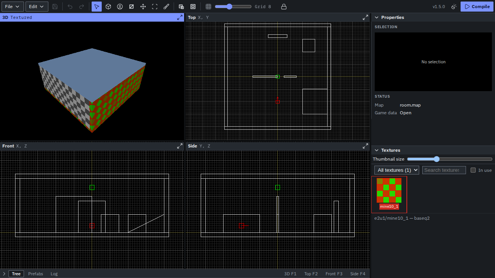

_The default workspace: toolbar, four views, properties panel, texture browser and status areas._

## Contents

1. [Requirements and privacy](#requirements-and-privacy)
2. [Quick start](#quick-start)
3. [The workspace](#the-workspace)
4. [Files, saving and autosave](#files-saving-and-autosave)
5. [Toolbar reference](#toolbar-reference)
6. [Tool modes](#tool-modes)
7. [Brush editing commands](#brush-editing-commands)
8. [Textures and surface properties](#textures-and-surface-properties)
9. [Entities](#entities)
10. [Groups, the tree and prefabs](#groups-the-tree-and-prefabs)
11. [Compiling and testing a map](#compiling-and-testing-a-map)
12. [Complete editing workflow](#complete-editing-workflow)
13. [Keyboard and mouse reference](#keyboard-and-mouse-reference)
14. [Troubleshooting and current limitations](#troubleshooting-and-current-limitations)

## Requirements and privacy

- Use the current or previous major version of Chrome, Edge, Firefox or Safari. Chromium-based browsers have the most capable file integration through the File System Access API.
- A legal Quake 2 installation is required for real textures and for compilation input. Joole does not include or download id Software's game data.
- Joole is an offline-capable PWA. Once its application files have been cached, the editor shell can reopen without a network connection; game data itself is still read only from files the user makes available. Joole does not send maps, game files, texture data or telemetry to a server. Browser storage (OPFS and IndexedDB) is used for autosave, settings, converted textures, file handles and prefabs.
- WASM threads need the deployment's COOP/COEP headers. The production deployment at [joole.niko-hujanen.workers.dev](https://joole.niko-hujanen.workers.dev/) is configured for them.

## Quick start

1. Open Joole in a supported browser.
2. Choose **File → Open Game Folder…** and select the Quake 2 installation directory — the directory that contains `baseq2/`. In browsers without a directory picker, use the folder upload fallback or **File → Open pak0.pak…** and select `baseq2/pak0.pak`.
3. Open an existing map with **File → Open Map…**. The same command accepts Quake 2 `.map` files and Joole `.joole.json` projects. To start from scratch, simply do not open a map.
4. Edit in the four views. Press `B` and drag in Top, Front or Side to create a brush; press `S` and click a brush to select it.
5. Save often with `Ctrl+S` (`Cmd+S` on macOS). This writes a `.joole.json` project, the primary lossless format.
6. Use **File → Export .map…** when the map is needed by another editor or by external compile tools.
7. Choose **Compile → Fast** for a quick sealed-map check. When the `.bsp` is produced, save or copy it into `baseq2/maps/` and test it in q2pro or another Quake 2 engine with `+map <name>`.

## The workspace

### Views

The workspace contains four views in a 2 × 2 arrangement:

| View  | Projection   | Axes shown  | Main use                                                            |
| ----- | ------------ | ----------- | ------------------------------------------------------------------- |
| 3D    | Perspective  | free camera | inspecting textured geometry, picking faces, flying through the map |
| Top   | Orthographic | X, Y        | floor-plan layout                                                   |
| Front | Orthographic | X, Z        | elevations and heights                                              |
| Side  | Orthographic | Y, Z        | profiles, ramps and heights                                         |

Quake 2 coordinates use the X/Y plane for the ground plan and Z for height. One unit is one Quake unit. The active view has a blue title bar. The title also shows either the coordinate axes or the live world coordinates under the pointer. In the 3D view it shows `Textured` normally and `Fly` while fly mode is active.

Each view has a maximise button. The same action is available everywhere with:

- `F1` — 3D
- `F2` — Top
- `F3` — Front
- `F4` — Side

Press the key again to restore the four-view grid. The view buttons are repeated at the right edge of the bottom tab strip.

### View navigation

| Action                               | Effect                                                               |
| ------------------------------------ | -------------------------------------------------------------------- |
| Middle-drag in Top, Front or Side    | pan the orthographic view                                            |
| Mouse wheel in Top, Front or Side    | zoom around the cursor; one notch multiplies or divides zoom by 1.32 |
| Mouse wheel in 3D                    | move forward or backward, one notch is 64 units                      |
| Middle-click in 3D                   | toggle pointer lock for mouse look                                   |
| Move mouse in pointer-lock mode      | look around                                                          |
| `W` / `A` / `D` in pointer-lock mode | move forward, left and right at 256 units/s                          |
| Left mouse button                    | use the active tool                                                  |
| Right-click in Top, Front or Side    | open the view context menu                                           |

Fly mode is intended to own `W`, `A`, `S` and `D`, and tool shortcuts are ignored while it is active. In the current implementation `S` is still intercepted by the Select-tool shortcut path before movement is recorded, so backward movement does not work; `W`, `A` and `D` do.

### Panels and splitters

- The **right dock** has two collapsible sections: **Properties** on top — entity properties, the selection texture, per-face surface attributes and file status — and **Textures** below. A section collapses to its header with the disclosure button, and the horizontal splitter between the sections moves with the mouse or the arrow keys.
- The **bottom panel** has three tabs: **Tree**, **Prefabs** and **Log**.
- Drag the vertical or horizontal splitter to resize a panel. A focused splitter can also be moved with the arrow keys in 8-pixel steps.
- The bottom panel can be enlarged when reading long compile logs or a deep document tree.
- The panel sizes, the dock's splitter position, the collapsed sections, the thumbnail size, the grid size and the theme are remembered between sessions.

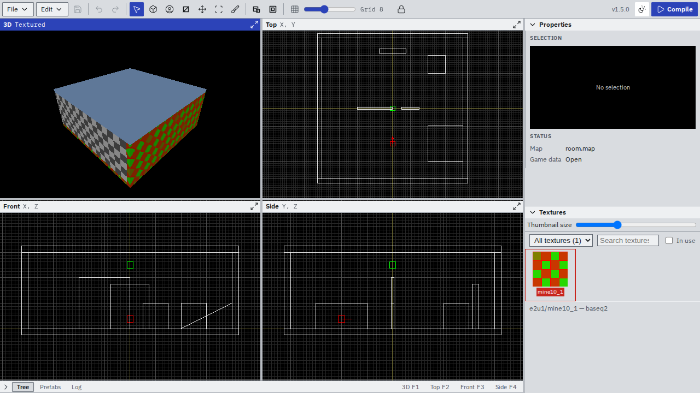

_The light theme changes the window chrome. Viewport colors deliberately remain the Qoole-style dark editing colors in both themes._

## Files, saving and autosave

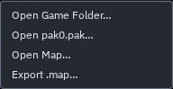

### File menu

| Command               | Description                                                                                                                                    |
| --------------------- | ---------------------------------------------------------------------------------------------------------------------------------------------- |
| **Open Game Folder…** | Indexes loose files, `.pak` files and `.pkz` files below `baseq2/`. Select the installation root that contains `baseq2/`, not a map directory. |
| **Open pak0.pak…**    | Uses one picked `pak0.pak` as the whole game-data source. This is the most reliable fallback when directory picking is unavailable.            |
| **Open Map…**         | Opens a `.map` file or a `.joole.json` project. Opening replaces the current document.                                                         |
| **Export .map…**      | Writes the current document in Quake 2 `.map` format for other editors and external compilers.                                                 |
| **Settings…**         | Opens the settings dialog (`Ctrl+,`).                                                                                                          |

In Chromium the game-directory handle is remembered locally and permission is requested again on later starts. The native open picker initially filters for `.map`; use its all-files choice to open a `.joole.json` project.

### Project and export formats

`.joole.json` is the primary save format. It preserves editor data such as stable node ids, groups, hidden/locked flags and exact floating-point values. `.map` is an export and interchange format. Groups are represented there as `func_group` entities with `_joole_*` keys so they can be re-imported.

The `.map` export is compile-oriented:

- plane points are converted to the closest valid integer representation when necessary;
- warnings are written to the log if a conversion moves vertices measurably or cannot produce a valid integer brush;
- unknown entity keys and key order are preserved.

Texture offsets and rotations are written as stored, including fractional values imported from another file. The original qbsp3 still reads those two fields with integer conversion, so their fractional parts are truncated at compile time even though the current exporter does not warn about them. Joole's own texture operations produce integer offsets and rotations.

### Browser differences

In Chromium, save commands use the operating system's save dialog when available. In Firefox and Safari, saving is download-based. Opening a map likewise uses either a native picker or a file-input fallback. These differences do not change the document format.

### Autosave and recovery

After the first unsaved document change, Joole autosaves the project to OPFS every 30 seconds and again when the page is hidden. If the editor restarts with dirty autosaved work, it shows a recovery prompt:

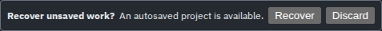

Choose **Recover** to load the autosave as `recovered.joole.json`, or **Discard** to delete the recovery copy. Saving a project explicitly clears the dirty autosave state.

### Settings

**File → Settings…** (`Ctrl+,`) opens the settings dialog. Every change applies immediately and is remembered between sessions; there is no OK or Cancel step. **Reset to Defaults** restores every setting at once. Escape closes the dialog.

| Setting                    | Effect                                                                            |
| -------------------------- | --------------------------------------------------------------------------------- |
| **Theme**                  | Dark or light window chrome. The viewport colors stay the editing colors in both. |
| **3D wheel step**          | How far one mouse-wheel notch moves the 3D camera, in units.                      |
| **Mouse-look sensitivity** | Degrees of turn per pixel of mouse movement in fly mode.                          |
| **Grid size at start-up**  | The snap grid a new session starts with.                                          |
| **Thumbnail size**         | The texture thumbnail size, the same slider as in the Textures section.           |
| **Show tool overlay**      | Whether the tool overlay is drawn.                                                |
| **Group CSG results**      | Whether Hollow and CSG Subtract group their fragments automatically.              |
| **Handle size**            | The size of the vertex, edge and face dots, 7–28 px (14 px by default).           |

The panel sizes, the collapsed sections and the splitter positions are remembered too, but they do not appear in the dialog.

## Toolbar reference

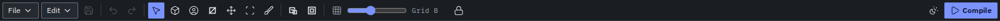

The toolbar is arranged left to right in functional groups.

Picking a tool — from the toolbar, with its shortcut or from a view's context menu — shows a translucent overlay at the bottom centre of the views for a few seconds: the tool's icon, name, shortcut and a one-line description. The overlay never blocks the views, it hides while fly mode is on, and **Settings → Show tool overlay** turns it off.

### File and Edit menus

The **File** menu is documented in [Files, saving and autosave](#files-saving-and-autosave).

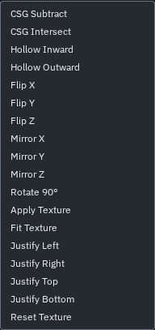

The **Edit** menu contains the brush and texture operations that do not have dedicated tool modes:

- **CSG Subtract**
- **CSG Intersect**
- **Hollow Inward**
- **Hollow Outward**
- **Flip X**, **Flip Y**, **Flip Z**
- **Mirror X**, **Mirror Y**, **Mirror Z**
- **Rotate 90°**
- **Apply Texture**
- **Fit Texture**
- **Justify Left**, **Justify Right**, **Justify Top**, **Justify Bottom**
- **Reset Texture**

Their exact behavior is described in [Brush editing commands](#brush-editing-commands) and [Textures and surface properties](#textures-and-surface-properties).

### Save, Undo and Redo icons

The Save, Undo and Redo toolbar icons are present as disabled placeholders in the current build. Use the implemented keyboard commands instead:

- `Ctrl+S` / `Cmd+S` — save project
- `Delete` / `Backspace` — delete the selection right away, with no confirmation; undo restores it
- `Ctrl+Z` / `Cmd+Z` — undo
- `Ctrl+Shift+Z`, `Ctrl+Y` / macOS equivalents — redo

### Tool buttons

The next seven buttons select the editing tools:

| Button        | Tool        | Shortcut |
| ------------- | ----------- | -------- |
| Mouse pointer | Select      | `S`      |
| Box           | Brush       | `B`      |
| Entity figure | Entity      | `E`      |
| Scissors      | Clip        | `C`      |
| Move arrows   | Vertex/edge | `V`      |
| Frame/scan    | Face        | `F`      |
| Brush         | Texture     | `T`      |

The active tool is filled with the accent color. In the current implementation the Select, Brush, Clip, Vertex/edge and Face buttons are clickable; the Entity and Texture buttons are visible but their click handlers are not wired. Use `E` and `T` for those two tools.

### Primitive controls

When the Brush tool is active, two controls appear:

- **Primitive** — `box`, `wedge`, `cylinder`, `cone` or `sphere`.
- **Sides** — the side count for round primitives, from 3 to 64. The default is 8. Box and wedge do not use the side count.

The `sphere` primitive is a convex octahedral approximation rather than a high-resolution segmented sphere.

### CSG Subtract and Hollow buttons

The next two icon buttons are shortcuts for common geometry operations:

- **CSG Subtract** — identical to **Edit → CSG Subtract**.
- **Hollow** — identical to **Edit → Hollow Inward**. Outward hollowing is available only in the Edit menu.

Both require a suitable brush selection; otherwise they write an explanatory warning to the log. When an operation splits a brush into two or more fragments, the fragments are put into one group named `subtract` or `hollow` — one undo step covers both the cut and the grouping. Fragments produced inside an existing group stay in that group instead of nesting a new one, so repeated cuts on the same wall keep a flat structure.

### Grid control

The slider and readout control the snap grid. The grid is always a power of two from 1 to 256 units; the default is 8. The keyboard equivalents are:

- `[` — halve the grid
- `]` — double the grid

The grid affects brush drawing, movement, vertex editing, entity placement and texture shifting. It does not automatically round existing rotated geometry.

### Texture lock

The padlock button toggles **Texture lock**. When enabled, moving or rotating a brush recomputes texture offsets, rotation and scale so the texture sticks to the surface. Quake 2's texture representation cannot encode every transformed orientation exactly; if the residual error exceeds 0.5 texels, the edit is still applied but a warning is written to the log.

### Theme and Compile

- The sun/moon button switches dark and light window chrome.
- **Compile** opens the compile profile menu. It is disabled until game data has been opened, because compilation needs the texture `.wal` headers and `pics/colormap.pcx`.

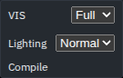

The profiles are **Fast**, **Normal**, **Final** and, while work is running, **Cancel**. See [Compiling and testing a map](#compiling-and-testing-a-map).

## Tool modes

### Select (`S`)

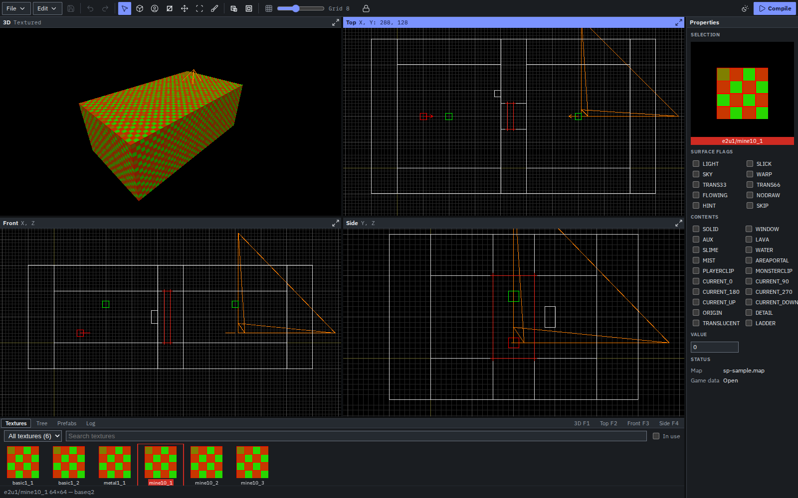

The Select tool picks and transforms whole brushes.

**Picking:**

- Click a brush in any view to replace the selection.
- `Shift+click` adds a brush or removes an already selected brush.
- When overlapping unselected brushes are hit at the same position, clicks can cycle between them; a brush that is already selected takes precedence in the current picking implementation.
- Drag on empty space in an orthographic view for a box selection. Every brush whose projected bounding box intersects the rectangle is selected.
- Click empty space without `Shift` clears the selection.

**Transforms:**

- Drag a selected brush to move it in the two axes of the orthographic view. Movement snaps to the grid. While a drag moves, rotates, resizes or reshapes brushes, they stay highlighted in red in every view, the 3D view included, so you can see exactly what the edit is changing.
- `Ctrl+drag` (`Cmd+drag` on macOS) rotates around the selection center in that view's plane.
- Drag close to a projected selection bounding-box corner to scale around the opposite corner. The dragged corner snaps to the grid: the resized brush's moved faces always land on grid lines, the size never drops below one grid step and the corner cannot cross its anchor — use Mirror to flip a brush instead.
- Multi-brush selections move and rotate as one unit.

A drag is merged into one undo step even though intermediate positions are applied continuously. Texture lock affects move and rotate operations when enabled.

**Typing a size:** with brushes selected, point at an orthographic view and press `Enter`. A field opens at the selection's centre with its current size as _width height depth_ of that view — in Front, for example, width is X, height is Z and depth is Y. Type a new size and press `Enter`: the selection is resized around its centre in one undo step. `Escape` cancels. Typed sizes are used exactly and are not snapped to the grid.

View picking is brush-based. Pick point entities, groups and brush-entity containers in the **Tree** tab; their properties then appear in the right panel.

### Brush (`B`)

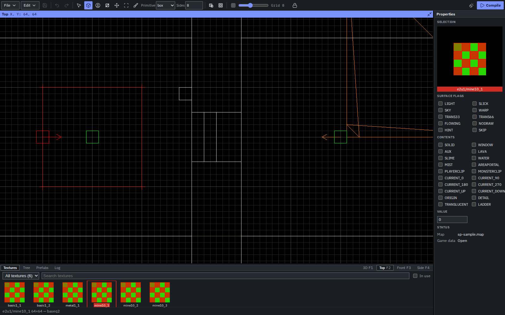

The Brush tool creates new convex primitives.

1. Press `B` or choose the box toolbar button.
2. Choose the primitive and, for round primitives, the side count.
3. Drag a rectangle in Top, Front or Side.
4. Release to create the brush. It becomes the selection.

The two dragged axes snap to the grid, and a small cross marks the snapped point under the cursor before the button is pressed. While dragging, a red box shows the brush in every orthographic view, with its in-plane extents labelled next to the edges and the full `W × D × H` size in the active view's title bar. The axis perpendicular to the view receives a depth of at least 64 units — the smallest multiple of the grid that reaches 64 — placed so that both faces lie on grid lines. Every bound of a painted brush is therefore a grid multiple at any grid size. Brush creation is not available in the 3D view.

**Typing a size:** click once in Top, Front or Side without dragging. A field opens at the clicked point; type the size as _width height depth_ of that view, separated by spaces or commas — for example `128 64 32` — and press `Enter`. The brush is created centred on the clicked point (snapped to the grid) and on the same working plane as a dragged brush, with the current primitive and side count. The size is used exactly, so a size that is not a multiple of the grid puts faces off the grid. `Escape` or clicking elsewhere cancels; an invalid entry shows a message and creates nothing. The field remembers the last size as its placeholder.

New brushes are created with Qoole's default texture, `e2u1/mine10_1`; choosing another texture in the browser does not change brushes that are already drawn.

Primitive notes:

- `box` — the normal building block for rooms and walls.
- `wedge` — a triangular prism for ramps and sloped pieces. It rises toward +X; flip or rotate it for other directions.
- `cylinder` — a vertical, Z-aligned n-sided prism.
- `cone` — a vertical, Z-aligned n-sided cone with its apex at +Z.
- `sphere` — a fixed convex octahedral approximation. The side count does not affect it.

**Context-menu shortcut:** right-click an orthographic view and choose **Add Brush** to switch directly to this tool.

### Entity (`E`)

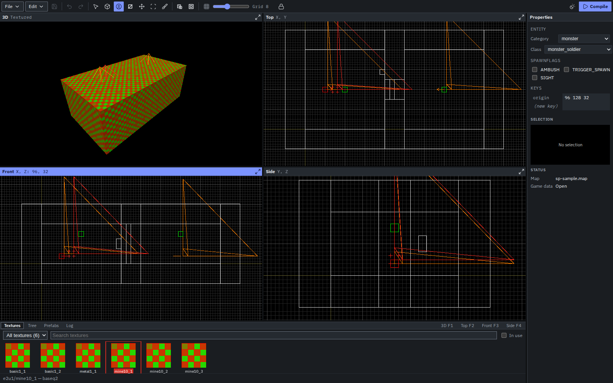

The Entity tool places point entities such as lights, monsters, items and `info_player_start`.

- Press `E` and click in an orthographic view.
- The entity is placed at the clicked point, snapped to the grid.
- The current class is `light` until another class is chosen through the context menu.
- The new entity becomes selected, so its keys can be edited immediately in the properties panel.

A click supplies the two axes of the chosen view; the third coordinate comes from that orthographic camera's current depth plane. Use Top for floor-plan position and Front or Side when height/depth is the important axis, then fine-tune the remaining coordinate through the entity's `origin` key when necessary.

The usual way to choose a class is the view context menu:

1. Right-click in Top, Front or Side.
2. Choose **Add Entity →**.
3. Choose a category such as `monster`, `item` or `target`.
4. Choose the exact class, for example `monster_soldier`.

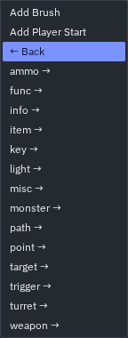
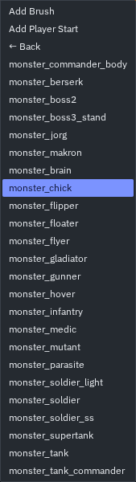

**Add Player Start** is a shortcut for `info_player_start`. Brush entities (`func_door`, `trigger_once`, and similar classes) are not placed as points. Select one or more brushes, right-click and use **Apply Entity →** instead; see [Entities](#entities).

Use orthographic views for predictable placement. The 3D view does not provide a useful ground-plane pick position in the current implementation.

### Clip (`C`)

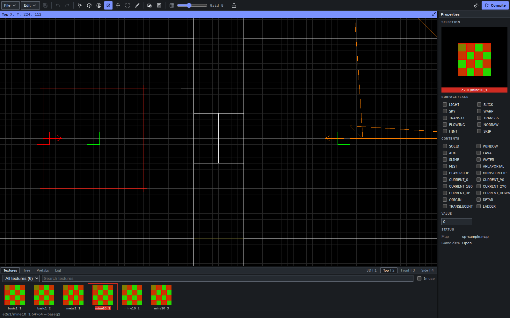

The Clip tool cuts selected brushes with a plane.

1. Select one or more brushes with the Select tool.
2. Press `C`.
3. Click the first plane point in an orthographic view.
4. Click a second, different point in the same view. The two points and the view's depth axis define the clipping plane.
5. Press `Tab` to cycle the result: keep front, keep back, or keep both sides as separate brushes.
6. Press `Enter` to apply, or `Escape` to cancel.

Both clicks snap to the grid. The preview line remains visible while the tool waits for confirmation. If the kept side is not the side you intended, press `Tab`; do not redraw the line unless the plane itself is wrong.

Clipping replaces each selected brush by its fragment or fragments. The newly created cut face uses the target brush's first face texture and attributes in the current implementation. It is undoable like every other document edit.

### Vertex/edge (`V`)

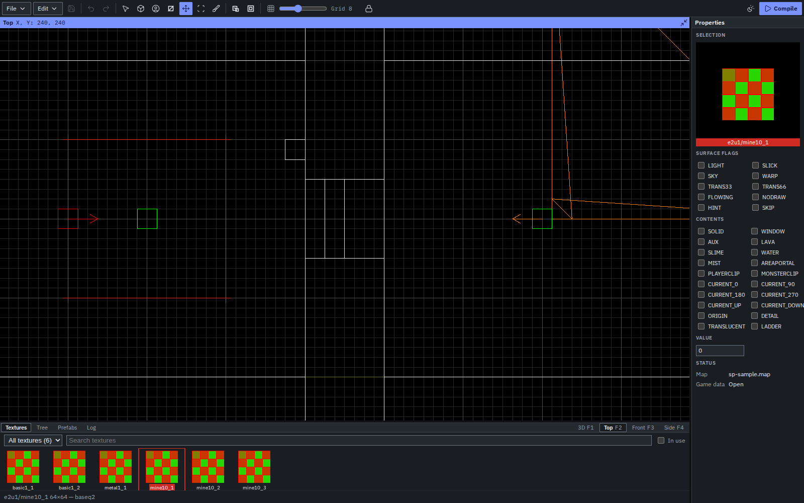

The Vertex/edge tool edits the derived geometry of selected brushes without changing the brush's plane-based truth.

- Press `V` for vertex/edge editing. The tool restores its last vertex or edge submode.
- Press `V` again while already in the tool to switch between vertex and edge handles. Returning from Face mode starts again in vertex mode.
- Every handle is a fixed-size square dot: yellow when idle, red when hovered or dragged. Vertices sit on the corners, edge dots sit at the edge midpoints and face dots at the face centres. The dots show in the 3D view too, but dragging works in the orthographic views. **Settings → Handle size** makes the dots larger or smaller; the area you can click grows with them.
- Drag a handle in an orthographic view. The grabbed point snaps onto the grid, so a vertex that started off the grid joins it with the first step. A small cross marks the snapped target and the brush's current size shows in the view's title bar while you drag.
- Connected planes are recomputed so the brush remains convex.

Edits are validated. A move that would create invalid or non-convex geometry is not applied; the rejected movement is shown as a dashed orange line. This is feedback, not a partial edit.

Vertex and edge editing operates only on already selected brushes. Use `S` first when you need to change the selection.

### Face (`F`)

The Face tool is the face submode of the same low-level editor.

- Press `F` to show face handles for the selected brushes.
- Drag a face handle in an orthographic view to move that face.
- The connected planes are recomputed from the moved face vertices and the result is validated before it is accepted.

The same grid snapping, convexity checking and dashed-orange rejection feedback apply as in vertex/edge editing. Pressing `V` afterwards returns to vertex mode.

### Texture (`T`)

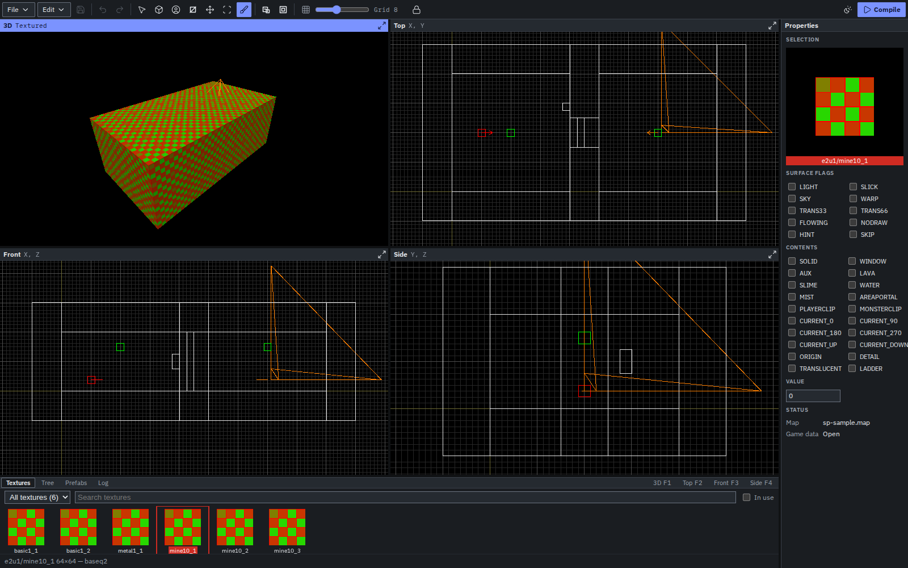

The Texture tool selects individual faces in the 3D view.

- Click a visible face to select it. Clicking the same single selected face again clears it.
  The picked faces are highlighted: a translucent red fill in the 3D view and red outlines in the orthographic views. The ◀ ▶ row at the top of the Properties panel steps through the brush as a whole and each of its faces in turn, wrapping around at both ends: stepping onto `Face n` picks just that face, and stepping back to `Brush` targets the whole brush again. The highlight disappears with the face selection when you leave the tool.

- `Shift+click` adds or removes faces in a multi-face selection.
- `Ctrl+click` (`Cmd+click`) is the eyedropper: it copies the face's texture name to the current texture without changing the face selection.
- Click empty space without a modifier to clear the face selection.
- Repeated clicks at the same ray position cycle through overlapping hits.

Faces can be picked only in 3D. The 2D views show the result, but they are not face-picking views.

The texture operations target the picked faces. If no faces are picked, they target every face of every currently selected brush. This distinction is important: selecting a whole brush is a quick way to retexture all of it, while the Texture tool gives face-level control.

## Brush editing commands

### Clipboard and duplication

| Command            | Shortcut                                                                               | Behavior                                                                      |
| ------------------ | -------------------------------------------------------------------------------------- | ----------------------------------------------------------------------------- |
| Cut                | `Ctrl+X` / `Cmd+X`                                                                     | copies the selected brushes as `.map` text and removes them                   |
| Copy               | `Ctrl+C` / `Cmd+C`                                                                     | copies the selected brushes as canonical `.map` text                          |
| Paste              | `Ctrl+V` / `Cmd+V`                                                                     | parses `.map` text from the clipboard or Joole's in-app clipboard mirror      |
| Duplicate          | `G`                                                                                    | toggle group-pick mode: clicks select whole groups, shown dashed in the views |
| `Ctrl+G`           | group the selection                                                                    |
| `Shift+G`          | ungroup every selected group                                                           |
| `Ctrl+D` / `Cmd+D` | copies and pastes the selected brushes in one step, offset by one grid unit in X and Y |

Because the clipboard payload is ordinary `.map` text, it can be exchanged with other editors that accept that format. Pasted brushes receive fresh ids. Clipboard and prefab copies keep full precision rather than forcing compile-oriented integer plane points. In the current implementation these clipboard commands operate on brushes only, not on point entities, entity containers or groups.

### CSG Subtract

The selected brushes are the **cutters**. Every overlapping unselected brush in the document is a target. The cutter volume is removed from each target; targets may be split into multiple convex fragments. Newly created cut faces receive the cutter's texture.

The cutter itself remains in the document. Delete or hide it separately if it was only a temporary carving volume. The current implementation considers overlapping targets in the whole document rather than limiting them to the active group scope, so inspect neighboring geometry before applying the operation.

Typical use:

1. Build the wall or solid volume to be cut.
2. Draw a cutter that overlaps it.
3. Select only the cutter.
4. Choose **Edit → CSG Subtract** or the CSG toolbar button.
5. Inspect the fragments, then remove or reuse the cutter as appropriate.

### CSG Intersect

**Edit → CSG Intersect** replaces two or more selected brushes with their common convex volume. The selected brushes must overlap and share the same parent in the document tree. The first selected brush keeps its id; the others are removed.

This is useful for trimming irregular overlaps down to a clean convex solid. It is not a union operation.

### Hollow

**Hollow Inward** and **Hollow Outward** turn exactly one selected solid brush into a shell made from wall fragments. The fixed shell thickness is 8 units.

- **Inward** removes volume from the inside of the original brush; the outside dimensions stay unchanged. This is the toolbar button's behavior.
- **Outward** expands the shell outside the original volume.

Hollowing a very small brush can be impossible because an 8-unit shell does not fit. In that case the operation reports that it cannot apply.

### Flip, Mirror and Rotate

- **Flip X/Y/Z** mirrors the selection in place across the axis plane through its own center.
- **Mirror X/Y/Z** duplicates the selection first, flips the copies and selects those copies.
- **Rotate 90°** rotates the selection exactly 90° counterclockwise about Z through its center.

The point order of faces is corrected so face normals continue to point outward. Rotate 90° is exact for grid-aligned integer geometry.

## Textures and surface properties

### Texture browser

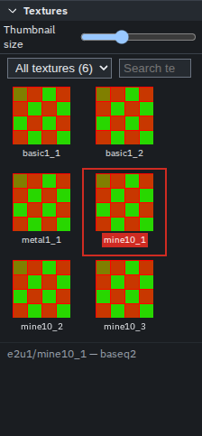

The **Textures** section of the right dock fills with thumbnails after game data is opened. It provides:

- a folder/source filter;
- substring search;
- an **In use** filter that keeps only textures referenced by the current document;
- a virtualised thumbnail grid;
- a **Thumbnail size** slider, from 32 to 128 pixels;
- a footer with the full texture name, pixel dimensions and source package or directory.

Clicking a thumbnail sets the **current texture** and applies it immediately: to the picked faces when the Texture tool has a face selection, or to every face of the selected brushes otherwise. Brushes inside a selected group or brush entity are textured as a whole. The change is one undo step. With nothing selected, clicking only sets the current texture. **Edit → Apply Texture** applies the current texture again without browsing.

Textures are converted lazily in a worker and cached in browser storage. Missing or not-yet-loaded textures use a checker fallback in views.

### Applying and adjusting textures

1. Pick individual faces with the Texture tool, or select whole brushes with the Select tool.
2. Click a texture in the browser. The texture is applied in the same step. Alternatively, use `Ctrl+click` on an already textured face as the eyedropper and choose **Edit → Apply Texture**.

The remaining texture commands act on the same target faces:

| Command                                 | Behavior                                                                                                   |
| --------------------------------------- | ---------------------------------------------------------------------------------------------------------- |
| Arrow keys while Texture tool is active | shift texture offsets by one grid step in the arrow direction                                              |
| `Shift+Left` / `Shift+Right`            | rotate the texture by the grid size in degrees, negative or positive                                       |
| **Fit Texture**                         | scales and offsets the texture to fit the face dimensions                                                  |
| **Justify Left/Right/Top/Bottom**       | aligns the texture to the chosen face edge using its real pixel dimensions                                 |
| **Reset Texture**                       | restores zero offsets, zero rotation and scale `1 1` while keeping the texture name and surface attributes |

Unloaded texture dimensions are treated as 64 × 64 until the `.wal` has been converted.

### Surface flags, contents and value

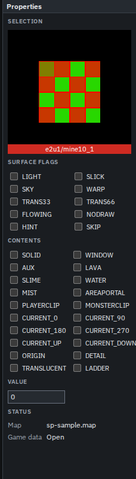

The right panel shows the texture preview and the per-face surface attributes of the target faces. Mixed values use indeterminate checkboxes or a `mixed` placeholder. A dot marks a value that differs from the `.wal` file's default attributes.

Surface flag checkboxes:

`LIGHT`, `SLICK`, `SKY`, `WARP`, `TRANS33`, `TRANS66`, `FLOWING`, `NODRAW`, `HINT`, `SKIP`

Contents checkboxes:

`SOLID`, `WINDOW`, `AUX`, `LAVA`, `SLIME`, `WATER`, `MIST`, `AREAPORTAL`, `PLAYERCLIP`, `MONSTERCLIP`, `CURRENT_0`, `CURRENT_90`, `CURRENT_180`, `CURRENT_270`, `CURRENT_UP`, `CURRENT_DOWN`, `ORIGIN`, `DETAIL`, `TRANSLUCENT`, `LADDER`

**Value** is an integer. With `SURF_LIGHT`, it is the emitted light intensity used by qrad3. Edits are undoable and apply to all target faces.

## Entities

### Entity definitions and display

Joole ships with Quake 2 entity definitions generated from the GPL game source. They provide:

- class names and categories;
- editor colors;
- point-entity box sizes;
- documented keys;
- spawnflag labels.

Known model classes can additionally display a frame-0 md2 wireframe loaded from the game data. Other point entities are drawn as colored boxes. `target`/`targetname` relationships are drawn as link lines in the orthographic views.

### Adding point entities

Use either of these workflows:

- right-click an orthographic view and choose **Add Player Start**;
- right-click and choose **Add Entity → category → class**;
- press `E` and click after the desired class has been made current.

The context-menu drill-down sets the chosen class as current, so subsequent Entity-tool clicks place the same class.

### Creating brush entities

A brush entity is geometry owned by an entity, such as `func_door`, `func_button`, `trigger_multiple` or `func_plat`.

1. Create and shape the brushes.
2. Select all brushes that should form the entity. They must share one parent in the document tree.
3. Right-click an orthographic view and choose **Apply Entity →**.
4. Choose a brush-entity category and class.

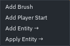

The brushes become children of the new entity in one undoable operation. The new entity is selected. **Apply Entity** appears only when the selection contains a brush.

### Entity properties panel

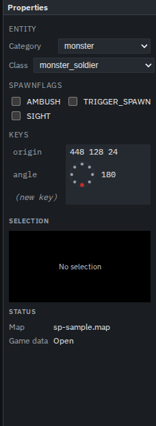

When an entity is selected, the right panel shows:

- **Category** and **Class** selectors;
- spawnflag checkboxes generated from the class definition;
- a key–value table;
- typed editors for common key types.

Typed editors include:

- an eight-direction compass and numeric field for `angle`;
- a color picker plus the raw `r g b` value for color keys;
- completion of existing `targetname` values in `target` fields.

Unknown keys are preserved and can be edited in the raw table. To add a key, type its name in `(new key)` and commit a value in the adjacent field. Setting an existing key to an empty value removes it.

## Groups, the tree and prefabs

### Document tree

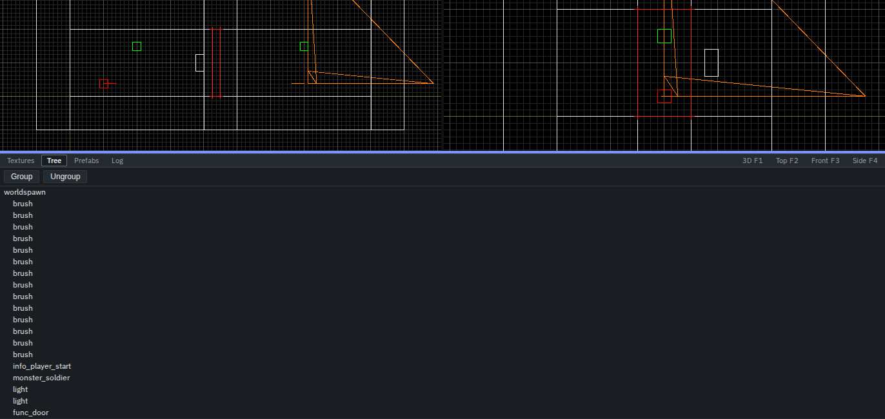

The **Tree** tab shows the `worldspawn` hierarchy: groups, entities and their child brushes. Select `worldspawn` itself to edit map-level entity keys.

- Click a row to select that node.
- `Shift+click` adds it to the selection.
- Drag a row onto an entity or group row to reparent it.
- Select nodes and choose **Group** to create a group. The selected nodes must share the same parent; otherwise the command is rejected and the log explains why.
- Select a group and choose **Ungroup** to move its children back to its parent.
- Group rows have `H` and `L` buttons for hidden and locked state.

A hidden group's subtree is not drawn. A locked group's subtree cannot be selected in the views. These states are editor data and are preserved in the project format.

### Group scope

Double-click a group to enter it. Inside a group's scope:

- view selection is limited to that subtree;
- newly created brushes are inserted into the group;
- the rest of the map is dimmed.

Double-click the same group again to leave the scope. This is useful when editing dense interior sections without accidentally selecting neighboring architecture.

The current tree UI does not provide a rename field; newly created groups use the name `group`. The name is preserved when present in a file.

### Prefabs

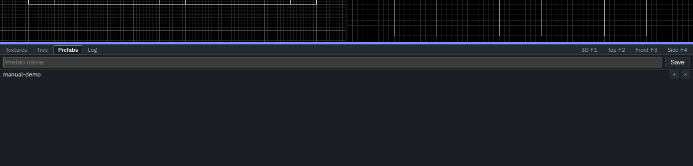

Prefabs are reusable `.map` snippets stored locally in OPFS.

**Save a prefab:**

1. Select the brushes to reuse.
2. Open the **Prefabs** tab.
3. Type a name and choose **Save**.

**Insert a prefab:**

- Drag its row into an orthographic view. The drop point is snapped to the grid. Dropping in the 3D view inserts at the origin because there is no ground-plane projection.
- Alternatively choose `+` on the row to insert it at the origin.

**Delete a prefab:** choose `×` on its row. Deletion affects only the stored prefab, not copies already inserted in the map.

Prefab insertion is undoable. Because prefabs use `.map` text, they can contain full-precision brush geometry. In the current implementation prefab saving serializes brushes only; point entities, entity containers and group structure are not included.

## Compiling and testing a map

### Profiles

Compilation runs entirely in browser workers using WASM builds of id's Quake 2 tools. The tools communicate through an in-memory filesystem; no data leaves the browser.

| Profile | Steps                          | Intended use                      |
| ------- | ------------------------------ | --------------------------------- |
| Fast    | qbsp3, qvis3 `-fast`; no qrad3 | quick leak and structural checks  |
| Normal  | qbsp3, qvis3, qrad3            | regular testing with lighting     |
| Final   | qbsp3, qvis3, qrad3 `-extra`   | slower high-quality lighting pass |

Choose **Compile**, then a profile. While compilation is active, the menu contains **Cancel**.

The compile pipeline first performs the same export validation as `.map` export. It supplies the `.wal` headers of the textures used by the map and `pics/colormap.pcx` when available. Tool output streams line by line into the **Log** tab. Entries are labeled **Info**, **Ok**, **Warning** or **Error**; the label color distinguishes routine compiler output from editor warnings and failures.

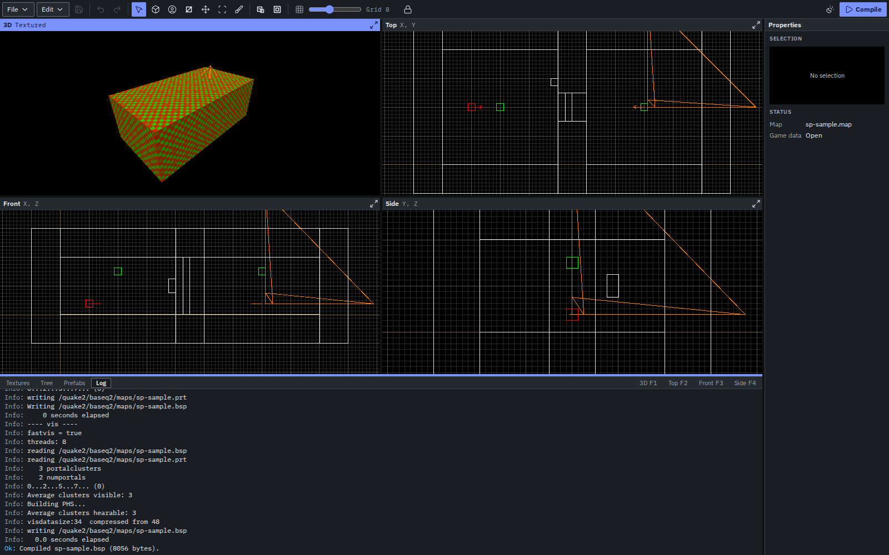

When compilation succeeds, the resulting `.bsp` is offered through the browser's save mechanism. Save it directly to `baseq2/maps/` when possible, or copy the downloaded file there. Start the game engine with `+map <basename>`; for example, `sp-sample.bsp` is normally tested with `+map sp-sample`. Joole cannot start an external game process from the browser.

### Leaks

qbsp3 requires the playable interior to be sealed against the void. If it finds a leak, the compile chain stops before visibility or lighting. Joole reads the generated pointfile and draws the leak path as a magenta polyline in the views.

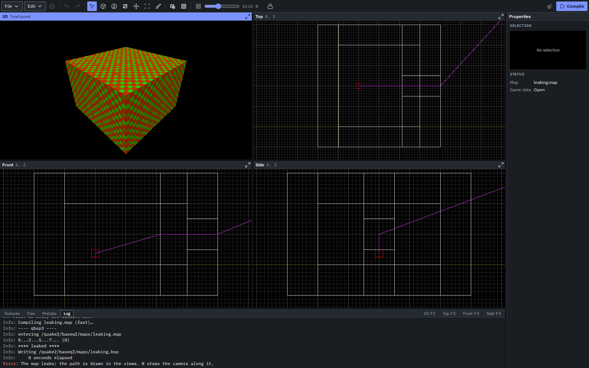

Press `N` to center the orthographic cameras on the next point in the leak path. Repeated presses advance through the path. Follow the line from inside the map toward the outside and close the first gap it crosses; then compile again. Complex maps can have more than one hole, so a new leak path after the fix does not necessarily mean the first fix failed.

## Complete editing workflow

This example builds and tests a simple room using the features described above.

1. **Prepare game data.** Open the Quake 2 installation folder or `pak0.pak`. Confirm that **Game data** is `Open` in the properties panel and that the texture browser is populated.
2. **Set a working grid.** Start at `Grid 8`. Use `[` for detail work and `]` for large architectural strokes.
3. **Draw the floor.** Press `B`, choose `box`, drag the floor rectangle in Top, then adjust its height in Front or Side if the default 64-unit depth is not desired.
4. **Draw the walls.** Draw each wall in the appropriate orthographic view. Work in Top for footprint and Front/Side for height.
5. **Make the room hollow where appropriate.** For a solid block that should become a room, select it and use **Hollow Inward**. For walls built separately, align them on the grid.
6. **Cut openings.** Draw a cutter overlapping a wall, select only the cutter and run **CSG Subtract**. Remove the cutter afterwards unless it is also geometry.
7. **Refine shapes.** Use Clip for clean plane cuts and Vertex/edge or Face editing for controlled local adjustments. Watch for dashed orange rejection previews.
8. **Add the player start.** Right-click Top and choose **Add Player Start**. Position it with the grid before clicking; if it needs fine adjustment, edit its `origin` key in the entity panel.
9. **Add lights and gameplay entities.** Use **Add Entity →** for lights, monsters, items and targets. Convert door or trigger geometry with **Apply Entity →**.
10. **Configure entities.** Select each entity in the tree, set keys and spawnflags, and use `target`/`targetname` pairs for doors, buttons and triggers.
11. **Texture the map.** Pick faces in 3D with `T`, choose textures in the browser and apply them. Use arrow-key shifts, rotation, fit and justify for alignment.
12. **Set surface attributes.** Mark sky, water, translucency, nodraw and light-emitting surfaces as needed. Check the value field for light-emitting faces.
13. **Organize.** Group repeated or dense areas in the Tree. Use scope when working inside them. Save reusable assemblies as prefabs.
14. **Save the project.** Press `Ctrl+S` / `Cmd+S` and keep the `.joole.json` as the authoritative source.
15. **Compile Fast.** Fix leaks and geometry warnings first. Use `N` to inspect leak paths.
16. **Compile Normal or Final.** Save the `.bsp` into `baseq2/maps/` and test it in q2pro.
17. **Iterate.** Return to Joole, adjust the project, save and compile again.

## Keyboard and mouse reference

`Ctrl` in this manual means `Ctrl` on Windows/Linux and `Cmd` on macOS. Letter shortcuts are typed without Ctrl, Alt or Shift and are ignored in text fields. Alt-modified shortcuts are not used.

### Tools and views

| Shortcut                               | Action                                                           |
| -------------------------------------- | ---------------------------------------------------------------- |
| `S`                                    | Select tool                                                      |
| `B`                                    | Brush tool                                                       |
| `E`                                    | Entity tool                                                      |
| `C`                                    | Clip tool                                                        |
| `V`                                    | Vertex/edge tool; press again to toggle vertex and edge submodes |
| `F`                                    | Face editing mode                                                |
| `T`                                    | Texture tool                                                     |
| `F1`                                   | maximise/restore 3D                                              |
| `F2`                                   | maximise/restore Top                                             |
| `F3`                                   | maximise/restore Front                                           |
| `F4`                                   | maximise/restore Side                                            |
| Arrow keys on a focused panel splitter | resize the panel by 8 px per press                               |

### Editing commands

| Shortcut       | Action                                                                     |
| -------------- | -------------------------------------------------------------------------- |
| `Delete`       | delete the selection, no confirmation                                      |
| `Enter`        | in Select, type a new size for the selection in the view under the pointer |
| `Ctrl+Z`       | undo                                                                       |
| `Ctrl+Shift+Z` | redo                                                                       |
| `Ctrl+Y`       | redo                                                                       |
| `Ctrl+S`       | save `.joole.json` project                                                 |
| `Ctrl+X`       | cut selected brushes as `.map` text                                        |
| `Ctrl+C`       | copy selected brushes as `.map` text                                       |
| `Ctrl+V`       | paste `.map` text                                                          |
| `Ctrl+D`       | duplicate selected brushes, offset by one grid step in X and Y             |
| `[`            | halve grid size                                                            |
| `]`            | double grid size                                                           |
| `N`            | go to the next leak-path point after a leaking compile                     |

`Ctrl+H` and `Ctrl+L` are present in the key map as reserved hide/lock commands, but they currently do not execute an editing command. Use the `H` and `L` buttons on group rows in the Tree tab.

### Clip tool keys

| Shortcut | Action                                  |
| -------- | --------------------------------------- |
| `Tab`    | cycle front, back and both sides        |
| `Enter`  | apply the clip                          |
| `Escape` | cancel the pending clip or close a menu |

### Texture tool keys

| Shortcut           | Action                                                      |
| ------------------ | ----------------------------------------------------------- |
| `ArrowLeft`        | shift texture left visually by one grid step                |
| `ArrowRight`       | shift texture right visually by one grid step               |
| `ArrowUp`          | shift texture up visually by one grid step                  |
| `ArrowDown`        | shift texture down visually by one grid step                |
| `Shift+ArrowLeft`  | rotate texture counterclockwise by the grid size in degrees |
| `Shift+ArrowRight` | rotate texture clockwise by the grid size in degrees        |

### Mouse actions

| Pointer action             | Context                   | Action                        |
| -------------------------- | ------------------------- | ----------------------------- |
| Left-click                 | any view                  | use active tool               |
| `Shift+left-click`         | Select tool               | add/remove brush in selection |
| `Ctrl+drag`                | Select tool on selection  | rotate selection              |
| Left-drag empty space      | Select tool, orthographic | box selection                 |
| Left-drag selection        | Select tool               | move selection                |
| Left-drag selection corner | Select tool, orthographic | scale selection               |
| Middle-drag                | orthographic              | pan                           |
| Mouse wheel                | orthographic              | zoom around cursor            |
| Mouse wheel                | 3D                        | move forward/backward         |
| Middle-click               | 3D                        | toggle pointer lock           |
| `W/A/D`                    | in pointer-lock mode      | move in 3D                    |
| Right-click                | orthographic              | view context menu             |
| `Shift+click`              | Texture tool in 3D        | add/remove face               |
| `Ctrl+click`               | Texture tool in 3D        | texture eyedropper            |

## Troubleshooting and current limitations

### Game data does not open

- Select the directory that contains `baseq2/`. In the current implementation, picking the `baseq2` directory itself can fail even though the error message suggests it; pick its parent or use **Open pak0.pak…** instead.
- The picker must include `baseq2/pics/colormap.pcx` and the texture files or packages.
- Only the `baseq2` tree is exposed by the current folder-opening UI. Mod-directory selection and mod `.def` loading are not yet user-facing workflows.

### Compile is disabled or fails immediately

- Open game data first.
- Check the log for missing `.wal` files. The compile can run without every texture, but missing headers produce warnings and incorrect defaults.
- Large Normal and Final compiles can take minutes. Use Fast while iterating and cancel a mistaken run from the Compile menu.

### A brush edit does nothing

Vertex, edge and face edits are rejected when they would make invalid or non-convex geometry. The rejected movement is dashed orange. Make a smaller move, increase the grid step only when appropriate, or use Clip/CSG to reach the shape in multiple valid operations.

### Texture lock warning

Quake texture axes cannot represent every transformed orientation exactly. A warning means the nearest representable result was used but its error exceeded 0.5 texels. Rotate in smaller steps, accept the small drift, or reset/fit the affected face.

### Selection seems impossible

- View picking currently selects brushes, not point entities or group containers. Use the Tree for those objects. Point entities also cannot yet be repositioned by dragging; edit their `origin` key instead.
- Locked groups prevent selection of their subtrees.
- While inside group scope, objects outside the scope cannot be selected. Double-click the scope group in the Tree to leave it.

### Current UI gaps to be aware of

- Save, Undo and Redo toolbar icons are disabled placeholders; the keyboard shortcuts work.
- `Ctrl+H` and `Ctrl+L` are reserved but currently do not invoke hide/lock commands.
- Entity placement is intended for orthographic views; 3D placement does not project onto a ground plane.
- There is no group rename field in the current Tree UI.
- The side-count input remains enabled for `sphere`, but the fixed octahedral primitive does not use it.
- The File menu has no **New** command. An empty document exists when the editor starts; reloading the page is the only way to return to a truly empty document, subject to the autosave recovery prompt.

These are implementation limitations, not intentional format restrictions. They do not affect the validity of saved `.joole.json` projects or exported `.map` files.
